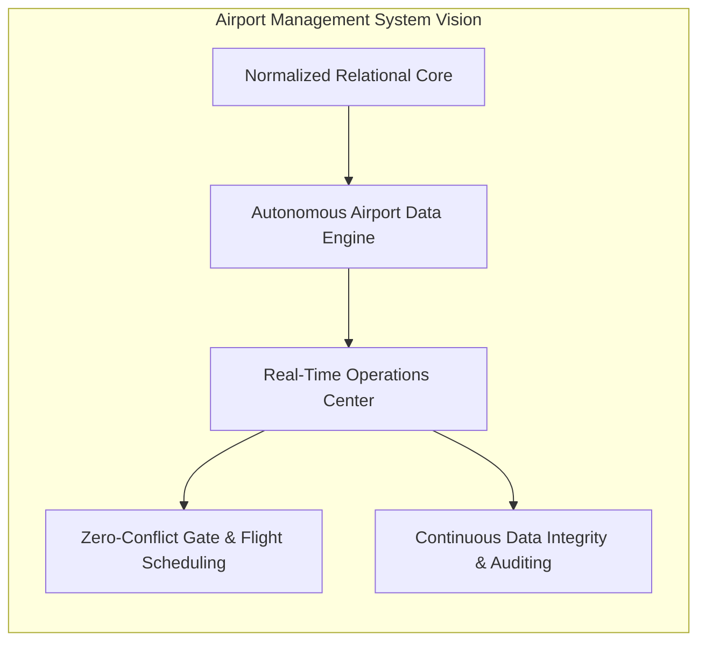
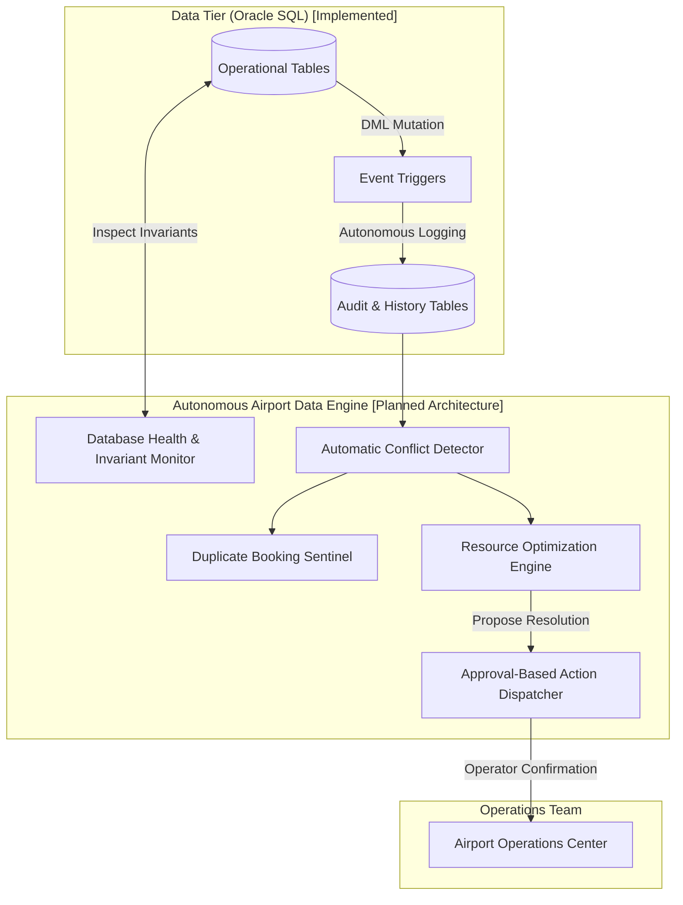

# Airport Management System

> **An enterprise-grade, multi-tier aviation operations platform powered by an intelligent Autonomous Airport Data Engine and normalized relational persistence.**

[](https://github.com/Saravana65/Airport-Management-System)
[](docs/DATABASE_DESIGN.md)
[](docs/SYSTEM_ARCHITECTURE.md)
[](docs/FEATURES.md)
[](docs/DEVELOPMENT_ROADMAP.md)

---

## Table of Contents
- [1. Project Overview](#1-project-overview)
- [2. Project Vision](#2-project-vision)
- [3. Core Modules & Implementation Status](#3-core-modules--implementation-status)
- [4. Autonomous Airport Data Engine](#4-autonomous-airport-data-engine)
- [5. Technology Stack](#5-technology-stack)
- [6. System Architecture](#6-system-architecture)
- [7. Project Directory Structure](#7-project-directory-structure)
- [8. Database Design & Relational Schema](#8-database-design--relational-schema)
- [9. Installation and Setup](#9-installation-and-setup)
- [10. Application Screenshots](#10-application-screenshots)
- [11. Future Enhancements](#11-future-enhancements)
- [12. Contribution Guidelines](#12-contribution-guidelines)
- [13. License](#13-license)
- [14. Author](#14-author)
- [15. Detailed Documentation Index](#15-detailed-documentation-index)

---

## 1. Project Overview

The **Airport Management System (AMS)** is a centralized operations platform engineered to model, manage, and coordinate the mission-critical workflows of modern commercial airports. Aviation infrastructure requires seamless real-time coordination across air traffic regulators, passenger booking desks, ground support staff, and airline dispatchers.

### The Problem Space
- **Operational Fragmentation**: Conventional airports often run legacy software where airline schedules, ticketing inventories, staff rosters, and facility allocations reside in isolated silos.
- **Latency in Incident Management**: When adverse weather or technical faults delay a flight, propagating notifications across passenger manifests, gate crews, and baggage handlers typically involves manual coordination.
- **Data Integrity & Overbooking Risks**: High-concurrency ticket reservations require strict relational integrity and transactional guarantees to eliminate phantom bookings, pricing errors, and lost audit trails.

### The Solution & Centralized Automation
The Airport Management System solves these problems by providing:
1. **Centralized Relational Persistence**: A normalized 3NF/BCNF relational database schema implemented in Oracle SQL covering flights, routes, airports, passengers, employees, and ticket pricing.
2. **Proactive Event Auditing**: Database triggers that capture flight delays and ticket price modifications the instant they occur.
3. **Decoupled Multi-Tier Architecture**: A planned multi-language ecosystem combining a fast React web frontend, a Node.js/Express API gateway, C-based algorithmic schedulers, and Java enterprise transaction services.

---

## 2. Project Vision

The long-term vision of this project is to create an **Autonomous Airport Operations Center**—a digital control tower that not only stores and serves operational data but actively monitors, audits, and optimizes airport resources in real time.



By coupling deterministic database rules with algorithmic optimization and autonomous background monitoring, the system aims to minimize turnaround delays, eliminate scheduling collisions, and ensure operational transparency.

---

## 3. Core Modules & Implementation Status

To maintain engineering transparency, all modules are categorized as **[Implemented]** (existing in the current codebase) or **[Planned]** (scheduled in the development roadmap).

| Module | Scope & Capabilities | Status | Technical Foundation |
| :--- | :--- | :--- | :--- |
| **Flight Operations Management** | Flight schedules, route networks, arrival/departure timetables, status categorization (`On-time`, `Delayed`), and dynamic cursor filtering. | **Implemented (Database)** / Planned (UI) | `FLIGHT` table, `FLIGHTSBYSTATUS` stored procedure |
| **Passenger Management** | 3NF decomposed passenger records: passport verification, demographic attributes, and flight manifest assignments. | **Implemented (Database)** / Planned (UI) | `PASSENGER1`, `PASSENGER2`, `PASSENGER3` tables |
| **Ticket Booking & Check-in** | Multi-class ticketing (Economy, Business, First), dynamic route/date pricing, cancellation surcharges, and fare audit logging. | **Implemented (Database)** / Planned (UI) | `TICKET1`, `TICKET2`, `TICKET3`, `TICKET_PRICE_HISTORY` |
| **Baggage Management** | Luggage tagging, conveyor routing algorithms, and carousel assignment. | **Planned** | Planned `BAGGAGE` entity & C graph routing |
| **Airport Resource & Gate Management** | Airfield facility modeling, airline terminal associations, and collision-free gate allocation. | **Partially Implemented** | `AIRPORT`, `CONTAINS` tables implemented; C gate scheduler planned |
| **Employee & Shift Management** | Personnel profiles across four branches (Administrative Support, Engineers, Traffic Monitors, Authority), shift tracking, and rule-based compensation adjustments. | **Implemented (Database)** / Planned (UI) | `EMPLOYEE1`, `EMPLOYEE2`, `SERVES` tables, `UPDATEDSalary` trigger |
| **Notification & Event Management** | Automated logging of delayed flights with timestamps and event dispatching. | **Implemented (Database)** / Planned (UI) | `DELAYEDFLIGHTS` trigger, `DELAYED_FLIGHTS` audit table |
| **Autonomous Airport Data Engine** | Continuous database integrity inspection, anomaly detection, conflict alerts, and automated audit logging. | **Foundational Triggers Implemented** / Engine Planned | Oracle SQL triggers implemented; background monitoring daemon planned |
| **Analytics & Reporting** | Specific route manifest queries (e.g. DFW Economy passengers) and operational performance reporting. | **Implemented (Database)** / Planned (UI) | `DFWECONOMYPASSENGERS` stored procedure |

*Detailed feature breakdown is documented in [`docs/FEATURES.md`](docs/FEATURES.md).*

---

## 4. Autonomous Airport Data Engine

The **Autonomous Airport Data Engine (AADE)** is the primary architectural differentiator of this platform. It represents an intelligent background operational layer designed to protect data integrity and automate routine operations.



### Proposed Engine Capabilities
1. **Database Health Monitoring**: Continuously evaluates index fragmentation, foreign key consistency, and connection health.
2. **Automatic Conflict Detection**: Identifies overlapping gate usage or runway approach collisions before they manifest physically.
3. **Duplicate Booking Detection**: Validates seat allocation invariants across high-concurrency reservation transactions.
4. **Data Integrity Monitoring**: Enforces relational consistency across decomposed passenger and ticket records.
5. **Flight & Gate Conflict Monitoring**: Reconciles delayed flight turnarounds against downstream gate assignments.
6. **Resource Optimization Recommendations**: Employs algorithmic heuristics to suggest the most cost-effective gate and runway reassignments.
7. **Event-Driven Automation**: Reacts autonomously to operational disruptions (e.g., automatically logging delays upon status change).
8. **Transaction Failure Detection**: Detects deadlocks or incomplete reservation state transitions and initiates recovery rollbacks.
9. **Audit Logging**: Maintains complete, tamper-resistant historical records of all critical modifications (implemented for ticket prices and flight delays).
10. **Approval-Based Automated Operations**: Generates remediation actions that require explicit operator approval before executing DML mutations, maintaining human oversight.

> [!NOTE]
> Foundational audit logging (`DELAYEDFLIGHTS`, `TICKET_PRICE_HISTORY`) is fully implemented in Oracle PL/SQL. The multi-threaded background analysis daemon and operator approval queue are scheduled for future development phases.

---

## 5. Technology Stack

| Technology | Layer | Role in System | Status |
| :--- | :--- | :--- | :--- |
| **Oracle SQL / PL/SQL** | Database Layer | Relational storage, referential integrity, stored procedures, and audit triggers | **Implemented** |
| **Node.js & Express.js** | Application / API Gateway | Stateless REST API, authentication middleware, and database connection pooling | **Planned** |
| **React.js** | Frontend Presentation | Interactive Operations Center dashboard and passenger self-service portal | **Planned** |
| **Java (JDK 17+)** | Enterprise Services | OOP domain services, booking state machines, and concurrency management | **Planned** |
| **ANSI C (C99/C11)** | Computation Engine | Graph algorithms, priority queues, and gate/runway allocation optimization | **Planned** |
| **Docker** | Infrastructure | Containerized execution of web, API, worker services, and database | **Planned** |
| **GitHub** | DevOps & Versioning | Version control, documentation hosting, and continuous integration | **Active** |
| **Antigravity** | Development Platform | AI-assisted engineering, architectural drafting, and documentation generation | **Active** |

*Comprehensive technology rationales are available in [`docs/TECHNOLOGY_STACK.md`](docs/TECHNOLOGY_STACK.md).*

---

## 6. System Architecture

The following diagram illustrates the complete planned multi-tier system architecture, explicitly highlighting currently implemented components versus planned tiers:

```mermaid
graph TB
    subgraph Tier1 ["1. Presentation Tier [Planned]"]
        UI_Admin["AOC Operations Dashboard\n(React.js / Vite)"]
        UI_Pass["Passenger Self-Service Portal\n(React.js / Tailwind CSS)"]
    end

    subgraph Tier2 ["2. Application & API Tier [Planned]"]
        API_Gateway["API Gateway & Router\n(Node.js / Express.js)"]
        Auth["JWT & Role-Based Access Control"]
        Pool["Oracle DB Driver Connection Pool\n(node-oracledb)"]
    end

    subgraph Tier3 ["3. Specialized Compute Services [Planned]"]
        C_Alg["C Algorithm Engine\n- Gate Bipartite Matching\n- Runway Heap Queues"]
        Java_Svc["Java Enterprise Services\n- Booking State Machine\n- Concurrency Management"]
    end

    subgraph Tier4 ["4. Autonomous Airport Data Engine [Planned / Triggers Implemented]"]
        AADE_Watcher["Integrity & Conflict Daemon [Planned]"]
        AADE_Triggers["Oracle Event Triggers [Implemented]\nDELAYEDFLIGHTS, TICKET_PRICE_HISTORY, UPDATEDSalary"]
    end

    subgraph Tier5 ["5. Relational Persistence Tier (Oracle SQL) [Implemented]"]
        Tables["Core Relational Tables (14 Tables)\nCITY, AIRPORT, AIRLINE, CONTAINS, FLIGHT,\nPASSENGER(1-3), EMPLOYEE(1-2), SERVES, TICKET(1-3)"]
        AuditTables["Audit & History Tables (2 Tables)\nDELAYED_FLIGHTS, TICKET_PRICE_HISTORY"]
        Procedures["Stored Procedures\nDFWECONOMYPASSENGERS(), FLIGHTSBYSTATUS()"]
    end

    subgraph Tier6 ["6. Containerization & Deployment [Planned]"]
        Docker["Docker Multi-Container Orchestration\n(Frontend, API, Worker, Database)"]
    end

    UI_Admin -->|HTTPS / JSON REST| API_Gateway
    UI_Pass -->|HTTPS / JSON REST| API_Gateway
    API_Gateway --> Auth
    Auth --> Pool
    API_Gateway <-->|N-API / IPC| C_Alg
    API_Gateway <-->|gRPC / REST| Java_Svc
    Pool <-->|Oracle Net Services (Port 1521)| Tables
    AADE_Triggers -->|Autonomously Populates| AuditTables
    AADE_Watcher <-->|Inspects Invariants| Tables
    Procedures -->|Cursor Traversal| Tables

    Docker -. encapsulates .-> Tier1
    Docker -. encapsulates .-> Tier2
    Docker -. encapsulates .-> Tier3
```

*For complete data flow diagrams and architectural deep-dives, see [`docs/SYSTEM_ARCHITECTURE.md`](docs/SYSTEM_ARCHITECTURE.md).*

---

## 7. Project Directory Structure

Below is the verified, exact directory structure of the repository. No unverified or non-existent files are listed:

```
Airport-Management-System/
├── .gitignore                             # Excludes binary media (PDFs, images, TIFFs)
├── AIRPORT_MANAGEMENT_SYSTEM(FINAL).sql   # Reference Oracle SQL schema, DDL, DML, triggers, procs
├── README.md                              # Main system documentation (this file)
└── docs/                                  # Technical & viva documentation suite
    ├── APPLICATION_MODULES.md             # Specifications for Admin, Airline, Passenger & Ops portals
    ├── AUTONOMOUS_DATABASE_PLAN.md        # 10 self-driving database features with real-world scenarios
    ├── DATABASE_DESIGN.md                 # Detailed relational schema of the reference database
    ├── DEVELOPMENT_ROADMAP.md             # 7-phase implementation plan and viva milestones
    ├── EXISTING_PROJECT_ANALYSIS.md       # Rigorous audit and critique of the reference SQL schema
    ├── FEATURES.md                        # Implemented vs. planned capability matrix
    ├── OUR_DATABASE_DESIGN.md             # Proposed 16-table normalized schema for our application
    ├── PROJECT_OVERVIEW.md                # Strategic objectives, stakeholder analysis, and vision
    ├── SYSTEM_ARCHITECTURE.md             # Multi-tier architectural specifications and diagrams
    ├── TECHNOLOGY_STACK.md                # Technology rationales and communication protocols
    └── TECHNOLOGY_USAGE.md                # Practical usage plan for React, Node, Oracle, Java, C, Docker
```

---

## 8. Database Design & Relational Schema

The relational database is implemented in [`AIRPORT_MANAGEMENT_SYSTEM(FINAL).sql`](AIRPORT_MANAGEMENT_SYSTEM(FINAL).sql). It contains 16 relational and audit tables structured to prevent update and deletion anomalies:

### Summary of Tables
- **Geographic & Facility**: `CITY`, `AIRPORT`, `CONTAINS` (Airline-to-Airport mapping).
- **Airlines & Flights**: `AIRLINE`, `FLIGHT` (Codes, source, destination, status, stops, layovers).
- **Passenger Entity (3NF Decomposed)**:
  - `PASSENGER1`: Candidate key mapping `(PID, PASSPORTNO)`.
  - `PASSENGER2`: Traveler demographics (`FNAME`, `LNAME`, `ADDRESS`, `PHONE`, `AGE`, `SEX`).
  - `PASSENGER3`: Flight booking relation `(PID, FLIGHT_CODE)`.
- **Workforce Entity (Decomposed)**:
  - `EMPLOYEE1`: Staff profiles, job classifications, shifts, and assigned airport.
  - `EMPLOYEE2`: Role-to-salary mapping (`JOBTYPE`, `SALARY`).
  - `SERVES`: Associative relation tracking staff attending to passengers.
- **Ticketing & Revenue (Decomposed)**:
  - `TICKET1`: Reservation details (`TICKET_NUMBER`, dates, seats, class, passenger).
  - `TICKET2`: Dynamic pricing schedule based on `(DATE_OF_BOOKING, SOURCE, DESTINATION, CLASS)`.
  - `TICKET3`: Cancellation surcharge schedule.
- **Autonomous Audit Tables**:
  - `DELAYED_FLIGHTS`: Automatically populated by the `DELAYEDFLIGHTS` trigger.
  - `TICKET_PRICE_HISTORY`: Historical price log populated by the `TICKET_PRICE_HISTORY` trigger before price updates.

### Stored Procedures
- `DFWECONOMYPASSENGERS()`: Explicit cursor query listing all economy passengers destined for Dallas/Fort Worth (`DFW`).
- `FLIGHTSBYSTATUS(IN_STATUS)`: Parameterized procedure querying flights matching a given status (e.g. `'Delayed'`, `'On-time'`).

### Active Triggers
- `DELAYEDFLIGHTS`: Captures delay events on `FLIGHT` and writes timestamped records to `DELAYED_FLIGHTS`.
- `UPDATEDSalary`: Computes and applies role-based percentage salary adjustments upon updates to `EMPLOYEE2`.
- `TICKET_PRICE_HISTORY`: Captures preceding ticket prices before any update occurs on `TICKET2`.

*For the complete data dictionary, ER diagrams, and normalization proofs, consult [`docs/DATABASE_DESIGN.md`](docs/DATABASE_DESIGN.md).*

---

## 9. Installation and Setup

### Prerequisites
To deploy and execute the currently available source code, you need:
- **Oracle Database**: 11g, 12c, 19c, 21c, or Oracle Express Edition (XE).
- **Client Tool**: Oracle SQL Developer, SQL*Plus, or any SQL IDE compatible with Oracle Database.

### Database Deployment Instructions

1. **Clone the Repository**:
   ```bash
   git clone https://github.com/Saravana65/Airport-Management-System.git
   cd Airport-Management-System
   ```

2. **Connect to Your Oracle Database Instance**:
   Connect via SQL*Plus or open your SQL worksheet in Oracle SQL Developer:
   ```sql
   sqlplus username/password@localhost:1521/XEPDB1
   ```

3. **Execute the SQL Script**:
   Run the master SQL file to create all tables, insert test seed data, compile stored procedures, and enable triggers:
   ```sql
   @AIRPORT_MANAGEMENT_SYSTEM(FINAL).sql
   ```

4. **Verify Deployment & Test Stored Procedures**:
   ```sql
   -- Enable console output
   SET SERVEROUTPUT ON;

   -- Test procedure 1: List Economy passengers to DFW
   EXEC DFWECONOMYPASSENGERS();

   -- Test procedure 2: Filter flights by delayed status
   EXEC FLIGHTSBYSTATUS('Delayed');

   -- Test procedure 2: Filter flights by on-time status
   EXEC FLIGHTSBYSTATUS('On-time');
   ```

5. **Test Autonomous Audit Triggers**:
   ```sql
   -- Test the price audit trigger by updating an existing ticket fare
   UPDATE TICKET2
   SET PRICE = 150000
   WHERE DATE_OF_BOOKING = '11-NOV-16' AND SOURCE = 'BOM' AND DESTINATION = 'DFW' AND CLASS = 'ECONOMY';

   -- Query the audit table to verify the previous price was captured
   SELECT * FROM TICKET_PRICE_HISTORY;
   ```

### Application & API Setup
- **Node.js / Express API**: *Pending Implementation (Phase 2)*
- **React.js Frontend**: *Pending Implementation (Phase 5)*
- **Docker Compose**: *Pending Implementation (Phase 6)*

---

## 10. Application Screenshots

*UI mockups and system monitoring screenshots will be populated upon completion of Phase 5 (Frontend Development).*

| View | Description | Status |
| :--- | :--- | :--- |
| **Airport Operations Center (AOC) Dashboard** | *[Placeholder: Live flight radar, gate status grid, and active alerts]* | Planned (Phase 5) |
| **Interactive Gate Allocation Matrix** | *[Placeholder: Bipartite matching visualizer for aircraft-to-gate assignments]* | Planned (Phase 5) |
| **Passenger Booking & Seat Canvas** | *[Placeholder: Seat layout, class selector, and boarding pass generator]* | Planned (Phase 5) |
| **Autonomous Data Engine Audit Stream** | *[Placeholder: Live telemetry stream of delay events and database health metrics]* | Planned (Phase 5) |

---

## 11. Future Enhancements

The system roadmap includes several advanced initiatives:
- **Autonomous Schedule Self-Healing**: Utilizing machine learning models to forecast flight delays before they occur and suggest preventative gate swaps.
- **Biometric Passenger Processing**: Integrating identity verification with the `PASSENGER2` passport relation.
- **Automated Baggage Routing Engine**: Implementing Dijkstra/A* pathfinding in C to route checked luggage through conveyor topologies.
- **Distributed Microservices Migration**: Decoupling the monolith into independent containerized services orchestrated via Kubernetes.

---

## 12. Contribution Guidelines

Contributions are welcome as the project progresses through its planned development phases!

### Development Workflow
1. **Fork the Repository**: Create your personal fork on GitHub.
2. **Create a Feature Branch**:
   ```bash
   git checkout -b feature/issue-description
   ```
3. **Adhere to Code Standards**:
   - Preserve existing SQL schemas, triggers, and naming conventions.
   - Ensure SQL scripts execute cleanly without syntax errors on standard Oracle Database environments.
   - Document all newly added endpoints, services, or algorithms in the `docs/` suite.
4. **Commit with Clear Messages**:
   ```bash
   git commit -m "feat(api): implement flight search controller"
   ```
5. **Open a Pull Request**: Submit your PR targeting the `main` branch with a clear description of changes.

---

## 13. License

**Status**: *Not yet specified.*

No formal license file is currently included in the repository. Please contact the author for permissions regarding commercial or open-source distribution.

---

## 14. Author

- **Author**: Saravana
- **GitHub**: [@Saravana65](https://github.com/Saravana65)
- **Repository**: [Airport-Management-System](https://github.com/Saravana65/Airport-Management-System)

---

## 15. Detailed Documentation Index

For in-depth architectural, database, and viva preparation documentation, refer to the following guides:

### Student Capstone & Viva Defense Guides
- 🔍 [**Existing Project Analysis & Audit**](docs/EXISTING_PROJECT_ANALYSIS.md) — Technical critique of reference SQL files, identifying 8 critical design flaws and reusable concepts.
- 📐 [**Our Proposed Database Design**](docs/OUR_DATABASE_DESIGN.md) — Custom 16-table 3NF schema resolving reference flaws (Aircraft, Gates, Baggage, Check-in, Users).
- 🖥️ [**Application Modules & Interfaces**](docs/APPLICATION_MODULES.md) — Functional specifications for Administrator, Airline Staff, Operations Staff, and Passenger portals.
- 🤖 [**Autonomous Database Plan**](docs/AUTONOMOUS_DATABASE_PLAN.md) — Self-monitoring database features with 10 real-world airport scenarios.
- ⚙️ [**Practical Technology Usage**](docs/TECHNOLOGY_USAGE.md) — Dedicated roles for React, Node.js, Oracle SQL, Java (OOP), and C (DSA) with zero redundancy.
- 🗺️ [**Development Roadmap**](docs/DEVELOPMENT_ROADMAP.md) — 7-milestone incremental implementation roadmap for student defense.

### Reference Architecture & Standards
- 📖 [**Project Overview & Vision**](docs/PROJECT_OVERVIEW.md) — Operational problem space, goals, and domain boundaries.
- 🏛️ [**System Architecture**](docs/SYSTEM_ARCHITECTURE.md) — Multi-tier topology, component interactions, and data flow diagrams.
- 🗄️ [**Reference Database Design**](docs/DATABASE_DESIGN.md) — Data dictionary and ER diagrams for legacy reference SQL.
- 📋 [**Feature Specifications**](docs/FEATURES.md) — Comprehensive feature matrix distinguishing implemented vs. planned capabilities.
- 🔬 [**Technology Stack Deep-Dive**](docs/TECHNOLOGY_STACK.md) — Deep-dive into technical prerequisites and design rationales.
