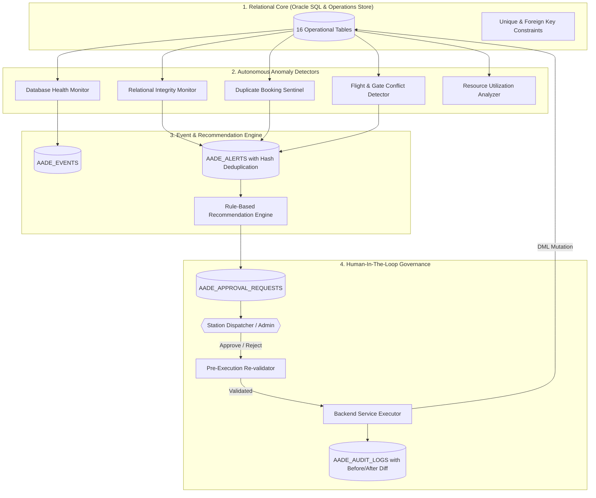

# Autonomous Airport Data Engine (AADE): Architecture Specification

## Overview

The **Autonomous Airport Data Engine (AADE)** is an active, self-monitoring operational intelligence layer engineered to monitor airport infrastructure, detect relational and scheduling anomalies, prevent duplicate allocations, calculate resource utilization, and present explainable corrective recommendations to authorized operators.

Unlike traditional passive CRUD database systems, AADE operates as an active sentinel running alongside the Express.js API backend and React.js frontend.

---

## 1. Architectural Philosophy: The Autonomous Loop

### Core Axiom: Human-In-The-Loop Governance
AADE **never automatically modifies critical operational data** (such as reassigning a gate to an aircraft or moving passenger seats) without human consent. 

Instead, the engine:
1. Detects the condition with sub-second latency.
2. Identifies affected records and computes the business rationale.
3. Formulates a proposed resolution (e.g. *"Reassign Flight AI680 to Gate G03"*).
4. Enqueues the proposal into the **AADE Approval Queue**.
5. When an operator clicks **Approve**, the engine re-validates current conditions, executes the update through existing services, and commits an immutable record into the audit history.

---

## 2. The 10 Logical Components

### 1. Database Health Monitor (`health.monitor.js`)
- Continuously inspects Oracle database connection viability, pool allocation (min 2, max 10), ping latency, and the availability/row count of 12 critical tables (`AIRPORTS`, `AIRLINES`, `AIRCRAFTS`, `GATES`, `FLIGHTS`, `FLIGHT_INSTANCES`, `PASSENGERS`, `EMPLOYEES`, `BOOKINGS`, `TICKETS`, `CHECK_IN`, `BAGGAGE`).
- Emits one of four system states:
  - `HEALTHY`: Database online, all tables available, latency $<50\text{ ms}$.
  - `WARNING`: High query latency ($>300\text{ ms}$) or elevated error rates.
  - `CRITICAL`: Missing required schema tables or persistent query failures.
  - `UNAVAILABLE`: Database offline; activates resilient in-memory operational fallback with zero data loss.

### 2. Data Integrity Monitor (`integrity.monitor.js`)
- Audits relational integrity across foreign key boundaries.
- Scans for orphan tickets lacking parent bookings, orphan baggage tags, invalid flight instance numbers, and confirmed bookings with zero issued tickets.
- Strictly non-destructive: flags issues for operator review without deleting records.

### 3. Duplicate Booking Detector (`duplicate.detector.js`)
- Protects booking and ticketing invariants.
- Detects duplicate 6-character PNR codes, seat allocation collisions on the same flight instance (two tickets claiming the same physical seat), and multiple concurrent bookings held by the same passenger on the same flight.

### 4. Flight & Gate Conflict Detector (`conflict.detector.js`)
- Enforces airside and terminal scheduling separation.
- Calculates overlapping gate departure/arrival intervals (including standard 30-minute aircraft pushback turnaround buffers).
- Identifies flights assigned to aerobridge stands undergoing `MAINTENANCE`.
- Flags unrecorded operational delays where scheduled departure time has elapsed by $>45\text{ minutes}$ while status remains `SCHEDULED`.

### 5. Resource Utilization Analyzer (`utilization.analyzer.js`)
- Evaluates operational infrastructure efficiency from live records:
  - **Gate Utilization Rate**: Percentage of terminal gates actively occupied.
  - **Fleet Deployment**: Proportion of commercial aircraft flying active rotations.
  - **Movement Congestion**: Grouping flights by 4-hour departure windows to pinpoint peak airport rush hours.
  - **Baggage Conveyance Velocity**: Distribution of luggage units across screening, loading, and baggage claim carousels.

### 6. Event and Alert Manager (`event.manager.js`)
- Chronological event stream logging all significant occurrences (`AADE_EVENTS`).
- Active alert registry (`AADE_ALERTS`) employing a **deterministic cryptographic hash key**:
  $$\text{hashKey} = \text{MD5}(\text{alertType} + \text{":"} + \text{entityType} + \text{":"} + \text{entityId})$$
- Prevents duplicate alert spamming across repeated monitoring runs by incrementing the occurrence counter and updating the last-detected timestamp on existing active alerts.

### 7. Rule-Based Recommendation Engine (`recommendation.engine.js`)
- Transforms detected anomalies into clear, explainable proposals.
- Every recommendation details:
  - **What Was Detected**: Factual description of the anomaly.
  - **Engineering Rationale**: Why the condition threatens airport operations.
  - **Suggested Corrective Action**: The exact operational adjustment.
  - **Action Payload**: Concrete parameters (e.g. `proposedGateId: 3`, `proposedSeat: "14B"`).

### 8. Approval-Based Action Manager (`approval.manager.js`)
- Enforces review workflows before applying modifications.
- Authorized operators approve or reject proposals with optional remarks.
- Re-validates that candidate gates/seats remain unoccupied before execution.
- Prevents re-executing already decided requests (`400 Bad Request`).

### 9. Audit History Manager (`audit.manager.js`)
- Maintains an immutable append-only execution log in `AADE_AUDIT_LOGS`.
- Captures before-and-after state snapshots (diffs), approver email, execution timestamp, and status.

### 10. Central Autonomous Engine Service (`engine.service.js`)
- Coordinates the background timer (default 60s or configurable interval).
- Prevents re-entrancy through an atomic `isCycleRunning` guard.
- Provides an on-demand trigger `POST /api/aade/run` allowing operators and faculty examiners to execute immediate monitoring cycles.
