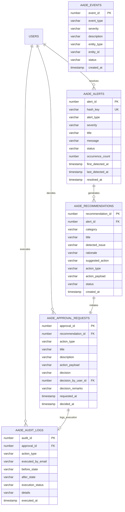

# Autonomous Airport Data Engine (AADE): Database Design

## Overview

The database layer of the Autonomous Airport Data Engine is defined in [`database/schema/11_aade_tables.sql`](../database/schema/11_aade_tables.sql). It introduces **5 relational tables** designed to support event auditing, alert deduplication, recommendation queues, operator approvals, and execution state diffs without mutating existing core operational tables.

---

## Relational Entity-Relationship Diagram

---

## Detailed Table Specifications

### 1. `AADE_EVENTS`
Chronological operational event stream emitted by autonomous daemons and monitoring sweeps.

| Column | Type | Nullable | Description |
| :--- | :--- | :---: | :--- |
| `EVENT_ID` | `NUMBER` (Identity PK) | No | Unique surrogate key |
| `EVENT_TYPE` | `VARCHAR2(50)` | No | Category (e.g. `ALERT_CRITICAL`, `AADE_CYCLE_COMPLETED`) |
| `SEVERITY` | `VARCHAR2(20)` | No | Check: `INFO`, `WARNING`, `CRITICAL` |
| `DESCRIPTION` | `VARCHAR2(500)` | No | Human-readable log narrative |
| `ENTITY_TYPE` | `VARCHAR2(50)` | Yes | Target entity table (e.g. `GATES`, `TICKETS`) |
| `ENTITY_ID` | `VARCHAR2(50)` | Yes | Target primary key identifier |
| `STATUS` | `VARCHAR2(20)` | No | Check: `LOGGED`, `PROCESSED`, `ARCHIVED` |
| `CREATED_AT` | `TIMESTAMP` | No | Default: `SYSTIMESTAMP` |

---

### 2. `AADE_ALERTS`
Active alert registry tracking unresolved anomalies with deduplication keys.

| Column | Type | Nullable | Description |
| :--- | :--- | :---: | :--- |
| `ALERT_ID` | `NUMBER` (Identity PK) | No | Unique surrogate key |
| `HASH_KEY` | `VARCHAR2(64)` | No | Unique composite MD5 hash for deduplication |
| `ALERT_TYPE` | `VARCHAR2(50)` | No | Type (e.g. `OVERLAPPING_GATE_ASSIGNMENT`) |
| `SEVERITY` | `VARCHAR2(20)` | No | Check: `INFO`, `WARNING`, `CRITICAL` |
| `TITLE` | `VARCHAR2(150)` | No | Alert headline |
| `MESSAGE` | `VARCHAR2(1000)` | No | Detailed diagnostic description |
| `STATUS` | `VARCHAR2(20)` | No | Check: `ACTIVE`, `ACKNOWLEDGED`, `RESOLVED`, `DISMISSED` |
| `OCCURRENCE_COUNT` | `NUMBER` | No | Times anomaly was re-detected across cycles |
| `FIRST_DETECTED_AT` | `TIMESTAMP` | No | Initial detection timestamp |
| `LAST_DETECTED_AT` | `TIMESTAMP` | No | Most recent detection timestamp |
| `RESOLVED_AT` | `TIMESTAMP` | Yes | Time marked as resolved/dismissed |
| `RESOLVED_BY_USER_ID` | `NUMBER` (FK) | Yes | References `USERS(USER_ID)` |

---

### 3. `AADE_RECOMMENDATIONS`
Rule-based corrective recommendations generated by the autonomous engine.

| Column | Type | Nullable | Description |
| :--- | :--- | :---: | :--- |
| `RECOMMENDATION_ID` | `NUMBER` (Identity PK) | No | Unique surrogate key |
| `ALERT_ID` | `NUMBER` (FK) | Yes | References `AADE_ALERTS(ALERT_ID)` |
| `CATEGORY` | `VARCHAR2(50)` | No | e.g. `GATE_ALLOCATION`, `SEAT_COLLISION_RESOLUTION` |
| `TITLE` | `VARCHAR2(150)` | No | Recommendation title |
| `DETECTED_ISSUE` | `VARCHAR2(1000)` | No | Explanation of what condition was discovered |
| `RATIONALE` | `VARCHAR2(1000)` | No | Engineering reason why the condition matters |
| `SUGGESTED_ACTION` | `VARCHAR2(500)` | No | Clear operational recommendation |
| `ACTION_TYPE` | `VARCHAR2(50)` | No | Action code (e.g. `REASSIGN_GATE`, `REASSIGN_SEAT`) |
| `ACTION_PAYLOAD` | `VARCHAR2(4000)` | Yes | JSON serialized execution parameters |
| `STATUS` | `VARCHAR2(20)` | No | Check: `PENDING`, `APPROVED`, `REJECTED`, `EXECUTED` |
| `CREATED_AT` | `TIMESTAMP` | No | Timestamp recommendation was issued |

---

### 4. `AADE_APPROVAL_REQUESTS`
Human-in-the-loop workflow queue requiring authorized operator sign-off before execution.

| Column | Type | Nullable | Description |
| :--- | :--- | :---: | :--- |
| `APPROVAL_ID` | `NUMBER` (Identity PK) | No | Unique surrogate key |
| `RECOMMENDATION_ID` | `NUMBER` (FK) | No | References `AADE_RECOMMENDATIONS(RECOMMENDATION_ID)` |
| `ACTION_TYPE` | `VARCHAR2(50)` | No | e.g. `REASSIGN_GATE`, `UPDATE_FLIGHT_STATUS` |
| `TITLE` | `VARCHAR2(150)` | No | Summary of proposed action |
| `DESCRIPTION` | `VARCHAR2(500)` | No | Detailed action instructions |
| `ACTION_PAYLOAD` | `VARCHAR2(4000)` | No | Parameter payload required for execution |
| `DECISION` | `VARCHAR2(20)` | No | Check: `PENDING`, `APPROVED`, `REJECTED` |
| `DECISION_BY_USER_ID` | `NUMBER` (FK) | Yes | References `USERS(USER_ID)` of operator |
| `DECISION_REMARKS` | `VARCHAR2(500)` | Yes | Comments or justification from operator |
| `REQUESTED_AT` | `TIMESTAMP` | No | When proposal was enqueued |
| `DECIDED_AT` | `TIMESTAMP` | Yes | When operator decided the request |

---

### 5. `AADE_AUDIT_LOGS`
Immutable append-only execution log recording all applied autonomous corrections.

| Column | Type | Nullable | Description |
| :--- | :--- | :---: | :--- |
| `AUDIT_ID` | `NUMBER` (Identity PK) | No | Unique surrogate key |
| `APPROVAL_ID` | `NUMBER` (FK) | Yes | References `AADE_APPROVAL_REQUESTS(APPROVAL_ID)` |
| `ACTION_TYPE` | `VARCHAR2(50)` | No | Executed action code |
| `EXECUTED_BY_USER_ID` | `NUMBER` (FK) | Yes | Operator user ID |
| `EXECUTED_BY_EMAIL` | `VARCHAR2(100)` | Yes | Operator email address for viva audit trail |
| `BEFORE_STATE` | `VARCHAR2(4000)` | Yes | JSON snapshot before modification |
| `AFTER_STATE` | `VARCHAR2(4000)` | Yes | JSON snapshot after modification |
| `EXECUTION_STATUS` | `VARCHAR2(20)` | No | Check: `SUCCESS`, `FAILED` |
| `DETAILS` | `VARCHAR2(1000)` | No | Execution summary narrative |
| `EXECUTED_AT` | `TIMESTAMP` | No | Timestamp modification was applied |

---

## Indexing Strategy
To guarantee fast lookups during periodic monitoring sweeps without table scans:
1. `idx_aade_events_type`: `(EVENT_TYPE, CREATED_AT)`
2. `idx_aade_alerts_status`: `(STATUS, SEVERITY)`
3. `idx_aade_recs_status`: `(STATUS)`
4. `idx_aade_appr_status`: `(DECISION, REQUESTED_AT)`
5. `idx_aade_audit_time`: `(EXECUTED_AT)`
