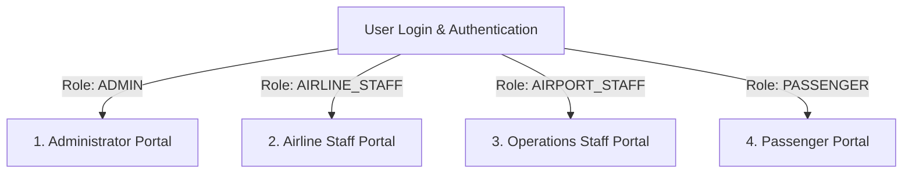
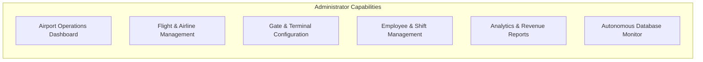
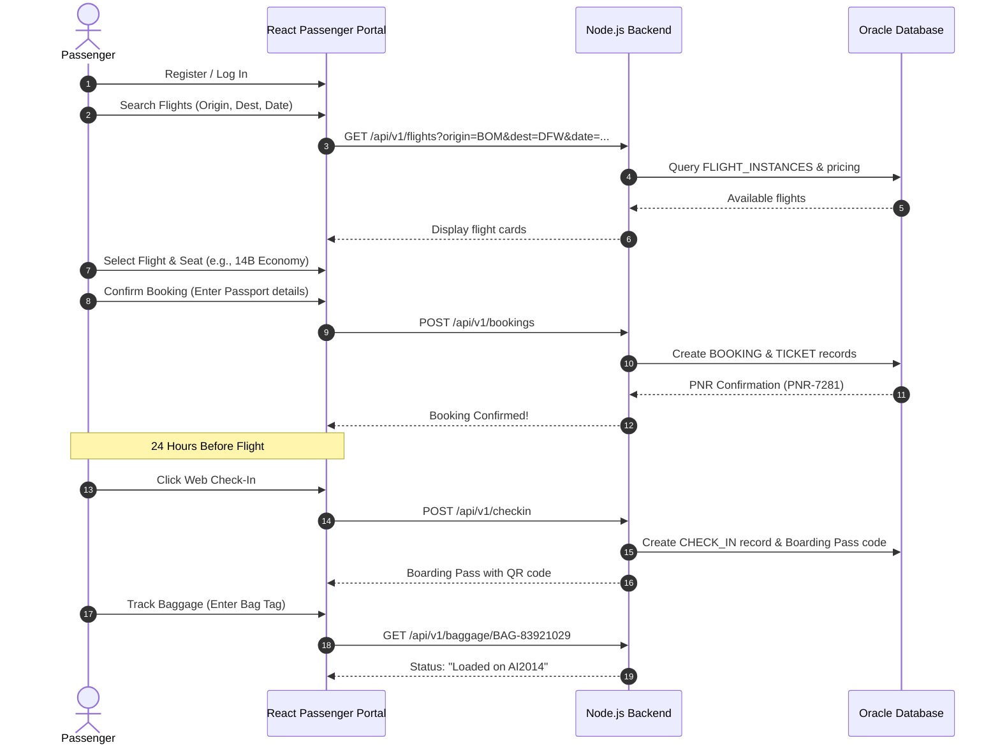

# Application Modules & User Interfaces Plan

> **Document Purpose**: Full-Stack Functional Specification for Viva & Development  
> **Application Name**: Airport Management System  
> **Target Audience**: BTech Faculty Presentation, Examiners, and Developers

---

## 1. Overview of System Interfaces

The application is structured into **four distinct role-based portals**, powered by a single backend REST API with JSON Web Token (JWT) role-based authorization:

---

## 2. Interface 1: Administrator Portal

### Purpose
The Administrator Portal provides top-level oversight of airport master data, financial health, employee allocation, and autonomous database monitoring.

### Functional Modules & Screens:

1. **Overall Airport Operations Dashboard**:
   - High-level KPI widgets: Active Flights Today, On-Time Performance (OTP) %, Total Passengers Handled, Gate Occupancy Rate, and Active Autonomous Alerts.
   - Live visual radar showing aircraft currently arriving, departing, or delayed.
2. **Flight & Airline Management**:
   - Register new partner airlines (`AIRLINES` table).
   - Create recurring flight routes (`FLIGHTS` table) and generate scheduled instances (`FLIGHT_INSTANCES`).
   - Edit, cancel, or reschedule flight instances.
3. **Gate & Terminal Configuration**:
   - Visual terminal map showing status of all boarding gates (`AVAILABLE`, `OCCUPIED`, `MAINTENANCE`).
   - Manual override to reassign gates during terminal maintenance.
4. **Employee & Shift Management**:
   - Register staff accounts and assign roles (`OPERATIONS_CONTROLLER`, `GATE_AGENT`, `BAGGAGE_HANDLER`, `ENGINEER`).
   - Assign shift timings (`DAY` vs. `NIGHT`) and airport facility locations.
5. **Analytics & Performance Reports**:
   - Route profitability and booking volume charts.
   - Passenger traffic trends by hour, day, and month.
   - Staff utilization statistics.
6. **Autonomous Database Monitor**:
   - Live stream of `OPERATIONAL_LOGS` populated by the Autonomous Airport Data Engine.
   - **Operator Approval Queue**: Review and approve/reject recommended automated interventions (e.g., gate swaps, anomaly resolutions).

---

## 3. Interface 2: Airline Staff Portal

### Purpose
Dedicated to airline customer service agents, gate agents, and flight dispatchers managing specific carrier flights.

### Functional Modules & Screens:
1. **Assigned Flights Management**:
   - View only flights operating under the staff member's specific airline carrier code (e.g., all Air India flights).
   - Update flight status (`BOARDING`, `DEPARTED`, `DELAYED`).
2. **Passenger Manifests**:
   - Real-time list of all booked travelers on a flight instance.
   - Filter travelers by cabin class (Economy, Business, First-Class), check-in status, and special service requests.
3. **Ticket Verification**:
   - Scan or look up a 13-digit ticket number or 6-character PNR booking reference.
   - Verify passport number against the passenger manifest.
4. **Check-in Management**:
   - Perform counter check-in for walk-in travelers.
   - Issue physical or digital boarding passes.
   - Mark no-show passengers prior to gate closure.
5. **Baggage Intake & Status**:
   - Record checked luggage weight and attach RFID/barcode bag tag numbers (`BAGGAGE` table).
   - Track baggage transfer from intake counters to aircraft hold loading.

---

## 4. Interface 3: Airport Operations Staff Portal

### Purpose
Used by the **Airport Operations Center (AOC)**, air traffic controllers, runway monitors, and ramp coordinators to manage ground resources.

### Functional Modules & Screens:
1. **Airfield Flight Timetable**:
   - Live master display of all incoming and outgoing flights across all airlines.
   - Dynamic search by flight number, origin, destination, and runway approach times.
2. **Gate Assignment Management**:
   - Interactive gate assignment matrix.
   - Visual warnings when two aircraft are assigned the same gate at overlapping times (integrated with the Autonomous Engine).
   - Fast drag-and-drop gate reassignment.
3. **Operational Event Log**:
   - Log ground incidents (weather diversions, runway de-icing, emergency medical holds).
   - Trigger broadcast notifications to affected airlines and gate agents.
4. **Flight Status Broadcast**:
   - Instant status toggle: trigger delays with structured reason codes (e.g., "Air Traffic Congestion", "Technical Inspection").

---

## 5. Interface 4: Passenger Portal

### Purpose
Responsive self-service portal for travelers accessible via mobile or desktop web browsers.

### Passenger Workflow:

### Functional Modules:
1. **Authentication**: Register with email/password; manage profile and passport records.
2. **Flight Search & Booking**: Intuitive flight search engine with date pickers, cabin class filters, and real-time price calculation.
3. **Interactive Seat Selection**: Visual 2D cabin map indicating available, reserved, and selected seats.
4. **Web Check-In & Boarding Pass**: One-click check-in available 24 hours prior to departure; generates a printable/downloadable digital boarding pass with barcode/QR code.
5. **Live Baggage Tracking**: Real-time status tracker displaying luggage journey: `Checked In` $\rightarrow$ `Security Cleared` $\rightarrow$ `Loaded on Flight` $\rightarrow$ `Claim Ready at Carousel 4`.
6. **Flight Alerts & Notifications**: In-app notification bell alerting passengers to gate changes, delays, or boarding calls.

---

## 6. Implementation Feasibility for a BTech Project

To ensure this project is achievable within an academic semester:
- **Phase 1 Focus**: Build the core database and Node.js REST API.
- **Phase 2 Focus**: Build the React frontend with shared reusable UI components.
- **Phase 3 Focus**: Add the Autonomous Airport Data Engine rules and C/Java specialized modules.
