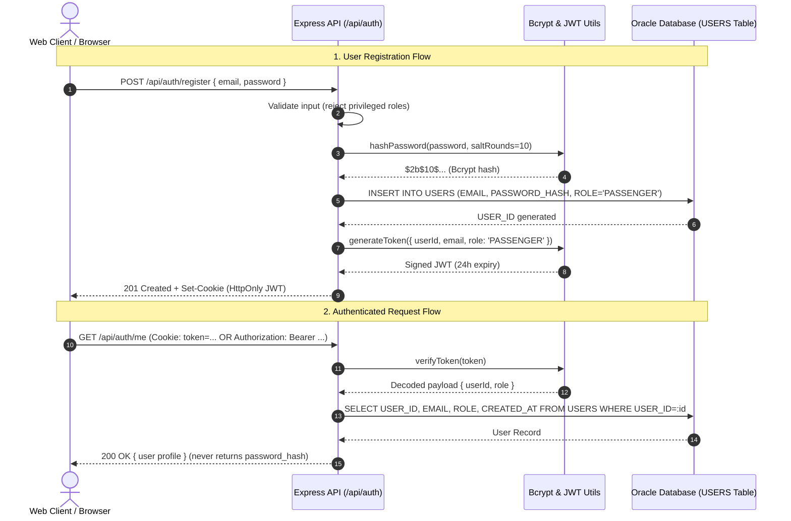

# Authentication & Security Architecture

> **Project Phase**: Phase 05 — Authentication, Authorization & Role Management  
> **Course / Degree**: BTech Capstone Project  
> **Author**: Saravana  
> **Repository**: [https://github.com/Saravana65/Airport-Management-System](https://github.com/Saravana65/Airport-Management-System)  
> **Stack**: Node.js, Express.js, Oracle SQL, JSON Web Tokens (JWT), bcrypt

---

## 1. Authentication Architecture Overview

The Airport Management System implements a **stateless, token-based authentication architecture** hardened against common web attack vectors (credential sniffing, SQL injection, privilege escalation, cross-site scripting, and CSRF).



---

## 2. Password Security & Hashing (bcrypt)

Plaintext passwords are **never stored** in the database and **never logged** to application traces.

### Hashing Strategy:
- **Algorithm**: `bcrypt` (Blowfish-based adaptive cipher).
- **Work Factor (Salt Rounds)**: `10` rounds ($2^{10} = 1024$ key derivations).
- **Salt Generation**: Automatically generated per-password by `bcrypt.genSalt`.
- **Timing Attack Mitigation**: `bcrypt.compare` runs in constant time, preventing timing-based side-channel attacks during credential verification.

```javascript
// backend/src/utils/auth.util.js
async function hashPassword(password) {
    return await bcrypt.hash(password, 10);
}

async function comparePassword(candidatePassword, hashedPassword) {
    return await bcrypt.compare(candidatePassword, hashedPassword);
}
```

---

## 3. Token Strategy: JWT & Cookie Management

### 3.1 Token Payload Structure
The signed JWT payload contains only non-sensitive identity metadata:
```json
{
  "userId": 1,
  "email": "traveler@gmail.com",
  "role": "PASSENGER",
  "iat": 1730677200,
  "exp": 1730763600
}
```
- **Signing Algorithm**: HMAC-SHA256 (`HS256`).
- **Secret Key**: Stored securely in `JWT_SECRET` via environment variables.
- **Expiration**: Configurable via `JWT_EXPIRES_IN` (Default: `24h`).

### 3.2 Secure Storage vs. localStorage (Viva Point!)
> [!IMPORTANT]
> **Viva Defense Insight**: Many student projects store tokens in `localStorage` in React, which is vulnerable to **Cross-Site Scripting (XSS)**—any malicious third-party JavaScript script can read `localStorage.getItem('token')`.  
> In our architecture:
> - The API transmits the JWT as an **`HttpOnly` Cookie**:
>   ```javascript
>   res.cookie('token', token, {
>       httpOnly: true, // Prevents JavaScript from reading the cookie
>       secure: config.isProduction, // Transmitted only over HTTPS in production
>       sameSite: config.isProduction ? 'strict' : 'lax', // CSRF defense
>       maxAge: 24 * 60 * 60 * 1000, // 24 hours
>   });
>   ```
> - The backend also supports `Authorization: Bearer <token>` headers for mobile or API tools (Postman, curl).

---

## 4. Privilege Escalation Prevention

To prevent malicious users from granting themselves elevated privileges during public signup:

1. **Hardcoded Role Enforcement**:
   - The public registration endpoint (`POST /api/auth/register`) enforces `role = 'PASSENGER'`.
   - The input validation middleware inspects the request body; if a user attempts to pass `{ "role": "ADMIN" }`, the request is blocked with `403 Forbidden` (`code: PRIVILEGE_ESCALATION_ATTEMPT`).
2. **Administrative Role Management**:
   - Only users authenticated with the `ADMIN` role can access `PUT /api/admin/users/:id/role`.
   - **Self-Demotion / Lockout Guard**: An administrator cannot modify their own role or deactivate their own account, preventing accidental total system lockouts.

---

## 5. Database Integration: `USERS` Table

The authentication layer maps directly to the verified `USERS` table defined in [`database/schema/06_user_and_passenger_tables.sql`](../database/schema/06_user_and_passenger_tables.sql):

```sql
CREATE TABLE USERS (
    USER_ID         NUMBER GENERATED BY DEFAULT AS IDENTITY,
    EMAIL           VARCHAR2(100)   NOT NULL,
    PASSWORD_HASH   VARCHAR2(255)   NOT NULL,
    ROLE            VARCHAR2(20)    NOT NULL,
    IS_ACTIVE       CHAR(1)         DEFAULT 'Y' NOT NULL,
    CREATED_AT      TIMESTAMP       DEFAULT SYSTIMESTAMP NOT NULL,

    CONSTRAINT pk_users PRIMARY KEY (USER_ID),
    CONSTRAINT uq_user_email UNIQUE (EMAIL),
    CONSTRAINT chk_user_role CHECK (ROLE IN ('ADMIN', 'AIRLINE_STAFF', 'AIRPORT_STAFF', 'PASSENGER')),
    CONSTRAINT chk_user_active CHECK (IS_ACTIVE IN ('Y', 'N'))
);
```

### Parameterized SQL & Bind Variables:
All SQL statements use Oracle bind parameters (`:email`, `:passwordHash`, `:role`) to eliminate SQL injection vulnerabilities:
```javascript
const result = await databaseService.execute(
    'SELECT USER_ID, EMAIL, PASSWORD_HASH, ROLE, IS_ACTIVE FROM USERS WHERE EMAIL = :email',
    { email: normalizedEmail }
);
```

---

## 6. Endpoints Reference

| Method | Endpoint | Access Level | Description |
| :--- | :--- | :--- | :--- |
| `POST` | `/api/auth/register` | Public | Registers a new passenger account with bcrypt password. |
| `POST` | `/api/auth/login` | Public | Authenticates credentials, verifies active status, issues JWT. |
| `POST` | `/api/auth/logout` | Public | Clears the `token` HTTP-only cookie. |
| `GET` | `/api/auth/me` | Authenticated | Returns sanitized profile of the currently logged-in user. |
| `PUT` | `/api/auth/change-password` | Authenticated | Validates current password and updates to new bcrypt hash. |
| `GET` | `/api/admin/users` | Admin Only | Retrieves all users in the system without password hashes. |
| `PUT` | `/api/admin/users/:id/role` | Admin Only | Modifies user role (`PASSENGER`, `AIRLINE_STAFF`, etc.). |
| `PUT` | `/api/admin/users/:id/status`| Admin Only | Activates or deactivates user accounts (`Y` / `N`). |
