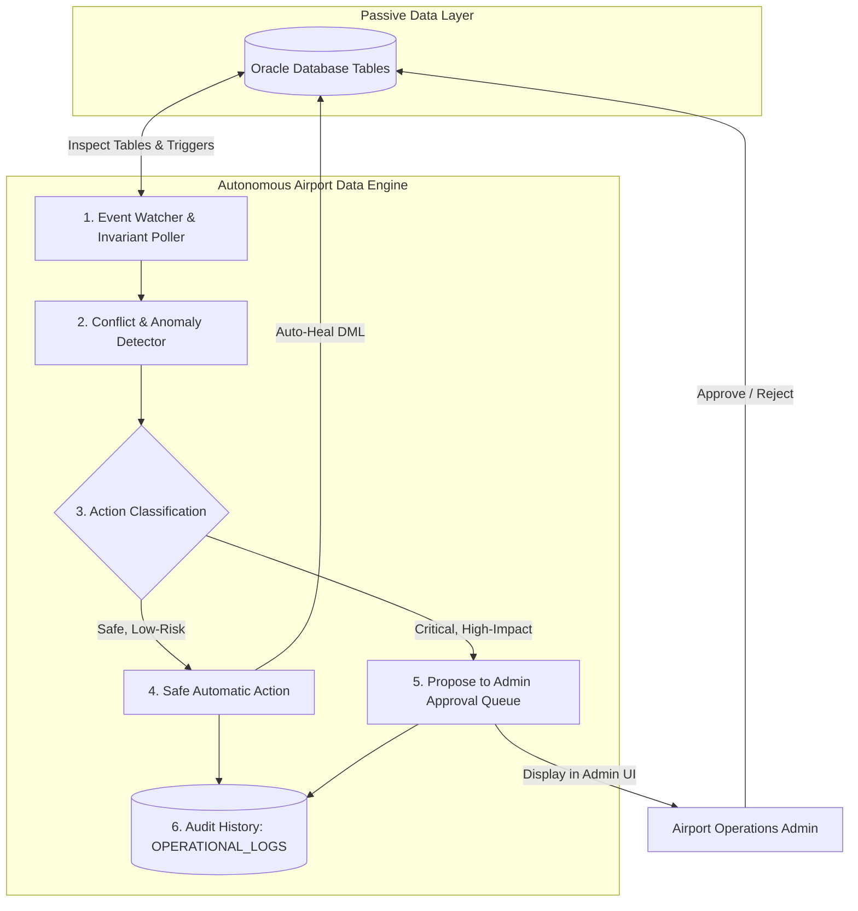

# Autonomous Airport Database: Concept & Implementation Plan

> **Document Status**: Architectural Plan / Educational Viva Guide  
> **Key Differentiator**: Self-Monitoring, Self-Healing, and Anomaly-Detecting Airport Operations Engine  
> **Student Author**: Saravana

---

## 1. What is an Autonomous Airport Database?

In traditional airport systems, the database is purely **passive**—it simply stores rows of data when an external program executes an `INSERT` or `UPDATE`. If an operator accidentally assigns two planes to the same gate at the same time, or if two passengers are booked into the same seat, a passive database allows the error unless an application programmer remembered to write a check.

The **Autonomous Airport Database (AADE)** transforms the database layer into an **active, self-monitoring operational system**. It continuously analyzes its own data, detects operational anomalies, automatically executes safe corrective actions, and alerts human operators with intelligent recommendations.

---

## 2. The 10 Planned Autonomous Features Explained

Below are the 10 proposed capabilities, explained with **simple, real-world airport scenarios** that can be effortlessly presented to faculty and examiners.

---

### Feature 1: Automatic Detection of Duplicate Bookings
- **Real-World Scenario**: Due to a network glitch or two users clicking "Confirm" at the same instant on different devices, both Passenger A and Passenger B get issued tickets for Seat `14A` on Flight `AI2014`.
- **How the Autonomous Engine Works**:
  - A database-level unique constraint and a periodic audit query scan `TICKETS` for matching `(FLIGHT_INSTANCE_ID, SEAT_NUMBER)`.
  - If a collision occurs, the engine immediately flags the second transaction as `CONFLICT_DETECTED`.
- **Action**:
  - Safe Action: Reverts the second ticket status to `PENDING_REASSIGNMENT`, keeps the first passenger confirmed, and notifies the booking agent.
  - Logs event to `OPERATIONAL_LOGS`.

---

### Feature 2: Overlapping Gate Assignment Detection
- **Real-World Scenario**: Flight `AA4367` (scheduled arrival 14:00, departure 15:30) and Flight `BA1689` (scheduled arrival 15:00, departure 16:30) are both mistakenly assigned to Gate `T1-G04`. This would cause a dangerous runway traffic jam with two wide-body jets trying to park at the same gate.
- **How the Autonomous Engine Works**:
  - The engine cross-references `FLIGHT_INSTANCES` where `GATE_ID` matches and scheduled time windows overlap (including a standard 30-minute buffer for aircraft pushback).
- **Action**:
  - Flags a `CRITICAL` conflict.
  - Queries `GATES` for an unoccupied gate in the same terminal.
  - Places a proposed gate change (e.g., "Move BA1689 to Gate T1-G08") into the **Admin Approval Queue**.

---

### Feature 3: Automated Flight Status & Delay Monitoring
- **Real-World Scenario**: Flight `AI2014` was scheduled to depart at 03:15, but the actual clock reaches 03:45 and the flight status is still marked as `'SCHEDULED'`.
- **How the Autonomous Engine Works**:
  - The watcher daemon compares `CURRENT_TIMESTAMP` with `ESTIMATED_DEPARTURE`.
  - If `CURRENT_TIMESTAMP > ESTIMATED_DEPARTURE + 15 MINUTES` and status is not `'DEPARTED'`, it detects an unrecorded operational delay.
- **Action**:
  - Automatically updates `FLIGHT_INSTANCES.STATUS` to `'DELAYED'`.
  - Triggers an automated entry in `FLIGHT_STATUS_HISTORY`.
  - Dispatches automated notifications to all booked travelers on that flight.

---

### Feature 4: Detection of Inconsistent Passenger & Ticket Records
- **Real-World Scenario**: A booking is marked as `'CANCELLED'`, but one of its associated tickets is still showing `'CHECKED_IN'`, or a ticket has no matching passenger ID due to an interrupted API request.
- **How the Autonomous Engine Works**:
  - The engine runs integrity verification queries checking for mismatched relational states between `BOOKINGS.STATUS` and `TICKETS.STATUS`.
- **Action**:
  - Safe Action: Corrects orphaned ticket statuses to `'CANCELLED'`.
  - Logs the anomaly in `OPERATIONAL_LOGS` with severity `WARNING`.

---

### Feature 5: Database Health & Invariant Monitoring
- **Real-World Scenario**: Over months of operations, tables with frequent updates (like `FLIGHT_STATUS_HISTORY` or `OPERATIONAL_LOGS`) grow excessively large, slow down index lookups, or consume excessive tablespace.
- **How the Autonomous Engine Works**:
  - Executes Oracle administrative system queries inspecting table row counts, index fragmentation, and database connection pool utilization.
- **Action**:
  - Generates weekly database diagnostic summaries displayed on the Admin Dashboard.
  - Flags when tablespace reaches 85% capacity.

---

### Feature 6: Identification of Underutilized Airport Resources
- **Real-World Scenario**: Gate `T2-G15` has had zero aircraft assigned for the past 48 hours, while Gate `T2-G02` has had back-to-back flights with zero buffer time, causing turn-around bottlenecks.
- **How the Autonomous Engine Works**:
  - Evaluates gate and carousel utilization ratios over rolling 7-day windows.
- **Action**:
  - Highlights underutilized resources on the Administrator Analytics screen with an efficiency recommendation: "Gate T2-G15 is 90% idle; redistribute 3 regional flights to balance ramp traffic."

---

### Feature 7: Operational Improvement Recommendations
- **Real-World Scenario**: A specific evening route (e.g., `BOM` to `DEL` departing at 18:00) has experienced delays on 8 out of the last 10 days due to late incoming aircraft.
- **How the Autonomous Engine Works**:
  - Analyzes the `FLIGHT_STATUS_HISTORY` table to calculate Punctuality / Delay correlation patterns.
- **Action**:
  - Automatically produces an actionable operational recommendation: "Flight AI2014 experiences an average delay of 42 minutes on Fridays. Consider extending turnaround buffer by 30 minutes in seasonal schedule."

---

### Feature 8: Automatic Safe Operational Healing
- **Real-World Scenario**: When an arriving flight lands, baggage is offloaded, and all bags for that flight are scanned as `'CLAIM_READY'`, the gate status remains stuck on `'OCCUPIED'` because the ground crew forgot to manually mark it free in the system.
- **How the Autonomous Engine Works**:
  - Detects that an aircraft departed 45 minutes ago and the gate has no active aircraft parked.
- **Action**:
  - Automatically updates `GATES.STATUS = 'AVAILABLE'` without requiring human intervention.
  - Logs the auto-clear action in `OPERATIONAL_LOGS`.

---

### Feature 9: Immutable Audit History of Automated Actions
- **Real-World Scenario**: Airport auditors and DGCA/FAA aviation regulators need proof of who changed a flight status or why an automated gate reallocation took place.
- **How the Autonomous Engine Works**:
  - Every autonomous check, self-healing action, or parameter adjustment is written to the `OPERATIONAL_LOGS` table with an exact `TIMESTAMP`, `DETAILS`, `ACTION_TAKEN`, and `EVENT_CATEGORY`.
- **Action**:
  - Provides complete historical traceability that cannot be deleted by standard users.

---

### Feature 10: Human-in-the-Loop Administrator Approval Queue
- **Real-World Scenario**: A thunderstorm grounds flights for 2 hours, requiring 12 flight gates and 4 runway slots to be rescheduled. An autonomous system should not arbitrarily swap gates for international wide-body flights without an experienced air traffic supervisor's approval.
- **How the Autonomous Engine Works**:
  - For high-impact operational changes (flight cancellations, gate swaps, emergency diversions), the engine creates a proposed solution record with `REQUIRES_ADMIN_APPROVAL = 'Y'` and `APPROVAL_STATUS = 'PENDING'`.
- **Action**:
  - The proposal appears in a glowing alert banner on the Admin Dashboard:
    > **Proposal #104**: Swap Flight AI127 from Gate T1-G04 to Gate T2-G01 due to incoming delay conflict.  
    > `[Approve & Apply]` `[Reject]` `[Modify]`
  - Only when the Administrator clicks **Approve** does the system execute the multi-table DML mutation.

---

## 3. Implementation Plan & Technology Mapping

| Feature | Implemented In | Technology | Academic Defense Value |
| :--- | :--- | :--- | :--- |
| **Audit Triggers (Delays & Fares)** | Database Tier | Oracle PL/SQL Triggers (`BEFORE UPDATE`, `AFTER UPDATE`) | Demonstrates advanced SQL and event-driven database programming. |
| **Conflict Detection & Health Monitor** | Background Engine | Node.js Worker Service (Cron / Interval Daemon) | Demonstrates backend background daemon architecture and async event loops. |
| **Gate Reassignment Algorithms** | Compute Module | C Program (Bipartite graph matching) | Demonstrates data structures (graphs, priority queues) in a systems language. |
| **Approval Queue Interface** | Frontend Tier | React.js Dashboard UI | Demonstrates interactive, human-in-the-loop enterprise UX. |

---

## 4. Status

This feature set is completely planned and specified. In keeping with project rules, **no implementation code will be written until you review and approve this document.**
