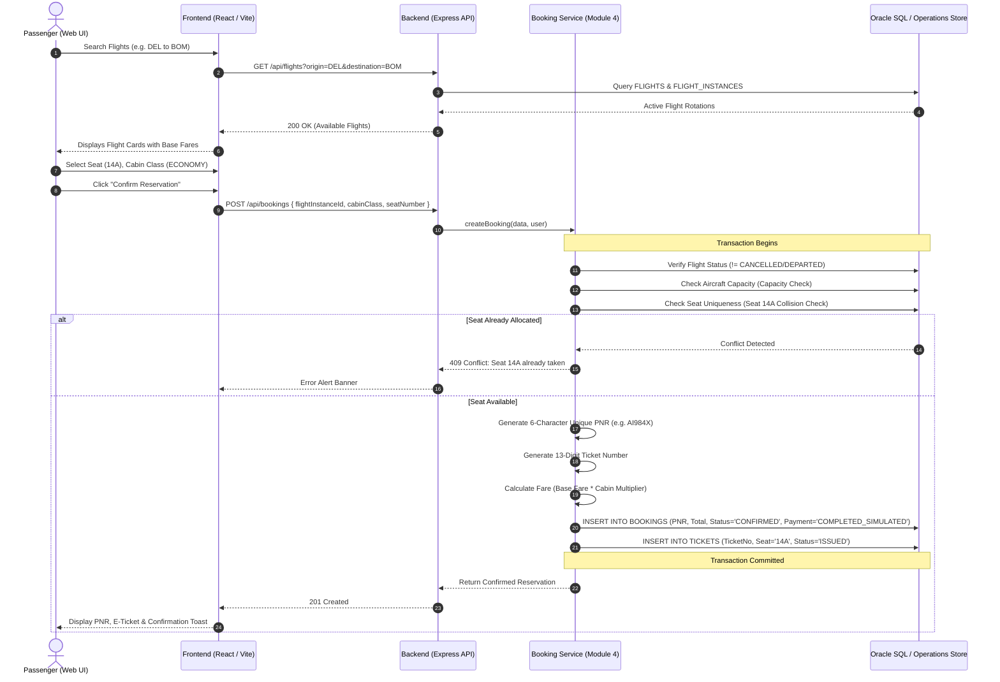

# Flight Reservation & Booking Lifecycle Specification

## Overview

The booking process in the Airport Management System coordinates multiple relational entities across `USERS`, `PASSENGERS`, `FLIGHT_INSTANCES`, `BOOKINGS`, and `TICKETS`.

To protect system integrity in high-traffic operations, the booking engine enforces **ACID transaction guarantees**, **seat collision locking**, **overbooking capacity verification**, and **payment state tracking**.

---

## 1. End-to-End Booking Sequence Diagram



---

## 2. Key Business Rules & Verification Points

### A. 6-Character Alphanumeric PNR
- **Format**: 6 uppercase characters generated via cryptographically secure pseudo-random numbers (e.g. `AI984X`, `K8LM2N`).
- **Collision Resistance**: The system loops to verify that no existing active booking holds the generated reference before committing.

### B. Duplicate Seat Prevention
- Before seat assignment is committed, the service checks all non-cancelled tickets on the target `flightInstanceId`.
- If an active ticket already claims the requested seat, the transaction is rejected with `409 Conflict`:
  ```json
  {
    "success": false,
    "error": "Seat 14A has already been allocated on this flight instance."
  }
  ```

### C. Overbooking Prevention
- Every aircraft has a defined seating capacity stored in `AIRCRAFTS.TOTAL_SEATS`.
- If `bookedTickets.length >= capacity`, new reservations are rejected with `409 Conflict: Flight instance is fully booked`.

### D. Cabin Class Multipliers
Ticket pricing reflects the luxury tier:
$$\text{Ticket Price} = \text{Base Fare} \times \text{Multiplier}$$
- **ECONOMY**: $1.0\times$
- **BUSINESS**: $2.5\times$
- **FIRST**: $4.0\times$

### E. Simulated Payment Integration
- Rather than requiring external merchant gateway keys during student demonstrations and viva, the booking engine simulates payment completion (`COMPLETED_SIMULATED`), ensuring reservations are immediately actionable for check-in and boarding pass issuance without fragile third-party dependencies.

---

## 3. Web Check-in & Digital Boarding Pass Workflow

Once a booking is confirmed:
1. The ticket appears in `GET /api/checkin/eligible`.
2. The traveler clicks **Generate Boarding Pass**.
3. The server assigns the gate and outputs a unique boarding pass code:
   $$\text{Boarding Pass} = \text{BP-}[\text{FLIGHT}]-[\text{SEAT}]-[\text{RANDOM4}]$$
   Example: `BP-AI101-14A-9412`.
4. Ticket status advances to `CHECKED_IN`.
5. Duplicate check-in attempts on the same ticket are rejected (`409 Conflict`).

---

## 4. Cancellation & Seat Release Rollback

A passenger or authorized airline staff member can cancel a reservation:
1. `PATCH /api/bookings/:id/cancel`
2. Validates ownership: Passenger can only cancel their own booking; unauthorized users are blocked (`403 Forbidden`).
3. Updates `BOOKINGS.STATUS = 'CANCELLED'`.
4. Updates all associated `TICKETS.STATUS = 'CANCELLED'`.
5. The previously locked seat (e.g. `14A`) is instantly released back into inventory for other passengers to book.
