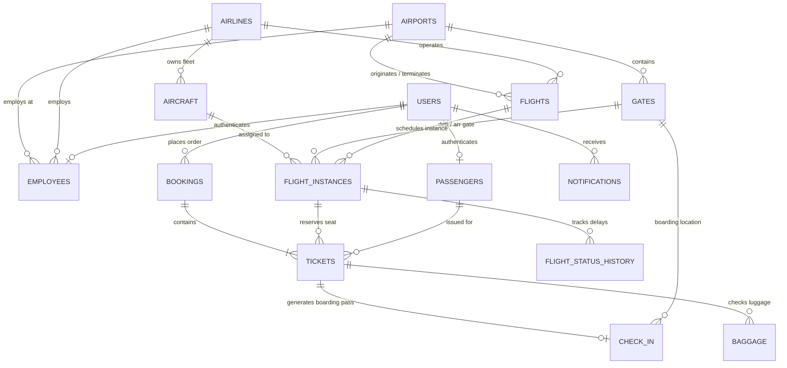

# Database Design: Airport Management System

> **Project Phase**: Phase 03 — Database Design & Oracle SQL Implementation  
> **Course / Degree**: BTech Capstone Project  
> **Author**: Saravana  
> **Repository**: [https://github.com/Saravana65/Airport-Management-System](https://github.com/Saravana65/Airport-Management-System)  
> **Target Database Engine**: Oracle Database (12c / 19c / 21c / Express Edition XE)

---

## Table of Contents
- [1. Overview & Architectural Improvements](#1-overview--architectural-improvements)
- [2. Entity-Relationship (ER) Diagram](#2-entity-relationship-er-diagram)
- [3. Normalization Strategy (3NF)](#3-normalization-strategy-3nf)
- [4. Complete Table Dictionary](#4-complete-table-dictionary)
  - [4.1 Facility & Fleet Tables](#41-facility--fleet-tables)
  - [4.2 Flight Schedule & Instance Tables](#42-flight-schedule--instance-tables)
  - [4.3 User, Passenger & Staff Tables](#43-user-passenger--staff-tables)
  - [4.4 Reservation, Ticketing & Baggage Tables](#44-reservation-ticketing--baggage-tables)
  - [4.5 Autonomous Audit & History Tables](#45-autonomous-audit--history-tables)
- [5. PL/SQL Programmability Suite](#5-plsql-programmability-suite)
  - [5.1 Stored Procedures](#51-stored-procedures)
  - [5.2 Database Triggers](#52-database-triggers)
  - [5.3 Analytical Views](#53-analytical-views)
- [6. Integrity Constraints & Sentinel Policies](#6-integrity-constraints--sentinel-policies)
- [7. Comparison: Reference Schema vs. Our Redesigned Schema](#7-comparison-reference-schema-vs-our-redesigned-schema)

---

## 1. Overview & Architectural Improvements

The Airport Management System database is an enterprise-grade relational persistence engine implemented in **Oracle SQL and PL/SQL**.

Following a thorough architectural audit of legacy reference material, this schema was redesigned from scratch to eliminate critical anomalies (such as the legacy "one-flight passenger" limitation and plain string timestamps), achieving full **Third Normal Form (3NF)** compliance while providing foundational tables for the **Autonomous Airport Data Engine**.

### Database Characteristics
- **RDBMS**: Oracle Database (12c, 19c, 21c, and Oracle Express Edition XE).
- **Dialect**: Oracle SQL / PL/SQL.
- **Total Tables**: 16 Normalized Relations.
- **Programmability Objects**: 8 Stored Procedures, 5 Database Triggers, 4 Analytical Views.
- **Physical Scripts**: Located in [`database/schema/`](../database/schema), [`database/procedures/`](../database/procedures), [`database/triggers/`](../database/triggers), and [`database/views/`](../database/views).

---

## 2. Entity-Relationship (ER) Diagram

---

## 3. Normalization Strategy (3NF)

Every relation in this schema strictly satisfies **Third Normal Form (3NF)**:
1. **1NF (Atomic Attributes)**: All columns contain scalar, non-repeating values.
2. **2NF (No Partial Key Dependencies)**: In all tables with composite primary or candidate keys (e.g., `GATES`, `FLIGHT_INSTANCES`, `TICKETS`), non-prime attributes are fully functionally dependent on the entire primary key.
3. **3NF (No Transitive Dependencies)**: Non-prime attributes depend solely on the primary key. For example:
   - Aircraft capacities reside in `AIRCRAFT`, not duplicated across tickets.
   - City and country information reside in `AIRPORTS`, avoiding update anomalies across routes.
   - User security credentials reside in `USERS`, separate from `PASSENGERS` demographics.

---

## 4. Complete Table Dictionary

### 4.1 Facility & Fleet Tables

#### Table: `AIRPORTS`
- **Script**: [`01_airport_tables.sql`](../database/schema/01_airport_tables.sql)
- **Primary Key**: `AIRPORT_CODE VARCHAR2(3)` (Official IATA code e.g., `'BOM'`, `'DEL'`, `'JFK'`).
- **Columns**: `AIRPORT_CODE`, `AIRPORT_NAME`, `CITY`, `STATE`, `COUNTRY`, `TIMEZONE`, `IS_ACTIVE`, `CREATED_AT`.
- **Constraints**: `chk_airport_code_format` (3 uppercase letters), `chk_airports_active` (`'Y'`/`'N'`).

#### Table: `AIRLINES`
- **Script**: [`02_airline_tables.sql`](../database/schema/02_airline_tables.sql)
- **Primary Key**: `AIRLINE_CODE VARCHAR2(3)` (e.g., `'AI'`, `'AA'`, `'BA'`).
- **Columns**: `AIRLINE_CODE`, `AIRLINE_NAME`, `THREE_DIGIT_CODE`, `COUNTRY`, `CONTACT_EMAIL`, `IS_ACTIVE`, `CREATED_AT`.
- **Constraints**: `uq_airline_3digit` (Unique 3-digit IATA accounting code).

#### Table: `GATES`
- **Script**: [`03_gate_tables.sql`](../database/schema/03_gate_tables.sql)
- **Primary Key**: `GATE_ID NUMBER GENERATED BY DEFAULT AS IDENTITY`.
- **Foreign Key**: `AIRPORT_CODE REFERENCES AIRPORTS(AIRPORT_CODE) ON DELETE CASCADE`.
- **Columns**: `GATE_ID`, `AIRPORT_CODE`, `TERMINAL`, `GATE_NUMBER`, `STATUS`, `IS_ACTIVE`, `CREATED_AT`.
- **Constraints**: `uq_gate_location UNIQUE (AIRPORT_CODE, TERMINAL, GATE_NUMBER)`, `chk_gate_status IN ('AVAILABLE', 'OCCUPIED', 'MAINTENANCE')`.

#### Table: `AIRCRAFT`
- **Script**: [`04_aircraft_tables.sql`](../database/schema/04_aircraft_tables.sql)
- **Primary Key**: `AIRCRAFT_ID NUMBER GENERATED BY DEFAULT AS IDENTITY`.
- **Foreign Key**: `AIRLINE_CODE REFERENCES AIRLINES(AIRLINE_CODE) ON DELETE CASCADE`.
- **Columns**: `AIRCRAFT_ID`, `REGISTRATION_NO`, `MODEL`, `AIRLINE_CODE`, `TOTAL_SEATS`, `ECONOMY_SEATS`, `BUSINESS_SEATS`, `FIRST_SEATS`, `STATUS`, `CREATED_AT`.
- **Constraints**: `uq_aircraft_reg UNIQUE (REGISTRATION_NO)`, `chk_seat_sum (TOTAL_SEATS = ECONOMY_SEATS + BUSINESS_SEATS + FIRST_SEATS)`.

---

### 4.2 Flight Schedule & Instance Tables

#### Table: `FLIGHTS`
- **Script**: [`05_flight_tables.sql`](../database/schema/05_flight_tables.sql)
- **Primary Key**: `FLIGHT_NUMBER VARCHAR2(10)` (e.g., `'AI2014'`, `'AA4367'`).
- **Foreign Keys**: `AIRLINE_CODE REFERENCES AIRLINES`, `ORIGIN_AIRPORT REFERENCES AIRPORTS`, `DEST_AIRPORT REFERENCES AIRPORTS`.
- **Columns**: `FLIGHT_NUMBER`, `AIRLINE_CODE`, `ORIGIN_AIRPORT`, `DEST_AIRPORT`, `SCHEDULED_DEPARTURE_TIME`, `SCHEDULED_ARRIVAL_TIME`, `FLIGHT_TYPE`, `BASE_FARE`, `IS_ACTIVE`, `CREATED_AT`.
- **Constraints**: `chk_flight_diff_airports (ORIGIN_AIRPORT != DEST_AIRPORT)`.

#### Table: `FLIGHT_INSTANCES`
- **Script**: [`05_flight_tables.sql`](../database/schema/05_flight_tables.sql)
- **Primary Key**: `FLIGHT_INSTANCE_ID NUMBER GENERATED BY DEFAULT AS IDENTITY`.
- **Foreign Keys**: `FLIGHT_NUMBER REFERENCES FLIGHTS`, `AIRCRAFT_ID REFERENCES AIRCRAFT`, `DEPARTURE_GATE_ID REFERENCES GATES`, `ARRIVAL_GATE_ID REFERENCES GATES`.
- **Columns**: `FLIGHT_INSTANCE_ID`, `FLIGHT_NUMBER`, `FLIGHT_DATE`, `AIRCRAFT_ID`, `DEPARTURE_GATE_ID`, `ARRIVAL_GATE_ID`, `SCHEDULED_DEPARTURE`, `ACTUAL_DEPARTURE`, `SCHEDULED_ARRIVAL`, `ACTUAL_ARRIVAL`, `STATUS`, `REMARKS`, `CREATED_AT`.
- **Constraints**: `uq_flight_date UNIQUE (FLIGHT_NUMBER, FLIGHT_DATE)`, `chk_instance_status IN ('SCHEDULED', 'BOARDING', 'DEPARTED', 'ON_TIME', 'DELAYED', 'CANCELLED', 'ARRIVED')`.

---

### 4.3 User, Passenger & Staff Tables

#### Table: `USERS`
- **Script**: [`06_user_and_passenger_tables.sql`](../database/schema/06_user_and_passenger_tables.sql)
- **Primary Key**: `USER_ID NUMBER GENERATED BY DEFAULT AS IDENTITY`.
- **Columns**: `USER_ID`, `EMAIL`, `PASSWORD_HASH`, `ROLE`, `IS_ACTIVE`, `CREATED_AT`.
- **Constraints**: `uq_user_email UNIQUE (EMAIL)`, `chk_user_role IN ('ADMIN', 'AIRLINE_STAFF', 'AIRPORT_STAFF', 'PASSENGER')`.

#### Table: `PASSENGERS`
- **Script**: [`06_user_and_passenger_tables.sql`](../database/schema/06_user_and_passenger_tables.sql)
- **Primary Key**: `PASSENGER_ID NUMBER GENERATED BY DEFAULT AS IDENTITY`.
- **Foreign Key**: `USER_ID REFERENCES USERS(USER_ID) ON DELETE SET NULL`.
- **Columns**: `PASSENGER_ID`, `USER_ID`, `FIRST_NAME`, `LAST_NAME`, `PASSPORT_NUMBER`, `PHONE`, `EMAIL`, `DATE_OF_BIRTH`, `GENDER`, `CREATED_AT`.
- **Constraints**: `uq_passenger_passport UNIQUE (PASSPORT_NUMBER)`.

#### Table: `EMPLOYEES`
- **Script**: [`07_employee_tables.sql`](../database/schema/07_employee_tables.sql)
- **Primary Key**: `EMPLOYEE_ID NUMBER GENERATED BY DEFAULT AS IDENTITY`.
- **Foreign Keys**: `USER_ID REFERENCES USERS`, `AIRPORT_CODE REFERENCES AIRPORTS`, `AIRLINE_CODE REFERENCES AIRLINES`.
- **Columns**: `EMPLOYEE_ID`, `USER_ID`, `AIRPORT_CODE`, `AIRLINE_CODE`, `FIRST_NAME`, `LAST_NAME`, `JOB_TITLE`, `SHIFT`, `CONTACT_PHONE`, `IS_ACTIVE`, `CREATED_AT`.

---

### 4.4 Reservation, Ticketing & Baggage Tables

#### Table: `BOOKINGS`
- **Script**: [`08_booking_tables.sql`](../database/schema/08_booking_tables.sql)
- **Primary Key**: `BOOKING_ID NUMBER GENERATED BY DEFAULT AS IDENTITY`.
- **Foreign Key**: `USER_ID REFERENCES USERS(USER_ID) ON DELETE CASCADE`.
- **Columns**: `BOOKING_ID`, `BOOKING_REFERENCE`, `USER_ID`, `BOOKING_DATE`, `TOTAL_AMOUNT`, `STATUS`, `CREATED_AT`.
- **Constraints**: `uq_booking_ref UNIQUE (BOOKING_REFERENCE)`.

#### Table: `TICKETS`
- **Script**: [`08_booking_tables.sql`](../database/schema/08_booking_tables.sql)
- **Primary Key**: `TICKET_ID NUMBER GENERATED BY DEFAULT AS IDENTITY`.
- **Foreign Keys**: `BOOKING_ID REFERENCES BOOKINGS`, `FLIGHT_INSTANCE_ID REFERENCES FLIGHT_INSTANCES`, `PASSENGER_ID REFERENCES PASSENGERS`.
- **Columns**: `TICKET_ID`, `BOOKING_ID`, `FLIGHT_INSTANCE_ID`, `PASSENGER_ID`, `TICKET_NUMBER`, `SEAT_NUMBER`, `CABIN_CLASS`, `PRICE`, `STATUS`, `CREATED_AT`.
- **Constraints**: `uq_ticket_number UNIQUE (TICKET_NUMBER)`, `uq_flight_seat UNIQUE (FLIGHT_INSTANCE_ID, SEAT_NUMBER)`.

#### Table: `CHECK_IN`
- **Script**: [`09_baggage_and_checkin_tables.sql`](../database/schema/09_baggage_and_checkin_tables.sql)
- **Primary Key**: `CHECK_IN_ID NUMBER GENERATED BY DEFAULT AS IDENTITY`.
- **Foreign Keys**: `TICKET_ID REFERENCES TICKETS ON DELETE CASCADE`, `GATE_ID REFERENCES GATES ON DELETE SET NULL`.
- **Columns**: `CHECK_IN_ID`, `TICKET_ID`, `CHECK_IN_TIME`, `BOARDING_PASS_CODE`, `BOARDING_TIME`, `GATE_ID`, `STATUS`, `CREATED_AT`.
- **Constraints**: `uq_checkin_ticket UNIQUE (TICKET_ID)`, `uq_boarding_pass UNIQUE (BOARDING_PASS_CODE)`.

#### Table: `BAGGAGE`
- **Script**: [`09_baggage_and_checkin_tables.sql`](../database/schema/09_baggage_and_checkin_tables.sql)
- **Primary Key**: `BAGGAGE_ID NUMBER GENERATED BY DEFAULT AS IDENTITY`.
- **Foreign Key**: `TICKET_ID REFERENCES TICKETS ON DELETE CASCADE`.
- **Columns**: `BAGGAGE_ID`, `TICKET_ID`, `TAG_NUMBER`, `WEIGHT_KG`, `STATUS`, `CAROUSEL_NUMBER`, `CREATED_AT`.
- **Constraints**: `uq_baggage_tag UNIQUE (TAG_NUMBER)`, `chk_baggage_weight (WEIGHT_KG >= 0 AND <= 60.0)`.

---

### 4.5 Autonomous Audit & History Tables

#### Table: `FLIGHT_STATUS_HISTORY`
- **Script**: [`10_operational_tables.sql`](../database/schema/10_operational_tables.sql)
- **Primary Key**: `HISTORY_ID NUMBER GENERATED BY DEFAULT AS IDENTITY`.
- **Foreign Keys**: `FLIGHT_INSTANCE_ID REFERENCES FLIGHT_INSTANCES`, `CHANGED_BY_USER_ID REFERENCES USERS`.

#### Table: `NOTIFICATIONS`
- **Script**: [`10_operational_tables.sql`](../database/schema/10_operational_tables.sql)
- **Primary Key**: `NOTIFICATION_ID NUMBER GENERATED BY DEFAULT AS IDENTITY`.
- **Foreign Key**: `USER_ID REFERENCES USERS(USER_ID) ON DELETE CASCADE`.

#### Table: `OPERATIONAL_LOGS`
- **Script**: [`10_operational_tables.sql`](../database/schema/10_operational_tables.sql)
- **Primary Key**: `LOG_ID NUMBER GENERATED BY DEFAULT AS IDENTITY`.
- **Columns**: `LOG_ID`, `EVENT_CATEGORY`, `SEVERITY`, `DETAILS`, `ACTION_TAKEN`, `REQUIRES_ADMIN_APPROVAL`, `APPROVAL_STATUS`, `LOGGED_AT`.

---

## 5. PL/SQL Programmability Suite

### 5.1 Stored Procedures
- **[`sp_register_flight_route`](../database/procedures/flight_procedures.sql)**: Master route insertion and validation.
- **[`sp_schedule_flight_instance`](../database/procedures/flight_procedures.sql)**: Daily schedule instance generation.
- **[`sp_assign_gate`](../database/procedures/flight_procedures.sql)**: Collision-detecting gate assignment.
- **[`sp_update_flight_status`](../database/procedures/flight_procedures.sql)**: Status updates with passenger alerts.
- **[`sp_book_ticket`](../database/procedures/booking_procedures.sql)**: Full ACID transaction: PNR, e-ticket, and seat lock.
- **[`sp_cancel_booking`](../database/procedures/booking_procedures.sql)**: Cancellation and instant seat release.
- **[`sp_check_in_passenger`](../database/procedures/booking_procedures.sql)**: Generates boarding pass and assigns gate.
- **[`sp_record_baggage`](../database/procedures/booking_procedures.sql)**: Issues barcode luggage tag.

### 5.2 Database Triggers
- **`trg_flight_status_audit`**: Automatically logs delay and cancellation events into `OPERATIONAL_LOGS`.
- **`trg_prevent_gate_conflict`**: Autonomous sentinel preventing double-allocation of gates within 30-minute buffer windows.
- **`trg_audit_ticket_cancellation`**: Logs ticket cancellations.
- **`trg_audit_user_registration`**: Audits user account registrations.
- **`trg_audit_aircraft_status`**: Audits aircraft maintenance transitions.

### 5.3 Analytical Views
- **`vw_flight_board`**: Master flight display system combining carrier, route, timetable, gate, and status.
- **`vw_passenger_manifest`**: Comprehensive manifest joining tickets, passenger demographics, and check-in codes.
- **`vw_gate_utilization`**: Live monitor of gate capacity and active departures.
- **`vw_revenue_summary`**: Commercial KPI view reporting gross revenue, ticket volume, and cancellations per airline.

---

## 6. Integrity Constraints & Sentinel Policies

Referential integrity is guaranteed throughout the schema via:
- Foreign keys with `ON DELETE CASCADE` on parent-child hierarchies (`BOOKINGS` $\rightarrow$ `TICKETS`, `AIRPORTS` $\rightarrow$ `GATES`).
- Foreign keys with `ON DELETE SET NULL` on operational assignments (`AIRCRAFT_ID`, `GATE_ID`) to ensure flights are preserved if an aircraft or gate is temporarily decommissioned.
- Unique constraints preventing duplicate bookings (`(FLIGHT_INSTANCE_ID, SEAT_NUMBER)`) and overlapping gate assignments.

---

## 7. Comparison: Reference Schema vs. Our Redesigned Schema

| Architectural Criterion | Reference Legacy Schema | Our Implemented Schema |
| :--- | :--- | :--- |
| **Primary Keys for Airports** | `VARCHAR2(100)` full string names | Standard 3-letter IATA codes (`AIRPORT_CODE VARCHAR2(3)`) |
| **Passenger Bookings** | Broken: `PASSENGER3.PID` was PK (max 1 flight in lifetime) | Standard `BOOKINGS` (PNR) and `TICKETS` (unlimited flights) |
| **Flight Timetables** | Plain text strings `VARCHAR2(10)` | Native Oracle `TIMESTAMP` and `DATE` |
| **Flight Recurrence** | Single flight code only; no daily instances | Decoupled `FLIGHTS` (routes) and `FLIGHT_INSTANCES` (dates) |
| **Fleet & Gate Tracking** | Non-existent | `AIRCRAFT` and `GATES` with conflict detection triggers |
| **Luggage & Boarding** | Non-existent | `BAGGAGE` and `CHECK_IN` with boarding pass codes |
| **Autonomous Sentinels** | Basic legacy trigger with syntax errors | Proactive gate conflict triggers and `OPERATIONAL_LOGS` |
