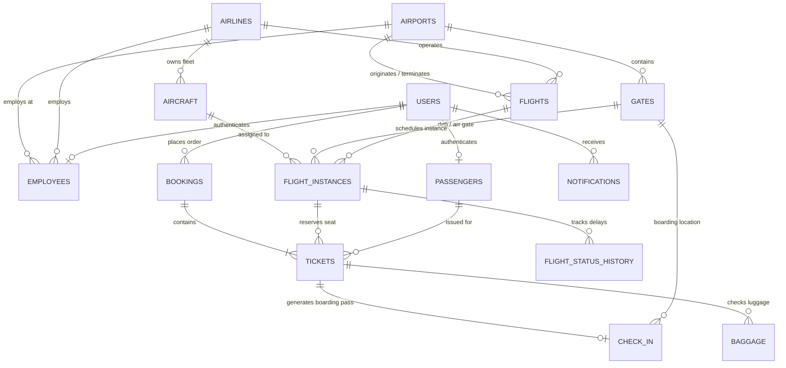

# Database Implementation & Technical Guide

> **Project Phase**: Phase 03 — Database Design & Oracle SQL Implementation  
> **Course / Degree**: BTech Capstone / Final Year Project  
> **Author**: Saravana  
> **Repository**: [https://github.com/Saravana65/Airport-Management-System](https://github.com/Saravana65/Airport-Management-System)  
> **Target Database Engine**: Oracle Database (12c / 19c / 21c / Express Edition XE)

---

## 1. Executive Summary

This document provides a comprehensive technical walkthrough of the custom Oracle SQL database implemented for the **Airport Management System**. 

Building upon the architectural critique of the legacy reference project, this database was constructed independently to satisfy the operational demands of modern airports, featuring **16 normalized relations**, **4 analytical views**, **8 stored procedures**, and **5 database triggers and sentinels**.

---

## 2. Implemented Schema Directory & Physical Scripts

All scripts reside in the [`database/`](../database) folder:

| Component | Physical Script Path | Objects Implemented |
| :--- | :--- | :--- |
| **Airports** | [`database/schema/01_airport_tables.sql`](../database/schema/01_airport_tables.sql) | Table: `AIRPORTS` (3-letter IATA PK) |
| **Airlines** | [`database/schema/02_airline_tables.sql`](../database/schema/02_airline_tables.sql) | Table: `AIRLINES` (IATA carrier code & accounting code) |
| **Gates** | [`database/schema/03_gate_tables.sql`](../database/schema/03_gate_tables.sql) | Table: `GATES` (Unique terminal gate locations) |
| **Aircraft** | [`database/schema/04_aircraft_tables.sql`](../database/schema/04_aircraft_tables.sql) | Table: `AIRCRAFT` (Tail registration & seat breakdown) |
| **Flights** | [`database/schema/05_flight_tables.sql`](../database/schema/05_flight_tables.sql) | Tables: `FLIGHTS` (Routes) & `FLIGHT_INSTANCES` (Daily runs) |
| **Users & Passengers** | [`database/schema/06_user_and_passenger_tables.sql`](../database/schema/06_user_and_passenger_tables.sql) | Tables: `USERS` (RBAC) & `PASSENGERS` (Passport verified) |
| **Employees** | [`database/schema/07_employee_tables.sql`](../database/schema/07_employee_tables.sql) | Table: `EMPLOYEES` (Staff rosters & shifts) |
| **Bookings & Tickets** | [`database/schema/08_booking_tables.sql`](../database/schema/08_booking_tables.sql) | Tables: `BOOKINGS` (PNR orders) & `TICKETS` (Seat assignments) |
| **Check-in & Baggage** | [`database/schema/09_baggage_and_checkin_tables.sql`](../database/schema/09_baggage_and_checkin_tables.sql) | Tables: `CHECK_IN` (Boarding pass) & `BAGGAGE` (Luggage tags) |
| **Audit & Operations** | [`database/schema/10_operational_tables.sql`](../database/schema/10_operational_tables.sql) | Tables: `FLIGHT_STATUS_HISTORY`, `NOTIFICATIONS`, `OPERATIONAL_LOGS` |
| **Stored Procedures** | [`database/procedures/flight_procedures.sql`](../database/procedures/flight_procedures.sql)<br>[`database/procedures/booking_procedures.sql`](../database/procedures/booking_procedures.sql) | `sp_register_flight_route`, `sp_schedule_flight_instance`, `sp_assign_gate`, `sp_update_flight_status`, `sp_book_ticket`, `sp_cancel_booking`, `sp_check_in_passenger`, `sp_record_baggage` |
| **Database Triggers** | [`database/triggers/flight_triggers.sql`](../database/triggers/flight_triggers.sql)<br>[`database/triggers/audit_triggers.sql`](../database/triggers/audit_triggers.sql) | `trg_flight_status_audit`, `trg_prevent_gate_conflict`, `trg_audit_ticket_cancellation`, `trg_audit_user_registration`, `trg_audit_aircraft_status` |
| **Analytical Views** | [`database/views/airport_views.sql`](../database/views/airport_views.sql) | `vw_flight_board`, `vw_passenger_manifest`, `vw_gate_utilization`, `vw_revenue_summary` |
| **Seed Data** | [`database/sample_data/insert_sample_data.sql`](../database/sample_data/insert_sample_data.sql) | Production-style test records across all modules |
| **Master Installer** | [`database/master_setup.sql`](../database/master_setup.sql) | Automated single-command deployment script |

---

## 3. Relational Architecture Diagram



---

## 4. Key Table Specifications & Normalization Rationale

### 4.1 Facilities & Fleet Domain
1. **`AIRPORTS`**: Keyed by `AIRPORT_CODE VARCHAR2(3)` (IATA code e.g. `'BOM'`, `'DFW'`). Eliminates 100-character string foreign keys found in older schemas. Includes IANA `TIMEZONE` string essential for international time math.
2. **`AIRLINES`**: Keyed by `AIRLINE_CODE VARCHAR2(3)`. Includes `THREE_DIGIT_CODE VARCHAR2(3) UNIQUE` for electronic ticket numbers (e.g. `'098'` for Air India, `'001'` for American Airlines).
3. **`GATES`**: Keyed by identity integer `GATE_ID`. Includes `CONSTRAINT uq_gate_location UNIQUE (AIRPORT_CODE, TERMINAL, GATE_NUMBER)`.
4. **`AIRCRAFT`**: Keyed by `AIRCRAFT_ID`. Features check constraint `TOTAL_SEATS = ECONOMY_SEATS + BUSINESS_SEATS + FIRST_SEATS` preventing capacity arithmetic errors.

### 4.2 Flight Schedule Domain
5. **`FLIGHTS`**: Static master route template (e.g., Flight `AI2014` from `BOM` to `DFW` departing at 02:10). Contains `BASE_FARE` and enforces `ORIGIN_AIRPORT != DEST_AIRPORT`.
6. **`FLIGHT_INSTANCES`**: Actual physical flight occurrences on specific dates. Contains exact `TIMESTAMP` columns for scheduled and actual departure/arrival. Enforces `CONSTRAINT uq_flight_date UNIQUE (FLIGHT_NUMBER, FLIGHT_DATE)`.

### 4.3 Users, Staff & Passenger Domain
7. **`USERS`**: Role-based authentication (`ROLE IN ('ADMIN', 'AIRLINE_STAFF', 'AIRPORT_STAFF', 'PASSENGER')`).
8. **`PASSENGERS`**: Stores demographic data identified by `PASSPORT_NUMBER UNIQUE`. Allows guest bookings by making `USER_ID` nullable.
9. **`EMPLOYEES`**: Maps staff to airports and optional airlines. Tracks shifts (`'DAY'`, `'NIGHT'`).

### 4.4 Reservation & Baggage Domain
10. **`BOOKINGS`**: Commercial order identified by unique 6-character PNR (`BOOKING_REFERENCE VARCHAR2(10) UNIQUE`).
11. **`TICKETS`**: Individual passenger seat. Features `CONSTRAINT uq_flight_seat UNIQUE (FLIGHT_INSTANCE_ID, SEAT_NUMBER)` preventing double-bookings.
12. **`CHECK_IN`**: Issues `BOARDING_PASS_CODE UNIQUE` and links departure gate.
13. **`BAGGAGE`**: Barcode luggage items (`TAG_NUMBER UNIQUE`) with weight constraints ($\le 60\text{ kg}$).

### 4.5 Autonomous Audit Domain
14. **`FLIGHT_STATUS_HISTORY`**: Chronological log of flight state changes.
15. **`NOTIFICATIONS`**: Targeted user alerts.
16. **`OPERATIONAL_LOGS`**: Engine table tracking conflict detections, auto-heals, and admin approval records.

---

## 5. PL/SQL Programmability Walkthrough

### 5.1 Stored Procedures
- **`sp_register_flight_route`**: Validates airport codes, checks base fares, and inserts new flight routes.
- **`sp_schedule_flight_instance`**: Validates timestamps and schedules a daily flight instance.
- **`sp_assign_gate`**: **Conflict Detection Logic**: Queries active flights at the target gate within a 30-minute buffer. If an overlap is detected, blocks the update, logs to `OPERATIONAL_LOGS`, and raises `-20008`.
- **`sp_update_flight_status`**: Mutates flight status (`DELAYED`, `BOARDING`, etc.), writes to `FLIGHT_STATUS_HISTORY`, and dispatches notification alerts to all passengers holding tickets on that flight.
- **`sp_book_ticket`**: **ACID Transaction**: Checks seat availability, generates random PNR and standard 13-digit e-ticket, records passenger, booking, and ticket in a single transaction with automatic rollback on error.
- **`sp_cancel_booking`**: Cancels PNR, sets tickets to `CANCELLED`, and nullifies `SEAT_NUMBER` so the seat becomes instantly available for other travelers.
- **`sp_check_in_passenger`**: Validates ticket status is `ISSUED`, calculates boarding time, generates boarding pass string, and marks ticket `CHECKED_IN`.
- **`sp_record_baggage`**: Generates unique bag barcode tag and verifies baggage allowance.

### 5.2 Database Triggers
- **`trg_flight_status_audit`**: `AFTER UPDATE OF STATUS ON FLIGHT_INSTANCES`: Autonomously logs all status transitions and flags delays in `OPERATIONAL_LOGS`.
- **`trg_prevent_gate_conflict`**: `BEFORE INSERT OR UPDATE ON FLIGHT_INSTANCES`: Database-native sentinel preventing overlapping flight assignments at the same gate.
- **`trg_audit_ticket_cancellation`**: Logs ticket cancellations into `OPERATIONAL_LOGS`.
- **`trg_audit_user_registration`**: Audits newly registered user accounts.
- **`trg_audit_aircraft_status`**: Audits aircraft maintenance transitions and flags when admin approval is required.

---

## 6. Testing & Verification Guide

### 6.1 Test Suite 1: Master Deployment
Execute in Oracle SQL Developer or SQL*Plus:
```sql
@master_setup.sql
```
**Expected Output**: All 16 tables, 4 views, 8 procedures, and 5 triggers compile without error (`PL/SQL procedure successfully completed`).

### 6.2 Test Suite 2: Transaction-Safe Ticket Booking
```sql
SET SERVEROUTPUT ON;
DECLARE
    v_pnr VARCHAR2(10);
    v_ticket VARCHAR2(20);
BEGIN
    sp_book_ticket(
        p_user_id => 5,
        p_flight_instance_id => 1,
        p_first_name => 'TEST',
        p_last_name => 'TRAVELER',
        p_passport_number => 'T99887766',
        p_seat_number => '18C',
        p_cabin_class => 'ECONOMY',
        p_price => 75000.00,
        o_booking_ref => v_pnr,
        o_ticket_number => v_ticket
    );
END;
/
```
**Expected Result**: PNR generated, ticket issued, and seat `18C` successfully locked.

### 6.3 Test Suite 3: Duplicate Seat Prevention
Attempt booking the exact same seat (`18C` on Instance `1`):
```sql
DECLARE
    v_pnr VARCHAR2(10);
    v_ticket VARCHAR2(20);
BEGIN
    sp_book_ticket(
        p_user_id => 6,
        p_flight_instance_id => 1,
        p_first_name => 'ANOTHER',
        p_last_name => 'PASSENGER',
        p_passport_number => 'X11223344',
        p_seat_number => '18C',
        p_cabin_class => 'ECONOMY',
        p_price => 75000.00,
        o_booking_ref => v_pnr,
        o_ticket_number => v_ticket
    );
END;
/
```
**Expected Result**: Raises `ORA-20021: Seat 18C is already booked on this flight.` Automatically logs attempt in `OPERATIONAL_LOGS`.

### 6.4 Test Suite 4: Gate Conflict Sentinel Prevention
Attempt assigning a gate that is already occupied during the same time window:
```sql
BEGIN
    sp_assign_gate(p_flight_instance_id => 2, p_gate_id => 1);
END;
/
```
**Expected Result**: The trigger or procedure detects an active flight within the 30-minute safety buffer, blocks the transaction, and logs a conflict warning in `OPERATIONAL_LOGS`.

---

## 7. Known Limitations & Future Enhancements

1. **Multi-Leg Itineraries**: The current schema links each ticket to a single `FLIGHT_INSTANCE_ID`. For connecting journeys (e.g., `BOM` $\rightarrow$ `DEL` $\rightarrow$ `JFK`), a passenger receives multiple tickets grouped under the same `BOOKING_ID` (PNR). A future enhancement can add a `FLIGHT_SEGMENTS` table.
2. **Terminal Maps**: Gate coordinates are stored logically (`TERMINAL`, `GATE_NUMBER`). In Phase 05 (Frontend), coordinate attributes $(X, Y)$ will be added for 2D canvas visualization.
3. **Database Environment**: Since our current local CLI environment lacks an active Oracle Database binary, scripts should be tested in **Oracle SQL Developer**, **SQL*Plus**, or **Oracle Cloud Live SQL** using the provided instructions.
