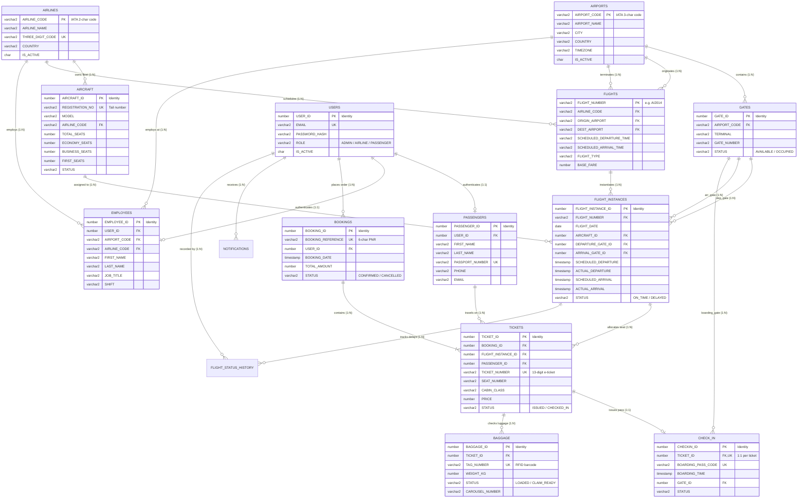

# Entity-Relationship (ER) Diagram: Airport Management System

**Project**: Airport Management System  
**Evaluation**: College DBMS Project Review & Faculty Viva Defense  
**Auditor**: Senior Oracle DBA & DBMS Faculty Mentor  
**Dialect**: Mermaid GFM (GitHub Flavored Markdown) ER Syntax  

---

## 1. Visual Entity-Relationship Diagram

---

## 2. Cardinality & Relationship Breakdown

| Parent Table | Relationship | Child Table | Foreign Key Column | On Delete Action | Business Semantics |
| :--- | :---: | :--- | :--- | :---: | :--- |
| `AIRPORTS` | **1 : N** | `GATES` | `GATES.AIRPORT_CODE` | `CASCADE` | One airport contains many terminal gates. |
| `AIRPORTS` | **1 : N** | `FLIGHTS` | `FLIGHTS.ORIGIN_AIRPORT` | `CASCADE` | Airport originates scheduled flight routes. |
| `AIRPORTS` | **1 : N** | `FLIGHTS` | `FLIGHTS.DEST_AIRPORT` | `CASCADE` | Airport terminates scheduled flight routes. |
| `AIRPORTS` | **1 : N** | `EMPLOYEES` | `EMPLOYEES.AIRPORT_CODE` | `CASCADE` | Airport stations operational personnel. |
| `AIRLINES` | **1 : N** | `AIRCRAFT` | `AIRCRAFT.AIRLINE_CODE` | `CASCADE` | Commercial carrier owns fleet aircraft. |
| `AIRLINES` | **1 : N** | `FLIGHTS` | `FLIGHTS.AIRLINE_CODE` | `CASCADE` | Airline operates flight timetable routes. |
| `FLIGHTS` | **1 : N** | `FLIGHT_INSTANCES` | `FLIGHT_INSTANCES.FLIGHT_NUMBER` | `CASCADE` | Route template instantiates daily occurrences. |
| `AIRCRAFT` | **1 : N** | `FLIGHT_INSTANCES` | `FLIGHT_INSTANCES.AIRCRAFT_ID` | `SET NULL` | Aircraft assigned to specific physical flight. |
| `GATES` | **1 : N** | `FLIGHT_INSTANCES` | `FLIGHT_INSTANCES.DEPARTURE_GATE_ID` | `SET NULL` | Gate docks aircraft for departure boarding. |
| `USERS` | **1 : 1** | `PASSENGERS` | `PASSENGERS.USER_ID` | `SET NULL` | Login account linked to traveler profile. |
| `USERS` | **1 : 1** | `EMPLOYEES` | `EMPLOYEES.USER_ID` | `CASCADE` | Login account linked to staff profile. |
| `USERS` | **1 : N** | `BOOKINGS` | `BOOKINGS.USER_ID` | `CASCADE` | User places one or more flight reservations. |
| `BOOKINGS` | **1 : N** | `TICKETS` | `TICKETS.BOOKING_ID` | `CASCADE` | A booking order contains 1 or more seats/tickets. |
| `FLIGHT_INSTANCES` | **1 : N** | `TICKETS` | `TICKETS.FLIGHT_INSTANCE_ID` | `CASCADE` | Daily flight allocates seats to issued tickets. |
| `PASSENGERS` | **1 : N** | `TICKETS` | `TICKETS.PASSENGER_ID` | `CASCADE` | Ticket is issued in traveler's passport name. |
| `TICKETS` | **1 : 1** | `CHECK_IN` | `CHECK_IN.TICKET_ID` | `CASCADE` | One ticket generates at most one boarding pass. |
| `TICKETS` | **1 : N** | `BAGGAGE` | `BAGGAGE.TICKET_ID` | `CASCADE` | Ticket passenger checks in 0, 1, or more bags. |

---

## 3. Academic Defense: Resolving Many-to-Many (M:N) Relationships

In your viva evaluation, faculty members often ask:
> *"Where are your Many-to-Many relationships, and how did you resolve them into physical tables?"*

1. **Airlines and Airports (M:N)**:
   - An airline flies to many airports; an airport serves many airlines.
   - **Resolution**: Resolved via the associative entity `FLIGHTS` (with foreign keys `AIRLINE_CODE`, `ORIGIN_AIRPORT`, and `DEST_AIRPORT`).
2. **Passengers and Flight Instances (M:N)**:
   - A passenger travels on many flights over time; a flight instance carries hundreds of passengers.
   - **Resolution**: Resolved via the bridge relation `TICKETS` (with foreign keys `PASSENGER_ID` and `FLIGHT_INSTANCE_ID`), enriched with transaction attributes like `SEAT_NUMBER`, `CABIN_CLASS`, and `PRICE`.
3. **Employees and Passengers (M:N)**:
   - Staff members service many passengers; passengers interact with various staff (gate agents, check-in desks).
   - **Resolution**: Tracked via `CHECK_IN.GATE_ID` and `EMPLOYEES.AIRPORT_CODE`.
