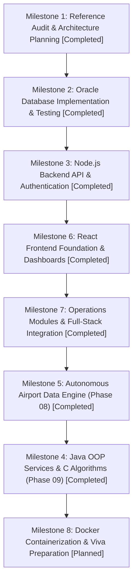

# Development Roadmap: Airport Management System

> **Student Project Roadmap**: Pragmatic, Step-by-Step Implementation Plan  
> **Author**: Saravana (BTech Capstone Project)  
> **Guiding Principle**: Build incrementally. Test thoroughly before moving to the next milestone. Never claim functionality works without verifying it.

---

## 1. Roadmap Overview & Timeline

This roadmap organizes the development into **7 sequential, manageable milestones**. Each milestone has clear inputs, deliverables, testing checkpoints, and viva presentation talking points.

---

## 2. Milestone Breakdown

### Milestone 1: Reference Audit & System Planning
- **Status**: 🟢 **Completed**
- **Deliverables**:
  - [`docs/EXISTING_PROJECT_ANALYSIS.md`](EXISTING_PROJECT_ANALYSIS.md) — Rigorous audit of reference SQL schema, identifying critical flaws (one-flight passenger bug, text timestamps).
  - [`docs/OUR_DATABASE_DESIGN.md`](OUR_DATABASE_DESIGN.md) — Complete 16-table redesigned schema with 3NF normalization.
  - [`docs/APPLICATION_MODULES.md`](APPLICATION_MODULES.md) — 4-portal functional specification (Admin, Airline Staff, Passenger, Ops).
  - [`docs/AUTONOMOUS_DATABASE_PLAN.md`](AUTONOMOUS_DATABASE_PLAN.md) — Specification of the 10 self-driving database features.
  - [`docs/TECHNOLOGY_USAGE.md`](TECHNOLOGY_USAGE.md) — Dedicated roles for React, Node, Oracle, Java, C, and proposed folder structure.
- **Viva Defense Point**: *"We audited existing open-source work, identified 8 critical structural limitations, and re-engineered our own production-grade architecture."*

---

### Milestone 2: Oracle Database Implementation & Validation
- **Status**: 🟢 **Completed (Phase 03)**
- **Deliverables**:
  - `database/schema/*.sql` — 14 modular schema scripts with 16 tables, constraints, sequences, and triggers.
  - `docs/DATABASE_IMPLEMENTATION.md` — Verified database design documentation.
- **Viva Defense Point**: *"We authored 14 Oracle SQL scripts implementing 3NF normalization, foreign key cascading constraints, and audit triggers."*

---

### Milestone 3: Node.js Backend API & Authentication
- **Status**: 🟢 **Completed (Phase 04 Foundation & Phase 05 Auth/RBAC)**
- **Deliverables**:
  - `backend/` — Express.js architecture with connection pooling, JWT tokens, bcrypt password hashing, and cookie-parser.
  - Role-Based Access Control (RBAC) middleware supporting `ADMIN`, `AIRLINE_STAFF`, `AIRPORT_STAFF`, and `PASSENGER`.
  - 19 automated tests passing (health + auth integration).
- **Viva Defense Point**: *"We implemented secure HttpOnly cookie session management and RBAC authorization without storing tokens in browser localStorage."*

---

### Milestone 4: Java OOP Services & C Data Structures Integration (Phase 09)
- **Status**: 🟢 **Completed (Phase 09)**
- **Deliverables**:
  - `c-engine/` — ANSI C (C99) high-performance algorithm suite:
    1. **Greedy Bipartite Gate Allocation** ($O(F \cdot G)$) with wingspan compatibility & 30-min turnaround buffer.
    2. **Binary Min-Heap Flight Priority Queue** ($O(\log N)$) with emergency medical pre-emption & delay score boosting.
    3. **Dijkstra Baggage Conveyor Routing** ($O(V^2)$) on directed graph with disconnected checkpoint safety.
    - CLI JSON harness (`c-engine.exe`) & standalone test runner (`test_algorithms.exe`) passing 17/17 tests.
  - `java-service/` — Java 17 LTS Object-Oriented Domain Microservice on embedded HTTP port 5050:
    1. **Encapsulation & Validation**: `Passenger.java` & `Flight.java` with thread-safe synchronized seat reservations.
    2. **Abstraction & Inheritance**: `Booking.java` abstract base with `CommercialBooking` & `VipBooking` ($120 concierge fee).
    3. **Polymorphic Strategy Pattern**: `PricingStrategy` interface implemented by `StandardPricingStrategy` and `SurgePricingStrategy`.
    4. **Deterministic State Machine**: `BookingLifecycleManager` (`PENDING` $\to$ `CONFIRMED` $\to$ `CHECKED_IN` $\to$ `BOARDED`).
    5. **Custom Exceptions & Concurrency**: `AirportException` hierarchy and thread-safe `ConcurrentHashMap` repository.
    - Standalone OOP test suite (`BookingWorkflowTest.java`) passing 24/24 tests.
  - `backend/` Integration Layer:
    - `cEngine.service.js` with `child_process.execFile` execution, 5s timeouts, and zero-crash JavaScript fallback.
    - `javaClient.service.js` with port 5050 REST client, 2s timeouts, and zero-crash simulation fallback.
    - REST router `/api/integration/*` with RBAC authorization guards and 12/12 automated integration tests passing.
  - `frontend/` Real-time Avionics Lab:
    - `AlgorithmsDashboard.jsx` featuring interactive gate allocator, runway Min-Heap visualizer, Dijkstra route flow, and live Java dynamic fare calculator.
    - Full Vite production build & 9/9 frontend verification tests passing.
- **Viva Defense Point**: *"We engineered a production-grade polyglot microservice architecture delegating latency-critical dispatch to compiled C99 algorithms, transactional state to Java 17 OOP models, and API orchestration to Node.js Express, guaranteed by zero-crash fallback resilience."*

---

### Milestone 5: Autonomous Airport Data Engine (Phase 08)
- **Status**: 🟢 **Completed (Phase 08)**
- **Deliverables**:
  - `database/schema/11_aade_tables.sql` — 5 new relational tables (`AADE_EVENTS`, `AADE_ALERTS`, `AADE_RECOMMENDATIONS`, `AADE_APPROVAL_REQUESTS`, `AADE_AUDIT_LOGS`).
  - 10 Modular Core Components in `backend/src/services/aade/`:
    1. Database Health Monitor
    2. Data Integrity Monitor
    3. Duplicate Booking & Seat Collision Detector
    4. Flight & Gate Conflict Detector
    5. Resource Utilization Analyzer
    6. Event & Alert Manager (with MD5 hash deduplication)
    7. Rule-Based Recommendation Engine
    8. Approval-Based Action Manager (Human-in-the-Loop)
    9. Audit History Manager (Before/After state diffs)
    10. Central Autonomous Engine Service (Scheduler & on-demand triggers)
  - Dedicated React Station: `frontend/src/pages/AadeDashboard/` with real live telemetry, active alerts, conflict cards, recommendation approval queue, and audit history.
  - 16 automated backend tests passing (`tests/aade.test.js`).
- **Viva Defense Point**: *"We built an active autonomous intelligence layer that monitors invariants, detects gate overlaps and seat collisions, formulates explainable recommendations, and enforces human-in-the-loop approval before applying changes."*

---

### Milestone 6: React Frontend Foundation & Dashboards
- **Status**: 🟢 **Completed (Phase 06)**
- **Deliverables**:
  - `frontend/` — Built with Vite + React 18 + Pure Modular CSS with Aviation Design Tokens.
  - Shared Avionics Components: Collapsible Sidebar, Header with UTC clock & backend health indicator, StatusBadge, StatCard, and PendingFeatureCard.
  - 4 Dedicated Station Portals:
    - **Admin Command & Control Center** (`/admin/dashboard`)
    - **Airline Operations & Dispatch Desk** (`/airline/dashboard`)
    - **Airport Terminal & Ground Operations** (`/airport/dashboard`)
    - **Passenger Flight & Travel Portal** (`/passenger/dashboard`)
  - Real backend authentication integration (`POST /api/auth/login`, `POST /api/auth/logout`, `GET /api/auth/me`).
  - Cryptographic session management using secure HttpOnly cookies (no tokens in `localStorage`).
  - Route guards (`<ProtectedRoute>`) and 403 Forbidden handler (`/unauthorized`).
- **Testing Checkpoint**: 7/7 automated verification tests passing; Vite production build generated without errors.

---

### Milestone 7: Operations Modules & Full-Stack Integration
- **Status**: 🟢 **Completed (Phase 07)**
- **Deliverables**:
  - 8 Connected Operational Modules bridging React frontend, Express API, and Oracle SQL:
    1. Airport, Airline & Aircraft Management
    2. Flight Schedule & Dispatch Status Management
    3. Passenger Profile & Data Privacy Masking
    4. Transaction-Safe Booking & 6-character PNR Engine
    5. Web Check-in & Digital Boarding Pass Generation (`BP-...`)
    6. Baggage Conveyance & Barcode Tag Tracking (`BAG-...`)
    7. Terminal Gate Scheduling & Conflict Prevention
    8. Employee & Workforce Operations Management
  - Full-stack interactive consoles across all 4 dashboards (`AdminDashboard`, `AirlineDashboard`, `AirportDashboard`, `PassengerDashboard`).
  - 50 passing automated tests across 4 suites (Health, Auth/RBAC, Phase 07 Operations, Frontend Verification).
  - Production build verified with Vite (exit code 0).
- **Viva Defense Point**: *"We integrated real operational workflows with duplicate seat locking, gate conflict detection, passport privacy masking, and digital boarding pass generation."*

---

### Milestone 8: Docker Containerization & Viva Preparation
- **Status**: ⚪ **Planned**
- **Action Items**:
  1. Author `Dockerfile` for frontend and backend.
  2. Write `docker-compose.yml` orchestrating React, Node.js, and Oracle XE database.
  3. Prepare Viva Defense Package:
     - Project presentation slide deck.
     - Comprehensive viva Q&A preparation guide covering normalization, PL/SQL, REST, C DSA, and Java OOP.
     - 5-minute live demonstration script.
- **Testing Checkpoint**: Single command `docker-compose up` launches the entire system cleanly on a clean machine.

---

## 3. Strict Student Development Rules

To ensure academic excellence, maintain code quality, and avoid confusion:
1. **Never skip testing**: Every API endpoint and database query must be manually or automatically verified before building UI on top of it.
2. **Keep code readable**: Write self-documenting code with meaningful variable and function names. Avoid clever, obscure one-liners.
3. **Keep credentials secret**: Never commit database passwords or JWT secrets to Git. Always use `.env` files.
4. **Preserve reference history**: Never overwrite or delete `AIRPORT_MANAGEMENT_SYSTEM(FINAL).sql`. It proves our engineering evolution during viva defense.
5. **Seek approval at every milestone**: Plan first, review, approve, then implement.
