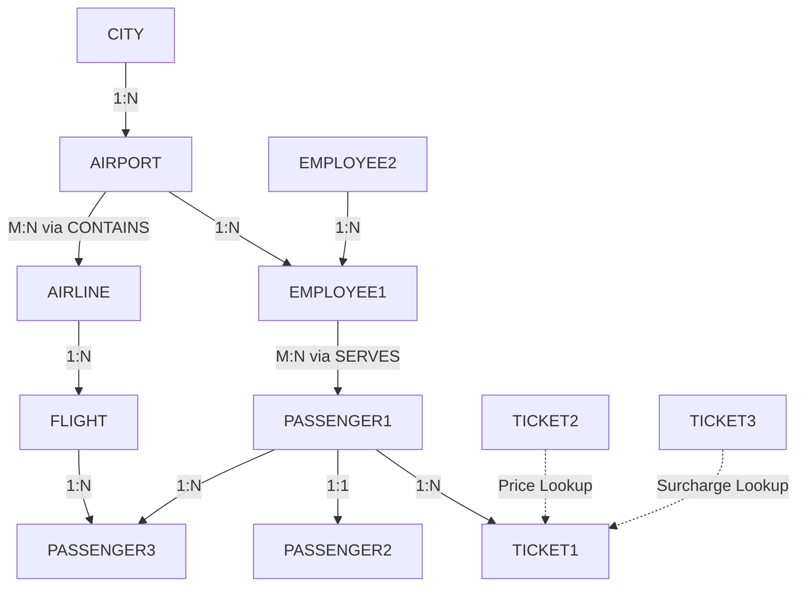

# Existing Project Analysis & Reference Evaluation

> **Target Audience**: BTech Project Evaluation, Faculty Presentation & Viva Defense  
> **Student Author**: Saravana  
> **Repository**: [https://github.com/Saravana65/Airport-Management-System](https://github.com/Saravana65/Airport-Management-System)

---

## 1. Project Background & Academic Integrity Statement

The initial SQL file in this repository (`AIRPORT_MANAGEMENT_SYSTEM(FINAL).sql`) was imported from a public academic project ([`patilankita79/Airport-Management-System-Database-Design`](https://github.com/patilankita79/Airport-Management-System-Database-Design)) to serve as **preliminary reference material**.

**Academic Integrity Clarification**:
- This database was **not independently authored** by our team.
- We do not claim ownership of the legacy SQL schema.
- We have performed a comprehensive architectural audit of this reference code to evaluate what concepts are valuable to learn from, what design flaws exist, and what must be redesigned to support a modern, full-stack Airport Management System.

---

## 2. Inventory of Existing Files

At the repository root and documentation directory, the following files exist:

| File Name | Category | Primary Purpose | Retain as Reference? |
| :--- | :--- | :--- | :--- |
| `AIRPORT_MANAGEMENT_SYSTEM(FINAL).sql` | SQL Script | Contains original DDL table definitions, sample seed data, two stored procedures, and three database triggers. | **Yes** — Keep as read-only historical reference. |
| `.gitignore` | Config | Prevents binary/media files (`.pdf`, `.png`, `.tiff`) from polluting the Git tree. | **Yes** — Active and required. |
| `README.md` | Documentation | Main repository documentation outlining the high-level system vision. | **Yes** — Main documentation entry point. |
| `docs/PROJECT_OVERVIEW.md` | Documentation | High-level operational domains and system vision. | **Yes** — Background context. |
| `docs/SYSTEM_ARCHITECTURE.md` | Documentation | Multi-tier architectural specifications and Mermaid diagrams. | **Yes** — Architectural blueprint. |
| `docs/DATABASE_DESIGN.md` | Documentation | Documentation of the reference Oracle schema objects. | **Yes** — Audit reference of the legacy schema. |
| `docs/DEVELOPMENT_ROADMAP.md` | Documentation | Phased engineering roadmap. | **Will be updated** for student project phases. |
| `docs/FEATURES.md` | Documentation | Reference capabilities matrix. | **Yes** — Feature comparison guide. |
| `docs/TECHNOLOGY_STACK.md` | Documentation | Explains how React, Node.js, Oracle, Java, and C fit into the project. | **Yes** — Tech stack guide. |

---

## 3. Analysis of Existing Database Tables

The reference file defines **16 tables** (14 relational tables + 2 audit tables):

### Table Breakdown:
1. **`CITY`**: Stores city name, state, and country (`CNAME` is Primary Key).
2. **`AIRPORT`**: Stores airport name, state, country, and references `CITY(CNAME)` via foreign key.
3. **`AIRLINE`**: Stores 2-character airline code (`AIRLINEID` PK), airline name, and 3-digit IATA code.
4. **`CONTAINS`**: Composite join table `(AIRLINEID, AP_NAME)` mapping which airlines operate at which airports.
5. **`FLIGHT`**: Contains flight number (`FLIGHT_CODE` PK), source, destination, arrival, departure, status, duration, stops, and airline ID.
6. **`PASSENGER1`**: Mapping table with composite key `(PID, PASSPORTNO)`.
7. **`PASSENGER2`**: Stores passenger demographics (name, address, phone, age, sex) keyed by `PASSPORTNO`.
8. **`PASSENGER3`**: Associates a passenger ID (`PID` PK) with a `FLIGHT_CODE`.
9. **`EMPLOYEE1`**: Staff records (SSN, name, contact, age, job type, sub-specialty, shift, assigned airport).
10. **`EMPLOYEE2`**: Lookup table mapping `JOBTYPE` to a fixed baseline `SALARY`.
11. **`SERVES`**: Composite table `(SSN, PID, PASSPORTNO)` linking which employee serves which passenger.
12. **`TICKET1`**: Individual ticket records (ticket number, route, travel dates, seat, class, cancellation date, passenger ID).
13. **`TICKET2`**: Fare pricing table keyed by `(DATE_OF_BOOKING, SOURCE, DESTINATION, CLASS)`.
14. **`TICKET3`**: Cancellation fee table keyed by `DATE_OF_CANCELLATION`.
15. **`DELAYED_FLIGHTS`**: Audit table populated by trigger when a flight is delayed.
16. **`TICKET_PRICE_HISTORY`**: Audit table populated by trigger when an airfare is updated in `TICKET2`.

---

## 4. Useful Database Concepts Demonstrated

For academic presentation and viva purposes, the reference file demonstrates several core relational concepts that are worth understanding and defending:

1. **Declarative Referential Integrity**:
   - Every foreign key uses `ON DELETE CASCADE`. If a parent airport or airline is deleted, child records are automatically purged, preventing orphan records.
2. **Multi-Table Normalization**:
   - The original schema decomposed the monolithic Passenger and Employee tables into separate relations to satisfy 2NF and 3NF conditions.
3. **PL/SQL Cursors in Stored Procedures**:
   - Demonstrated in `DFWECONOMYPASSENGERS` and `FLIGHTSBYSTATUS`: uses explicit cursor declaration, `%rowtype`, `LOOP`, `FETCH`, and `EXIT WHEN %NOTFOUND`.
4. **Row-Level Event Auditing via Triggers**:
   - Demonstrated in `TICKET_PRICE_HISTORY`: uses `:OLD` pseudo-records in a `BEFORE UPDATE` trigger to capture historical state before modification.

---

## 5. Critical Flaws & Unrealistic Design Choices in the Reference Schema

During our viva defense, our faculty will look for critical thinking. Here is an honest technical critique of why the reference database **cannot be used as-is** in our real application:

| Flaw # | Reference Schema Design | Why It Is Problematic in a Real System | Our Redesign Fix |
| :--- | :--- | :--- | :--- |
| **1. The One-Flight Passenger Bug** | In `PASSENGER3`, `PID` is the **Primary Key** (`PRIMARY KEY(PID)`). | If `PID` is the primary key, a passenger can **only ever book ONE flight in their entire life**! Any second booking causes an immediate `ORA-00001: unique constraint violated`. | We will create a dedicated `BOOKINGS` and `BOOKING_PASSENGERS` table where a passenger can have unlimited bookings. |
| **2. Natural String Primary Key on Airport** | `AIRPORT` uses `AP_NAME VARCHAR2(100)` as the primary key. | Foreign keys like `CONTAINS` and `EMPLOYEE1` have to duplicate a 100-character string (e.g., `'Dallas/Fort Worth International Airport'`). If an airport is renamed, all child tables break or require cascade updates. | Use the standard 3-letter IATA code (`AIRPORT_CODE VARCHAR2(3)`, e.g., `'DFW'`, `'JFK'`) as the primary key. |
| **3. Flight Timetables Stored as Plain Strings** | In `FLIGHT`, `ARRIVAL` and `DEPARTURE` are stored as `VARCHAR2(10)` (e.g., `'02:10'`, `'03:15'`). | You cannot perform date math, time calculations, calculate delay minutes, or format time zones on plain strings without brittle string manipulation. | Use Oracle `TIMESTAMP WITH TIME ZONE` or `DATE` data types. |
| **4. Lack of Flight Instance Concept** | `FLIGHT_CODE` is the primary key in `FLIGHT`. | A flight number like `AI2014` flies every day. If `FLIGHT_CODE` is the primary key, you can only store a single flight occurrence in the entire database. | Separate static flight schedules (e.g., `FLIGHTS`) from daily scheduled flight instances (`FLIGHT_SCHEDULES` or `FLIGHT_INSTANCES`). |
| **5. Artificial Surcharge Keying** | `TICKET3` uses `DATE_OF_CANCELLATION` as its Primary Key. | If two passengers cancel tickets on `'10-DEC-16'`, the second cancellation crashes with a duplicate key error! Cancellation fees should depend on fare class, hours before departure, or policy, not calendar date. | Move cancellation fees into fare rules or directly into the ticket record. |
| **6. Over-Normalized Salary Table** | `EMPLOYEE2` maps `JOBTYPE` directly to `SALARY`. | Every "Traffic Monitor" in the world would have the exact same salary (\$80,000) regardless of years of experience, shift, or airport location. | Move base salary and hourly rates directly to individual employee contracts. |
| **7. Broken Trigger Logic** | `DELAYEDFLIGHTS` is an `AFTER INSERT` trigger containing `if updating('STATUS')`. | `updating()` returns `TRUE` only during an `UPDATE` statement, never during an `INSERT`. This code will never execute as intended during inserts! | Rewrite trigger as `AFTER UPDATE OF STATUS ON FLIGHT_INSTANCES`. |
| **8. Disconnected Source & Destination** | `SOURCE` and `DESTINATION` in `FLIGHT` are plain strings without Foreign Keys. | Nothing stops an operator from inserting an invalid airport code like `'XYZ'` or `'FOO'`. | Add foreign keys referencing `AIRPORTS(AIRPORT_CODE)`. |

---

## 6. What Is Missing for a Complete Application?

The reference SQL file is purely an isolated database exercise. To build a functioning full-stack Airport Management System, the following domains are completely missing:

1. **User Authentication & Roles**: No `USERS`, `ROLES`, or password hash tables for Admin, Staff, and Passengers.
2. **Aircraft Fleet & Seating**: No `AIRCRAFT` table (Boeing 737, Airbus A320), seat maps, or seat row/column availability.
3. **Gate & Terminal Resources**: No `GATES`, `TERMINALS`, or runway assignment tables.
4. **Baggage Tracking**: No luggage tags, weight records, or carousel allocations.
5. **Passenger Check-in Lifecycle**: No check-in state (`BOOKED` $\rightarrow$ `CHECKED_IN` $\rightarrow$ `BOARDED` $\rightarrow$ `COMPLETED`).
6. **Application Backend & API**: No REST API endpoints to perform CRUD operations from a browser.
7. **Frontend User Interface**: No web dashboards for controllers, airline agents, or travelers.

---

## 7. Recommendation for Next Steps

1. **Keep [`AIRPORT_MANAGEMENT_SYSTEM(FINAL).sql`](../AIRPORT_MANAGEMENT_SYSTEM(FINAL).sql)** as a reference archive. It serves as valuable evidence of how we analyzed an existing project and improved upon it.
2. **Design our own database schema** in [`docs/OUR_DATABASE_DESIGN.md`](OUR_DATABASE_DESIGN.md) that fixes every flaw identified above and adds the missing operational modules.
3. **Review and approve the new design** before generating or executing any new SQL script.
