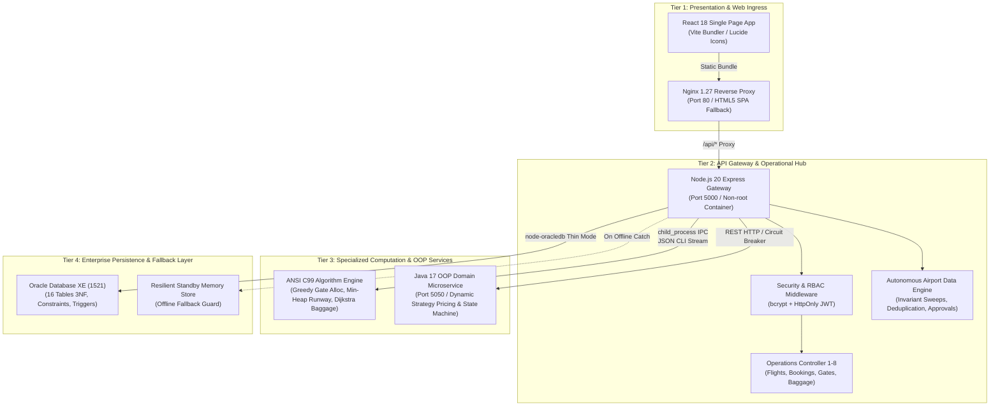

# Final System Architecture Specification

**Project:** Airport Management System (Autonomous Aviation Platform)  
**Phase:** Phase 11 — Final System Integration & Demonstration Readiness  
**Author:** Saravana (BTech Student Capstone Project)  
**Repository:** [https://github.com/Saravana65/Airport-Management-System](https://github.com/Saravana65/Airport-Management-System)  
**Version:** 1.0.0 (Production Candidate)

---

## 1. Architectural Overview

The Airport Management System is an enterprise-modeled, multi-language polyglot platform designed to integrate high-performance computation, strict object-oriented business domain modeling, an autonomous self-healing data engine, and an intuitive reactive user interface.

The system is architected across four distinct physical and logical tiers:



---

## 2. Multi-Language Component Responsibilities

| Language / Runtime | Architectural Component | Core Responsibility | Communication Protocol |
| :--- | :--- | :--- | :--- |
| **React 18 + Vite** | Frontend Presentation | Role-specific station consoles (Admin, Airline Staff, Airport Staff, Passenger), real-time algorithms visualizer, and AADE approval workbench. | HTTPS / REST via Fetch API |
| **Node.js 20 Express** | API Gateway & Orchestration | Security gateway, JWT session issuance, RBAC routing, scheduled AADE monitoring daemon, and polyglot coordinator. | HTTP JSON / Reverse Proxy |
| **ANSI C (C99)** | Algorithmic Core Engine | Sub-millisecond mathematical optimizations: Greedy interval gate allocation ($O(F\cdot G)$), binary min-heap runway landing priority queue ($O(\log N)$), and Dijkstra shortest conveyor path routing ($O(V^2)$). | IPC Subprocess (`execFile`) with JSON standard streams |
| **Java (JDK 17 LTS)** | OOP Domain Microservice | Enterprise business logic: Polymorphic dynamic pricing strategies, booking lifecycle state transitions (`PENDING` $\to$ `CONFIRMED` $\to$ `CHECKED_IN` $\to$ `BOARDED`), and thread-safe concurrent repository. | HTTP REST on Port 5050 |
| **Oracle SQL / PL/SQL** | Relational Database | 16 3NF normalized tables, composite unique constraints (`FLIGHT_INSTANCE_ID`, `SEAT_NUMBER`), foreign key referential cascades, sequences, and audit tables. | Oracle Net (TCP Port 1521) in Thin Mode |

---

## 3. Autonomous Airport Data Engine (AADE)

The AADE acts as an intelligent monitoring and governance layer that continuously sweeps database transactions to enforce aviation invariants without manual intervention:

```
[ Scheduled Daemon / Manual Trigger ]
                │
                ▼
      [ Database Health Sweep ]
                │
                ▼
  [ Relational Integrity Scan ] ───► Detects orphaned tickets & passenger records
                │
                ▼
  [ Seat Collision Scanner ]   ───► Identifies dual allocation of identical seat
                │
                ▼
  [ Gate Conflict Detector ]   ───► Flags overlapping ground schedules at same gate
                │
                ▼
 [ Resource Utilization Telemetry ]── Computes gate, runway, and fleet occupancy %
                │
                ▼
 [ Cryptographic Alert Deduplication ] (SHA-256 Hash Key prevents duplicate alert spam)
                │
                ▼
 [ Rule-Based Recommendation Engine ] ──► Formulates human-readable action proposal
                │
                ▼
 [ Human-in-the-Loop Operator Gate ]  ──► Authorized controller APPROVES or REJECTS
                │
                ▼
 [ Immutable Execution Audit Trail ]  ──► Logs before/after states, approver ID & timestamp
```

---

## 4. Containerization & Network Topology

In containerized environments (`docker-compose.yml`), services operate within an isolated bridge network (`airport-network`):

- **Nginx Ingress (`airport-frontend`):** Port 80 exposed to host. Serves SPA assets with gzip caching; routes `/api/*` to `backend:5000`.
- **Backend Gateway (`airport-backend`):** Port 5000 exposed to host. Runs under non-root `node` user with `dumb-init` signal handling.
- **Java Microservice (`airport-java-service`):** Port 5050 exposed. Runs under unprivileged `airport` system user.
- **Host Oracle XE Bridge:** Reached via `host.docker.internal:1521/XEPDB1` through Docker host gateway bridging.
