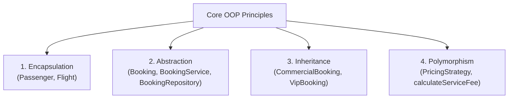

# Phase 09: Java Object-Oriented Programming (OOP) Concepts & Viva Guide

**Project:** Airport Management System  
**Audience:** BTech Faculty Examination, Viva Voce & Technical Evaluation  

This document explains every Object-Oriented Programming (OOP) principle implemented in the `java-service` module, providing exact code references and theoretical definitions to answer common viva questions.

---

## 1. The Four Pillars of OOP



### 1.1 Encapsulation (Data Hiding & Protection)
* **Definition:** Bundling state (fields) and behavior (methods) together while restricting direct access to private internal state to prevent unauthorized or illegal modifications.
* **Implementation:**
  - `Passenger.java`: All fields (`passengerId`, `firstName`, `lastName`, `email`, `passportNumber`) are declared `private final`. Constructor validates non-empty names. State is accessible only via public getters (`getFullName()`, `getEmail()`).
  - `Flight.java`: Seat availability (`bookedSeats`) is `private`. Outside callers cannot directly modify `bookedSeats`; they must invoke `reserveSeat()` or `releaseSeat()`, which perform boundary checks.
* **Viva Question:** *"Why not just make `bookedSeats` public in `Flight`?"*  
  **Answer:** Making it public allows any caller to assign negative seats or exceed `totalCapacity`, violating domain invariants. Encapsulation guarantees valid state at all times.

---

### 1.2 Abstraction (Hiding Complexity Behind Contracts)
* **Definition:** Exposing essential operational interfaces while hiding lower-level implementation details and mechanics.
* **Implementation:**
  - **Abstract Class:** `Booking.java` provides common state (`bookingReference`, `passenger`, `flight`, `ticket`, `status`) and abstract methods (`calculateServiceFee()`, `getBookingType()`). It cannot be instantiated directly.
  - **Interface:** `BookingService` and `BookingRepository` define pure abstract behavioral contracts. The controller/caller interacts only with `BookingService`, remaining unaware of whether data is stored in memory, Oracle SQL, or MongoDB.
* **Viva Question:** *"What is the difference between an Abstract Class and an Interface in your project?"*  
  **Answer:** `Booking` is an abstract class because all bookings share concrete identity fields, timestamps, and ticket associations. `BookingRepository` and `PricingStrategy` are interfaces because they specify pure behaviors without shared state.

---

### 1.3 Inheritance (Code Reusability & Specialization)
* **Definition:** Mechanism where a child class acquires properties and behaviors from a parent class, modeling an "is-a" relationship.
* **Implementation:**
  - `CommercialBooking extends Booking`: Specializes the booking for standard travelers, adding `frequentFlyerMember` status.
  - `VipBooking extends Booking`: Specializes the booking for diplomatic/executive travelers, adding `dedicatedLoungeId` and `fastTrackSecurityEnabled`.
* **Viva Question:** *"What does `super()` do in `VipBooking`?"*  
  **Answer:** It invokes the constructor of the parent abstract class `Booking` to initialize common state (`bookingId`, `bookingReference`, `passenger`, `flight`).

---

### 1.4 Polymorphism (Dynamic Method Dispatch & Strategy Pattern)
* **Definition:** Ability of an entity to take multiple forms. Allows a single method call to execute different behaviors at runtime based on the actual object type.
* **Implementation:**
  - **Subtype Polymorphism (Method Overriding):**
    Calling `booking.calculateServiceFee()` automatically dispatches to `CommercialBooking` ($15 or $25) or `VipBooking` ($120 lounge surcharge) based on runtime instantiation.
  - **Strategy Pattern Polymorphism:**
    `PricingStrategy` interface defines `calculatePrice()`.
    - `StandardPricingStrategy`: Computes `baseFare × cabinClassMultiplier`.
    - `SurgePricingStrategy`: Analyzes flight load factor (&gt;75%, &gt;90%) and departure countdown (&le;2 days) to dynamically calculate surge pricing.
* **Viva Question:** *"How does the system calculate dynamic prices without if-else spaghetti code?"*  
  **Answer:** Through the Strategy Pattern. We pass an instance of `PricingStrategy` (Standard or Surge) to calculate the fare polymorphically at runtime.

---

## 2. Design Patterns Implemented

### 2.1 State Pattern (Lifecycle Workflow)
* **File:** `com.airport.workflow.BookingLifecycleManager`
* **Lifecycle Flow:**
  $$\text{PENDING} \longrightarrow \text{CONFIRMED} \longrightarrow \text{CHECKED\_IN} \longrightarrow \text{BOARDED}$$
  $$\text{PENDING} \text{ or } \text{CONFIRMED} \longrightarrow \text{CANCELLED}$$
* **Rules & Invariants:**
  - Once a passenger has `BOARDED`, the booking cannot be cancelled (`InvalidCancellationException`).
  - Skipping stages (e.g. `PENDING` directly to `BOARDED`) throws `InvalidBookingStateException`.
  - When transitioning to `CANCELLED`, the system automatically invokes `flight.releaseSeat()` to restore aircraft seat inventory.

### 2.2 Strategy Pattern (Dynamic Pricing)
* **File:** `com.airport.service.PricingStrategy`
* Allows runtime switching between standard fixed rates and surge/demand-responsive pricing algorithms without altering caller code.

---

## 3. Custom Exception Hierarchy

All custom domain exceptions inherit from `AirportException (extends RuntimeException)`:

```
AirportException (base class with errorCode & message)
├── BookingNotFoundException ("BOOKING_NOT_FOUND")
├── InvalidBookingStateException ("INVALID_STATE_TRANSITION")
├── SeatUnavailableException ("SEAT_UNAVAILABLE")
└── InvalidCancellationException ("CANCELLATION_DISALLOWED")
```

**Why Unchecked Exceptions?**  
In modern Java and microservice architectures, domain rule violations are unchecked (`RuntimeException`), allowing clean error handling at the HTTP controller boundary (`BookingHttpHandler`) which translates them into structured JSON error responses with appropriate HTTP 400 status codes.

---

## 4. Collections and Concurrency

| Java Concept | Usage in Airport Management System |
| :--- | :--- |
| `ConcurrentHashMap<String, Booking>` | Thread-safe in-memory store in `InMemoryBookingRepository`. Prevents race conditions during simultaneous lookups and inserts. |
| `Collections.unmodifiableList()` | Encapsulates repository outputs (`findAll()`) to prevent callers from mutating internal storage directly. |
| `synchronized` methods | Protects seat booking (`reserveSeat()`, `releaseSeat()`) in `Flight.java` to prevent overbooking when multiple threads book concurrently. |
| `java.util.UUID` | Generates cryptographically collision-free booking IDs and ticket numbers (`TK-XXXXXX`). |
