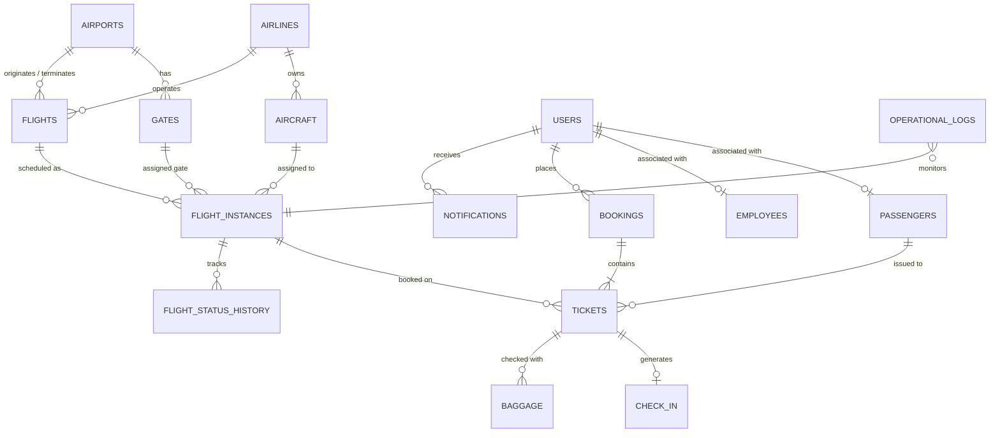

# Proposed Database Design: Airport Management System

> **Document Status**: Proposed / Pending Student & Faculty Approval  
> **Target RDBMS**: Oracle Database (12c / 19c / 21c / Express Edition XE)  
> **Student Author**: Saravana

---

## 1. Design Philosophy & Objectives

This schema is designed from the ground up for our application requirements, solving all structural flaws identified in the reference repository.

### Key Architectural Improvements:
1. **Real-World Keys**: Uses 3-letter IATA airport codes (`AIRPORT_CODE`, e.g., `'BOM'`, `'DFW'`) instead of 100-character string names.
2. **Schedules vs. Flight Instances**: Distinguishes between recurring flight routes (`FLIGHTS`) and daily scheduled flights (`FLIGHT_INSTANCES`).
3. **Realistic Ticketing Lifecycle**: A passenger can make unlimited bookings over time; each booking issues distinct tickets with seat assignments and check-in states.
4. **Temporal Accuracy**: Replaces plain text time strings with Oracle `TIMESTAMP` and `DATE` data types.
5. **Full Operational Coverage**: Adds core airport entities that were missing: Aircraft, Gates, Baggage, Check-in, Users/Roles, Flight History, Notifications, and Operational Logs.

---

## 2. Proposed Entity-Relationship Diagram

---

## 3. Complete Table Specifications

### 3.1 Facility & Fleet Tables

#### Table 1: `AIRPORTS`
- **Purpose**: Stores international and domestic airport facilities.
- **Columns**:
  - `AIRPORT_CODE` (`VARCHAR2(3)`, NOT NULL, PK) — 3-letter IATA code (e.g., `'JFK'`, `'BOM'`, `'SFO'`).
  - `AIRPORT_NAME` (`VARCHAR2(100)`, NOT NULL) — Official name of the airport.
  - `CITY` (`VARCHAR2(50)`, NOT NULL) — Metropolitan city served.
  - `COUNTRY` (`VARCHAR2(50)`, NOT NULL) — Country location.
  - `TIMEZONE` (`VARCHAR2(50)`, NOT NULL) — Standard timezone (e.g., `'Asia/Kolkata'`, `'America/New_York'`).
- **Relationships**: Parent to `GATES`, `FLIGHTS` (Origin and Destination).

#### Table 2: `AIRLINES`
- **Purpose**: Stores certified commercial air carriers.
- **Columns**:
  - `AIRLINE_CODE` (`VARCHAR2(3)`, NOT NULL, PK) — 2 or 3 letter IATA/ICAO code (e.g., `'AI'`, `'AA'`, `'BA'`).
  - `AIRLINE_NAME` (`VARCHAR2(100)`, NOT NULL) — Commercial airline brand.
  - `COUNTRY` (`VARCHAR2(50)`, NOT NULL) — Country of registration.
  - `CONTACT_EMAIL` (`VARCHAR2(100)`)
- **Relationships**: Parent to `AIRCRAFT`, `FLIGHTS`, `EMPLOYEES`.

#### Table 3: `GATES`
- **Purpose**: Physical boarding gates located inside airport terminals.
- **Columns**:
  - `GATE_ID` (`NUMBER GENERATED BY DEFAULT AS IDENTITY`, PK)
  - `AIRPORT_CODE` (`VARCHAR2(3)`, NOT NULL, FK) — References `AIRPORTS(AIRPORT_CODE)`.
  - `TERMINAL` (`VARCHAR2(10)`, NOT NULL) — Terminal identifier (e.g., `'T1'`, `'T2'`).
  - `GATE_NUMBER` (`VARCHAR2(10)`, NOT NULL) — Gate tag (e.g., `'G12'`, `'G24'`).
  - `STATUS` (`VARCHAR2(20)`, DEFAULT `'AVAILABLE'`) — Constraint: `'AVAILABLE'`, `'OCCUPIED'`, `'MAINTENANCE'`.
- **Relationships**: Assigned to `FLIGHT_INSTANCES`.

#### Table 4: `AIRCRAFT`
- **Purpose**: Individual aircraft in an airline's fleet.
- **Columns**:
  - `AIRCRAFT_ID` (`NUMBER GENERATED BY DEFAULT AS IDENTITY`, PK)
  - `REGISTRATION_NO` (`VARCHAR2(20)`, NOT NULL, UNIQUE) — Aircraft tail number (e.g., `'VT-ANX'`).
  - `MODEL` (`VARCHAR2(50)`, NOT NULL) — Aircraft type (e.g., `'Boeing 777-300ER'`, `'Airbus A320neo'`).
  - `AIRLINE_CODE` (`VARCHAR2(3)`, NOT NULL, FK) — References `AIRLINES(AIRLINE_CODE)`.
  - `TOTAL_SEATS` (`NUMBER`, NOT NULL)
  - `ECONOMY_SEATS` (`NUMBER`, NOT NULL)
  - `BUSINESS_SEATS` (`NUMBER`, NOT NULL)
  - `FIRST_SEATS` (`NUMBER`, NOT NULL)
- **Relationships**: Assigned to specific `FLIGHT_INSTANCES`.

---

### 3.2 Flight Scheduling Tables

#### Table 5: `FLIGHTS`
- **Purpose**: Master flight routes and static schedules (recurring timetable).
- **Columns**:
  - `FLIGHT_NUMBER` (`VARCHAR2(10)`, NOT NULL, PK) — Commercial route code (e.g., `'AI2014'`, `'AA4367'`).
  - `AIRLINE_CODE` (`VARCHAR2(3)`, NOT NULL, FK) — References `AIRLINES(AIRLINE_CODE)`.
  - `ORIGIN_AIRPORT` (`VARCHAR2(3)`, NOT NULL, FK) — References `AIRPORTS(AIRPORT_CODE)`.
  - `DEST_AIRPORT` (`VARCHAR2(3)`, NOT NULL, FK) — References `AIRPORTS(AIRPORT_CODE)`.
  - `SCHEDULED_DEPARTURE_TIME` (`VARCHAR2(5)`, NOT NULL) — Routine departure time (`'HH24:MI'`).
  - `SCHEDULED_ARRIVAL_TIME` (`VARCHAR2(5)`, NOT NULL) — Routine arrival time (`'HH24:MI'`).
  - `FLIGHT_TYPE` (`VARCHAR2(20)`) — `'DIRECT'`, `'NON-STOP'`, `'CONNECTING'`.
- **Relationships**: Parent to daily `FLIGHT_INSTANCES`.

#### Table 6: `FLIGHT_INSTANCES`
- **Purpose**: Actual scheduled flight on a specific calendar date with live operational status.
- **Columns**:
  - `FLIGHT_INSTANCE_ID` (`NUMBER GENERATED BY DEFAULT AS IDENTITY`, PK)
  - `FLIGHT_NUMBER` (`VARCHAR2(10)`, NOT NULL, FK) — References `FLIGHTS(FLIGHT_NUMBER)`.
  - `FLIGHT_DATE` (`DATE`, NOT NULL) — Date of operation.
  - `AIRCRAFT_ID` (`NUMBER`, FK) — References `AIRCRAFT(AIRCRAFT_ID)`.
  - `GATE_ID` (`NUMBER`, FK) — References `GATES(GATE_ID)`.
  - `ESTIMATED_DEPARTURE` (`TIMESTAMP`)
  - `ACTUAL_DEPARTURE` (`TIMESTAMP`)
  - `ESTIMATED_ARRIVAL` (`TIMESTAMP`)
  - `ACTUAL_ARRIVAL` (`TIMESTAMP`)
  - `STATUS` (`VARCHAR2(20)`, DEFAULT `'SCHEDULED'`) — Values: `'SCHEDULED'`, `'BOARDING'`, `'DEPARTED'`, `'ON_TIME'`, `'DELAYED'`, `'CANCELLED'`, `'ARRIVED'`.
- **Relationships**: Parent to `TICKETS`, `FLIGHT_STATUS_HISTORY`.

---

### 3.3 Users & Personnel Tables

#### Table 7: `USERS`
- **Purpose**: Centralized authentication table supporting all actors in the application.
- **Columns**:
  - `USER_ID` (`NUMBER GENERATED BY DEFAULT AS IDENTITY`, PK)
  - `EMAIL` (`VARCHAR2(100)`, NOT NULL, UNIQUE) — Login credential.
  - `PASSWORD_HASH` (`VARCHAR2(255)`, NOT NULL) — Secure hashed password.
  - `ROLE` (`VARCHAR2(20)`, NOT NULL) — Constraint: `'ADMIN'`, `'AIRLINE_STAFF'`, `'AIRPORT_STAFF'`, `'PASSENGER'`.
  - `IS_ACTIVE` (`CHAR(1)`, DEFAULT `'Y'`)
  - `CREATED_AT` (`TIMESTAMP`, DEFAULT `SYSTIMESTAMP`)
- **Relationships**: Parent to `PASSENGERS`, `EMPLOYEES`, `BOOKINGS`, `NOTIFICATIONS`.

#### Table 8: `PASSENGERS`
- **Purpose**: Demographic and passport details for travelers.
- **Columns**:
  - `PASSENGER_ID` (`NUMBER GENERATED BY DEFAULT AS IDENTITY`, PK)
  - `USER_ID` (`NUMBER`, FK, NULLABLE) — References `USERS(USER_ID)` (null for guest bookings).
  - `FIRST_NAME` (`VARCHAR2(50)`, NOT NULL)
  - `LAST_NAME` (`VARCHAR2(50)`, NOT NULL)
  - `PASSPORT_NUMBER` (`VARCHAR2(20)`, NOT NULL, UNIQUE)
  - `PHONE` (`VARCHAR2(20)`)
  - `EMAIL` (`VARCHAR2(100)`)
  - `DATE_OF_BIRTH` (`DATE`)
  - `GENDER` (`VARCHAR2(1)`)
- **Relationships**: Associated with `TICKETS`.

#### Table 9: `EMPLOYEES`
- **Purpose**: Operational airport and airline personnel.
- **Columns**:
  - `EMPLOYEE_ID` (`NUMBER GENERATED BY DEFAULT AS IDENTITY`, PK)
  - `USER_ID` (`NUMBER`, NOT NULL, FK) — References `USERS(USER_ID)`.
  - `AIRPORT_CODE` (`VARCHAR2(3)`, NOT NULL, FK) — References `AIRPORTS(AIRPORT_CODE)`.
  - `AIRLINE_CODE` (`VARCHAR2(3)`, FK, NULLABLE) — Nullable for general airport staff.
  - `FIRST_NAME` (`VARCHAR2(50)`, NOT NULL)
  - `LAST_NAME` (`VARCHAR2(50)`, NOT NULL)
  - `JOB_TITLE` (`VARCHAR2(50)`, NOT NULL) — E.g., `'OPERATIONS_CONTROLLER'`, `'GATE_AGENT'`, `'BAGGAGE_HANDLER'`.
  - `SHIFT` (`VARCHAR2(20)`) — `'DAY'`, `'NIGHT'`.
  - `CONTACT_PHONE` (`VARCHAR2(20)`)

---

### 3.4 Booking, Ticketing & Check-in Tables

#### Table 10: `BOOKINGS`
- **Purpose**: Commercial order placed by a customer containing one or more tickets.
- **Columns**:
  - `BOOKING_ID` (`NUMBER GENERATED BY DEFAULT AS IDENTITY`, PK)
  - `BOOKING_REFERENCE` (`VARCHAR2(10)`, NOT NULL, UNIQUE) — 6-character PNR code (e.g., `'PNR982'`).
  - `USER_ID` (`NUMBER`, NOT NULL, FK) — References `USERS(USER_ID)`.
  - `BOOKING_DATE` (`TIMESTAMP`, DEFAULT `SYSTIMESTAMP`)
  - `TOTAL_AMOUNT` (`NUMBER(10,2)`, NOT NULL)
  - `STATUS` (`VARCHAR2(20)`, DEFAULT `'CONFIRMED'`) — `'CONFIRMED'`, `'CANCELLED'`, `'REFUNDED'`.
- **Relationships**: Parent to `TICKETS`.

#### Table 11: `TICKETS`
- **Purpose**: Individual passenger seat issuance for a flight instance.
- **Columns**:
  - `TICKET_ID` (`NUMBER GENERATED BY DEFAULT AS IDENTITY`, PK)
  - `BOOKING_ID` (`NUMBER`, NOT NULL, FK) — References `BOOKINGS(BOOKING_ID)`.
  - `FLIGHT_INSTANCE_ID` (`NUMBER`, NOT NULL, FK) — References `FLIGHT_INSTANCES(FLIGHT_INSTANCE_ID)`.
  - `PASSENGER_ID` (`NUMBER`, NOT NULL, FK) — References `PASSENGERS(PASSENGER_ID)`.
  - `TICKET_NUMBER` (`VARCHAR2(20)`, NOT NULL, UNIQUE) — Standard 13-digit ticket number.
  - `SEAT_NUMBER` (`VARCHAR2(5)`) — E.g., `'14A'`, `'02C'`.
  - `CABIN_CLASS` (`VARCHAR2(20)`, NOT NULL) — `'ECONOMY'`, `'BUSINESS'`, `'FIRST'`.
  - `PRICE` (`NUMBER(10,2)`, NOT NULL)
  - `STATUS` (`VARCHAR2(20)`, DEFAULT `'ISSUED'`) — `'ISSUED'`, `'CHECKED_IN'`, `'BOARDED'`, `'CANCELLED'`.
- **Relationships**: Parent to `CHECK_IN`, `BAGGAGE`.

#### Table 12: `CHECK_IN`
- **Purpose**: Records boarding pass generation and passenger airport check-in status.
- **Columns**:
  - `CHECK_IN_ID` (`NUMBER GENERATED BY DEFAULT AS IDENTITY`, PK)
  - `TICKET_ID` (`NUMBER`, NOT NULL, UNIQUE, FK) — References `TICKETS(TICKET_ID)`.
  - `CHECK_IN_TIME` (`TIMESTAMP`, DEFAULT `SYSTIMESTAMP`)
  - `BOARDING_PASS_CODE` (`VARCHAR2(50)`, NOT NULL, UNIQUE)
  - `BOARDING_TIME` (`TIMESTAMP`)
  - `GATE_ID` (`NUMBER`, FK) — References `GATES(GATE_ID)`.
  - `STATUS` (`VARCHAR2(20)`, DEFAULT `'COMPLETED'`) — `'COMPLETED'`, `'BOARDED'`.

#### Table 13: `BAGGAGE`
- **Purpose**: Tracks checked luggage for a passenger ticket.
- **Columns**:
  - `BAGGAGE_ID` (`NUMBER GENERATED BY DEFAULT AS IDENTITY`, PK)
  - `TICKET_ID` (`NUMBER`, NOT NULL, FK) — References `TICKETS(TICKET_ID)`.
  - `TAG_NUMBER` (`VARCHAR2(30)`, NOT NULL, UNIQUE) — Barcode string (e.g., `'BAG-83921029'`).
  - `WEIGHT_KG` (`NUMBER(5,2)`, NOT NULL)
  - `STATUS` (`VARCHAR2(30)`, DEFAULT `'CHECKED_IN'`) — `'CHECKED_IN'`, `'SECURITY_CLEARED'`, `'LOADED'`, `'TRANSIT'`, `'CLAIM_READY'`, `'COLLECTED'`.
  - `CAROUSEL_NUMBER` (`VARCHAR2(10)`) — Baggage belt number (e.g., `'BELT-04'`).

---

### 3.5 Operational History & Autonomous Engine Tables

#### Table 14: `FLIGHT_STATUS_HISTORY`
- **Purpose**: Audits all changes to flight times and delays.
- **Columns**:
  - `HISTORY_ID` (`NUMBER GENERATED BY DEFAULT AS IDENTITY`, PK)
  - `FLIGHT_INSTANCE_ID` (`NUMBER`, NOT NULL, FK) — References `FLIGHT_INSTANCES(FLIGHT_INSTANCE_ID)`.
  - `OLD_STATUS` (`VARCHAR2(20)`)
  - `NEW_STATUS` (`VARCHAR2(20)`, NOT NULL)
  - `REASON` (`VARCHAR2(255)`)
  - `CHANGED_AT` (`TIMESTAMP`, DEFAULT `SYSTIMESTAMP`)
  - `CHANGED_BY_USER_ID` (`NUMBER`, FK) — References `USERS(USER_ID)`.

#### Table 15: `NOTIFICATIONS`
- **Purpose**: User-facing alerts for flight delays, gate changes, and check-in reminders.
- **Columns**:
  - `NOTIFICATION_ID` (`NUMBER GENERATED BY DEFAULT AS IDENTITY`, PK)
  - `USER_ID` (`NUMBER`, NOT NULL, FK) — References `USERS(USER_ID)`.
  - `TITLE` (`VARCHAR2(100)`, NOT NULL)
  - `MESSAGE` (`VARCHAR2(500)`, NOT NULL)
  - `NOTIFICATION_TYPE` (`VARCHAR2(30)`) — `'FLIGHT_DELAY'`, `'GATE_CHANGE'`, `'BOARDING'`, `'SYSTEM'`.
  - `IS_READ` (`CHAR(1)`, DEFAULT `'N'`)
  - `CREATED_AT` (`TIMESTAMP`, DEFAULT `SYSTIMESTAMP`)

#### Table 16: `OPERATIONAL_LOGS` (Autonomous Engine)
- **Purpose**: Central log for the Autonomous Airport Data Engine.
- **Columns**:
  - `LOG_ID` (`NUMBER GENERATED BY DEFAULT AS IDENTITY`, PK)
  - `EVENT_CATEGORY` (`VARCHAR2(50)`, NOT NULL) — `'CONFLICT_DETECTED'`, `'DUPLICATE_BOOKING'`, `'HEALTH_CHECK'`, `'AUTO_HEAL'`.
  - `SEVERITY` (`VARCHAR2(20)`, NOT NULL) — `'INFO'`, `'WARNING'`, `'CRITICAL'`.
  - `DETAILS` (`VARCHAR2(1000)`, NOT NULL) — Technical description of the detected anomaly.
  - `ACTION_TAKEN` (`VARCHAR2(500)`) — Automated correction or proposed recommendation.
  - `REQUIRES_ADMIN_APPROVAL` (`CHAR(1)`, DEFAULT `'N'`)
  - `APPROVAL_STATUS` (`VARCHAR2(20)`, DEFAULT `'NOT_REQUIRED'`) — `'NOT_REQUIRED'`, `'PENDING'`, `'APPROVED'`, `'REJECTED'`.
  - `LOGGED_AT` (`TIMESTAMP`, DEFAULT `SYSTIMESTAMP`)

---

## 4. Normalization Verification

- **1NF**: Every column contains atomic values; no repeating groups.
- **2NF**: No partial key dependencies; all non-key attributes are fully dependent on the primary key.
- **3NF**: No transitive dependencies. For example:
  - Flight routes are in `FLIGHTS`; instances are in `FLIGHT_INSTANCES`.
  - Aircraft capacities are in `AIRCRAFT`; not repeated across ticket instances.
  - User credentials are in `USERS`; personal demographics are in `PASSENGERS`.

---

## 5. Next Steps

This document is submitted for your review. **We will not generate or execute the SQL DDL until you confirm your approval.**
