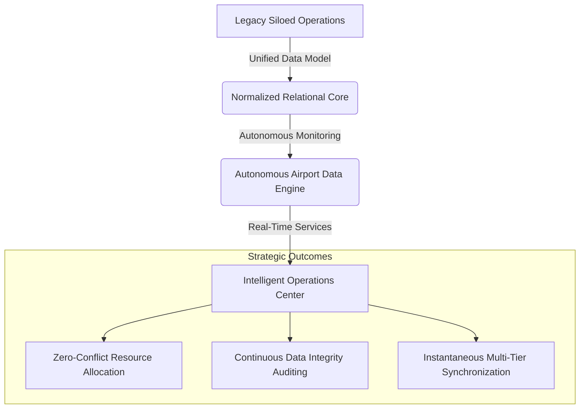
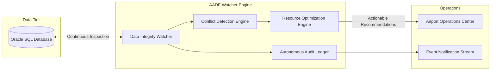

# Project Overview: Airport Management System

## Table of Contents
- [1. Executive Summary](#1-executive-summary)
- [2. Problem Statement & Industry Context](#2-problem-statement--industry-context)
- [3. Project Vision & Strategic Goals](#3-project-vision--strategic-goals)
- [4. Operational Domains & Stakeholder Ecosystem](#4-operational-domains--stakeholder-ecosystem)
- [5. The Role of Centralized Automation](#5-the-role-of-centralized-automation)
- [6. The Autonomous Airport Data Engine Concept](#6-the-autonomous-airport-data-engine-concept)
- [7. Implementation Status Disclaimer](#7-implementation-status-disclaimer)

---

## 1. Executive Summary

Modern commercial aviation infrastructure demands ultra-reliable, high-throughput data processing across interconnected domains: airline networks, airport terminals, flight control schedules, passenger ticketing pipelines, ground handling crews, and administrative operations. 

The **Airport Management System (AMS)** is designed as an end-to-end, multi-tier operational platform that unifies airport administration into a cohesive digital workflow. At its core, the system models relational flight schedules, decomposed passenger manifests, tiered ticketing structures, and multi-disciplinary employee assignments. 

The strategic differentiator of the platform is the **Autonomous Airport Data Engine**—an intelligent backend architectural layer proposed to automate operational conflict resolution, detect data integrity anomalies, prevent duplicate seat allocations, audit real-time flight disruptions, and recommend optimal resource dispatching.

---

## 2. Problem Statement & Industry Context

### 2.1 The Challenge of Operational Fragmentation
Airports operate under complex multi-party environments where airlines, ground handlers, security personnel, air traffic coordinators, and passenger service agents traditionally interact through disparate legacy software systems. This fragmentation leads to:

- **Data Silos**: Information regarding a flight delay or gate switch does not propagate instantaneously across ticketing desks, baggage handlers, and passenger notification portals.
- **Manual Conflict Detection**: Overbooking, runway congestion, and staff reassignment are frequently handled through manual coordination, introducing latency and human error.
- **Ticketing & Manifest Inconsistencies**: Without strict relational constraints and audit logs, fare revisions, cancellation penalties, and seat allocations can suffer from race conditions and synchronization drifts.
- **Audit Deficits**: Tracking historical price adjustments and operational delays across high-volume transaction environments requires proactive database-level triggers and event-driven logging.

### 2.2 Operational Objectives
The Airport Management System addresses these systemic issues by establishing:
1. **A Single Source of Truth**: Centralized, normalized relational schemas managing flights, passengers, staff, routes, and tickets.
2. **Deterministic Data Integrity**: Strict database-level referential integrity and cascading rules to eliminate orphan records.
3. **Automated Event Auditing**: Autonomous trigger mechanisms capturing delayed flights and fare price adjustments at the moment of modification.
4. **Decoupled Architecture**: High-performance separation of concerns separating transactional database storage, algorithmic optimization, API mediation, and administrative user interfaces.

---

## 3. Project Vision & Strategic Goals

The vision for the Airport Management System is to evolve from a normalized relational database design into a fully realized, cloud-native airport operations suite.

### Strategic Objectives
- **Zero-Conflict Flight & Resource Scheduling**: Implement graph-based and deterministic scheduling algorithms (via specialized C engine modules) to assign gates, runways, and baggage carousels without overlaps.
- **Self-Healing Data Engine**: Deploy an autonomous background watcher that continuously inspects active tables, flags orphan states, validates booking invariants, and alerts operators.
- **Real-Time Operational Visibility**: Deliver an administrative dashboard (React.js) connected to reactive backend services (Node.js/Express) providing live operational telemetry.
- **Scalable Enterprise Reliability**: Package services into modular Docker containers capable of deploying on-premises or across distributed cloud environments.

---

## 4. Operational Domains & Stakeholder Ecosystem

The system establishes operational boundaries across four primary operational domains:

| Domain | Scope & Responsibilities | Key Relational Entities |
| :--- | :--- | :--- |
| **Airfield & Flight Operations** | Flight code registration, source/destination routing, arrival and departure scheduling, flight type categorization (Direct, Non-stop, Connecting), and delay monitoring. | `FLIGHT`, `AIRPORT`, `AIRLINE`, `CONTAINS`, `CITY` |
| **Passenger & Manifest Operations** | Passenger identification, passport tracking, personal demographic data, and flight assignments. | `PASSENGER1`, `PASSENGER2`, `PASSENGER3` |
| **Ticketing & Revenue Management** | Ticket issuance, seat assignments, cabin classes (Economy, Business, First-Class), dynamic pricing tables, cancellation surcharges, and price modification auditing. | `TICKET1`, `TICKET2`, `TICKET3`, `TICKET_PRICE_HISTORY` |
| **Workforce & Terminal Operations** | Airport personnel records, job categorizations (Administrative Support, Engineer, Traffic Monitor, Airport Authority), shift schedules, airport associations, and passenger service allocations. | `EMPLOYEE1`, `EMPLOYEE2`, `SERVES` |

### Key Stakeholders
- **Airport Operations Center (AOC)**: Central controllers monitoring runway throughput, flight timeliness, gate assignments, and system-wide alerts.
- **Airlines & Gate Agents**: Service representatives booking passengers, modifying flight statuses, updating seat configurations, and managing cancellations.
- **Ground Crew & Technical Personnel**: Engineers and traffic monitors assigned to specific shifts, tracking airfield conditions and flight turnarounds.
- **Passengers**: End consumers booking tickets, selecting classes, and receiving timely flight status notifications.

---

## 5. The Role of Centralized Automation

Automation within airport systems is not merely a convenience—it is a critical safeguard against operational bottlenecks and catastrophic scheduling collisions. 

By centralizing business logic and utilizing database-native automation (PL/SQL triggers and stored procedures), the system ensures:
1. **Atomic Event Capture**: When a flight status changes to `'Delayed'`, an audit record is immediately committed to the `DELAYED_FLIGHTS` table without requiring intervention from an external application thread.
2. **Immutable Price History**: Every update to airfare in `TICKET2` automatically replicates the preceding fare state into `TICKET_PRICE_HISTORY`, providing complete financial traceability for revenue auditors.
3. **Dynamic Compensation Modeling**: Updates to employee salaries trigger rule-based adjustments based on defined operational classifications.

---

## 6. The Autonomous Airport Data Engine Concept

The flagship engineering concept of this architecture is the **Autonomous Airport Data Engine (AADE)**.

### Proposed Core Capabilities
- **Database Health & Invariant Verification**: Periodic inspection of table structures, index health, and foreign key cascades.
- **Duplicate Booking Prevention**: Algorithmic verification ensuring that no seat across any flight segment is allocated to multiple passengers simultaneously.
- **Gate & Runway Conflict Monitoring**: Automatic detection of overlapping arrival/departure slots at single airfield facilities.
- **Event-Driven Automation**: Trigger-based dispatching of maintenance tickets when an aircraft logs multiple delayed turnarounds.
- **Human-in-the-Loop Operational Approval**: Autonomous generation of corrective actions (e.g., flight rerouting or gate swap) that require operator confirmation prior to execution.

---

## 7. Implementation Status Disclaimer

To maintain technical accuracy, the project's current status is explicitly categorized:

- **Implemented**: The complete Oracle SQL database schema ([`AIRPORT_MANAGEMENT_SYSTEM(FINAL).sql`](../AIRPORT_MANAGEMENT_SYSTEM(FINAL).sql)), encompassing 16 relational and audit tables, sample production-style datasets, two stored procedures (`DFWECONOMYPASSENGERS`, `FLIGHTSBYSTATUS`), and three PL/SQL triggers (`DELAYEDFLIGHTS`, `UPDATEDSalary`, `TICKET_PRICE_HISTORY`).
- **Planned / Conceptualized**: The React.js frontend interface, the Node.js/Express.js REST API layer, the Java enterprise services, the C algorithmic optimization modules, the standalone Autonomous Airport Data Engine background daemon, and Docker orchestration containers.
