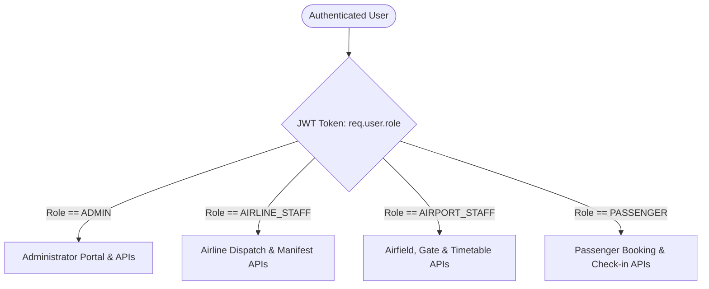

# Role-Based Access Control (RBAC) & Permissions Matrix

> **Project Phase**: Phase 05 — Authentication, Authorization & Role Management  
> **Course / Degree**: BTech Capstone Project  
> **Author**: Saravana  
> **Repository**: [https://github.com/Saravana65/Airport-Management-System](https://github.com/Saravana65/Airport-Management-System)

---

## 1. Overview of System Roles

The Airport Management System enforces a strict **Role-Based Access Control (RBAC)** architecture governed on the backend API tier. Every registered user possesses exactly one active role:



### The 4 User Roles:

1. **`ADMIN` (System & Airport Administrator)**:
   - Full authority over user accounts, employee rosters, and system configuration.
   - Access to administrative APIs, role assignments, and account activations/deactivations.
   - Monitors autonomous operational logs and approval queues.
2. **`AIRLINE_STAFF` (Airline Agent / Flight Dispatcher)**:
   - Manages flights operated by their assigned airline carrier.
   - Views passenger manifests and verifies tickets.
   - Conducts airport counter check-ins and logs luggage weight tags.
3. **`AIRPORT_STAFF` (Airport Operations Center / Ground Crew)**:
   - Monitors live master flight timetables and runway approaches.
   - Allocates boarding gates and manages terminal resources.
   - Logs operational delays and airfield safety events.
4. **`PASSENGER` (Traveler / Customer)**:
   - Searches commercial flight schedules and fare classes.
   - Books tickets, selects seats, and completes web check-ins.
   - Downloads digital boarding passes and tracks checked baggage.

---

## 2. Comprehensive Role-Permission Matrix

| Functional Capability | `ADMIN` | `AIRLINE_STAFF` | `AIRPORT_STAFF` | `PASSENGER` | Enforcing Middleware |
| :--- | :---: | :---: | :---: | :---: | :--- |
| **Register Account (Public)** | ❌ *(Admin created)* | ❌ *(Admin created)* | ❌ *(Admin created)* | 🟢 **Allowed** | `validateRegisterInput` |
| **Login & Obtain Session** | 🟢 **Allowed** | 🟢 **Allowed** | 🟢 **Allowed** | 🟢 **Allowed** | Public Route |
| **View Own Profile (`/api/auth/me`)** | 🟢 **Allowed** | 🟢 **Allowed** | 🟢 **Allowed** | 🟢 **Allowed** | `authenticateUser` |
| **Change Own Password** | 🟢 **Allowed** | 🟢 **Allowed** | 🟢 **Allowed** | 🟢 **Allowed** | `authenticateUser` |
| **View All Users (`/api/admin/users`)**| 🟢 **Allowed** | ❌ *Forbidden* | ❌ *Forbidden* | ❌ *Forbidden* | `authorizeRoles('ADMIN')` |
| **Change User Roles (`/role`)** | 🟢 **Allowed** | ❌ *Forbidden* | ❌ *Forbidden* | ❌ *Forbidden* | `authorizeRoles('ADMIN')` |
| **Deactivate Account (`/status`)** | 🟢 **Allowed** | ❌ *Forbidden* | ❌ *Forbidden* | ❌ *Forbidden* | `authorizeRoles('ADMIN')` |
| **Search Flights & View Timetables** | 🟢 **Allowed** | 🟢 **Allowed** | 🟢 **Allowed** | 🟢 **Allowed** | Public / Authenticated |
| **Book Flights & Reserve Seats** | 🟢 **Allowed** | 🟢 **Allowed** | ❌ *Forbidden* | 🟢 **Allowed** | `authorizeRoles('PASSENGER', 'ADMIN')` |
| **View Flight Passenger Manifest** | 🟢 **Allowed** | 🟢 **Allowed** | ❌ *Forbidden* | ❌ *Forbidden* | `authorizeRoles('AIRLINE_STAFF', 'ADMIN')` |
| **Assign / Swap Boarding Gates** | 🟢 **Allowed** | ❌ *Forbidden* | 🟢 **Allowed** | ❌ *Forbidden* | `authorizeRoles('AIRPORT_STAFF', 'ADMIN')` |
| **Intake Baggage & Weigh Luggage** | 🟢 **Allowed** | 🟢 **Allowed** | ❌ *Forbidden* | ❌ *Forbidden* | `authorizeRoles('AIRLINE_STAFF', 'ADMIN')` |
| **Review Autonomous Approval Queue** | 🟢 **Allowed** | ❌ *Forbidden* | ❌ *Forbidden* | ❌ *Forbidden* | `authorizeRoles('ADMIN')` |

---

## 3. Route Authorization Matrix

The table below maps existing and planned API endpoints to the required authorization level:

| HTTP Method | Route Endpoint | Required Role / Guard | Access Description |
| :--- | :--- | :--- | :--- |
| `GET` | `/api/health` | Public | System status and memory diagnostic. |
| `GET` | `/api/health/database` | Public | Oracle connection latency test. |
| `POST` | `/api/auth/register` | Public (Strict `PASSENGER`) | Creates self-service traveler accounts. |
| `POST` | `/api/auth/login` | Public | Authenticates credentials and returns JWT. |
| `POST` | `/api/auth/logout` | Public | Destroys authentication cookie. |
| `GET` | `/api/auth/me` | Any Authenticated Role | Retrieves authenticated user profile. |
| `PUT` | `/api/auth/change-password` | Any Authenticated Role | Updates user password with bcrypt hashing. |
| `GET` | `/api/admin/users` | `ADMIN` Only | Lists complete user directory. |
| `PUT` | `/api/admin/users/:id/role` | `ADMIN` Only | Promotes/demotes user operational roles. |
| `PUT` | `/api/admin/users/:id/status`| `ADMIN` Only | Enables (`Y`) or disables (`N`) user login. |

---

## 4. Middleware Implementation Mechanics

The authorization logic is implemented in [`backend/src/middleware/auth.middleware.js`](../backend/src/middleware/auth.middleware.js) using the higher-order function `authorizeRoles`:

```javascript
function authorizeRoles(...allowedRoles) {
    return (req, res, next) => {
        // 1. Verify user was successfully authenticated upstream
        if (!req.user || !req.user.role) {
            return errorResponse(res, 'Access denied. User role not identified.', 403);
        }

        // 2. Enforce role membership
        if (!allowedRoles.includes(req.user.role)) {
            return errorResponse(
                res,
                `Access forbidden. Role '${req.user.role}' is not authorized to access this resource.`,
                403,
                { requiredRoles: allowedRoles, currentRole: req.user.role }
            );
        }

        // 3. User is authorized; proceed to controller
        next();
    };
}
```

### Defense-in-Depth: Why Client-Side Route Hiding is NOT Security
> [!TIP]
> **Viva Defense Insight**: In web applications, simply hiding a button or sidebar menu in React (e.g., `{user.role === 'ADMIN' && <AdminLink />}`) provides **zero actual security**. Any user can open developer tools, inspect JavaScript bundles, or send direct HTTP requests using Postman.  
> In our project, **the backend Express API serves as the immutable source of truth**: every privileged route passes through `authorizeRoles()`. Even if an attacker creates their own HTTP request, the backend rejects it with `403 Forbidden` unless their cryptographic JWT proves `role === 'ADMIN'`.
