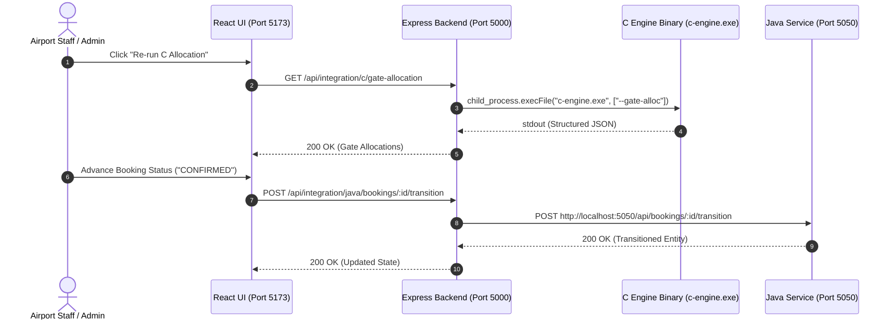

# Phase 09: Polyglot Service Integration Architecture

**Project:** Airport Management System  
**Modules:** Node.js Express Gateway, C Algorithm Engine, Java OOP Microservice  

---

## 1. System Communication Architecture

The Airport Management System employs a **Polyglot Micro-Architecture** that delegates tasks to the optimal programming language:
- **Node.js (Express):** Gateway orchestration, REST API routing, JWT authentication, and RBAC authorization.
- **ANSI C (C99):** High-throughput, deterministic algorithmic computation (Gate allocation, Min-heap runway priority, Dijkstra conveyor path).
- **Java 17 (OOP):** Domain modeling, state machine lifecycle management, dynamic pricing strategies, and concurrency controls.
- **React.js (Vite):** Visual dashboards, real-time simulation controls, and operational telemetry.



---

## 2. Process Isolation & Graceful Degradation (Zero-Crash Guarantee)

A core requirement of enterprise software is **Error Isolation**: the main application must never crash if an external service or binary fails or is offline.

### 2.1 C Engine Subprocess Safety (`cEngine.service.js`)
1. **Dynamic Path Resolution:** Resolves `c-engine.exe` across multiple possible relative and absolute paths.
2. **Timeout Enforcement:** Subprocess execution is wrapped in a strict **5,000ms timeout** via `child_process.execFile` to prevent hung CLI processes.
3. **Pure JavaScript Fallback Engine:** If the C binary is uncompiled, deleted, or in an incompatible OS environment, the service seamlessly switches to a JavaScript fallback that outputs the identical data schema.
4. **Metadata Indicator:** Outputs `executionMode: "NATIVE_C_BINARY"` or `"JAVASCRIPT_FALLBACK"` so operators and faculty can inspect execution provenance.

### 2.2 Java OOP Microservice Resilience (`javaClient.service.js`)
1. **Health Probing:** Checks `GET /health` on port 5050 with a **2,000ms timeout** (`AbortSignal.timeout(2000)`).
2. **Offline In-Memory Fallback:** If the Java microservice is not running (`ECONNREFUSED` or timeout), the Node.js layer services requests from an in-memory simulation repository conforming to the exact Java OOP state machine rules.
3. **Graceful Status Reporting:** Diagnostic badges in the UI clearly indicate `"PORT 5050 CONNECTED"` vs `"OFFLINE FALLBACK"` without throwing unhandled exceptions.

---

## 3. Network Port Allocations

| Component | Default Port | Protocol | Description |
| :--- | :--- | :--- | :--- |
| **Node.js Gateway** | `5000` | HTTP / REST | Main backend API, JWT auth, database pool |
| **Java OOP Microservice** | `5050` | HTTP / REST | Embedded Sun `HttpServer`, booking lifecycle, dynamic pricing |
| **React Frontend** | `5173` | HTTP | Vite development and preview server |
| **Oracle Database XE** | `1521` | Oracle TNS | Relational database (XEPDB1 service) |

---

## 4. Subprocess CLI Contract (C Engine)

The C binary communicates through standard Unix/Windows command line flags with output to `stdout`:

```cmd
c-engine.exe [--gate-alloc | --priority-queue | --baggage-route]
```

### JSON Schema Output Example (`--priority-queue`):
```json
{
  "dataStructure": "Binary Min-Heap Priority Queue",
  "complexity": { "insert": "O(log N)", "extractMin": "O(log N)", "peek": "O(1)" },
  "queueSize": 4,
  "sequencedTakeoffs": [
    {
      "sequenceRank": 1,
      "flightNumber": "MEDEVAC-1",
      "scheduledDepartureMinute": 600,
      "delayMinutes": 0,
      "isEmergency": true,
      "calculatedUrgencyScore": -9400
    }
  ]
}
```
