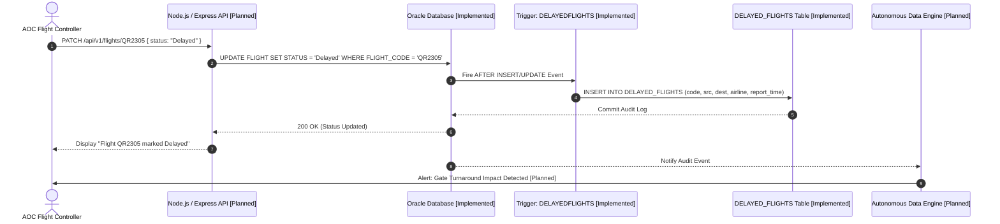
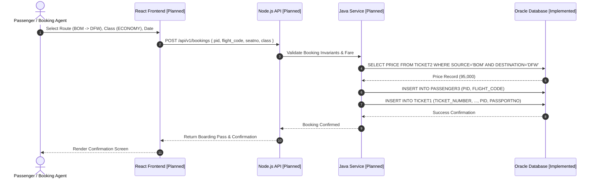
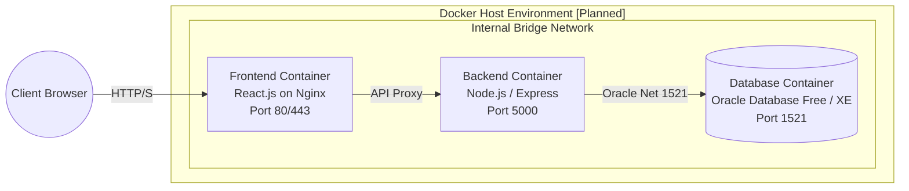

# System Architecture: Airport Management System

## Table of Contents
- [1. Architectural Overview](#1-architectural-overview)
- [2. Multi-Tier Architecture Diagram](#2-multi-tier-architecture-diagram)
- [3. Tier-by-Tier Specification](#3-tier-by-tier-specification)
  - [3.1 Presentation Tier (React.js) - [Planned]](#31-presentation-tier-reactjs---planned)
  - [3.2 Application & API Tier (Node.js & Express) - [Planned]](#32-application--api-tier-nodejs--express---planned)
  - [3.3 High-Performance Algorithm Engine (C Modules) - [Planned]](#33-high-performance-algorithm-engine-c-modules---planned)
  - [3.4 Enterprise Service Layer (Java OOP Modules) - [Planned]](#34-enterprise-service-layer-java-oop-modules---planned)
  - [3.5 Autonomous Airport Data Engine - [Planned / Foundational Triggers Implemented]](#35-autonomous-airport-data-engine---planned--foundational-triggers-implemented)
  - [3.6 Persistence & Data Tier (Oracle SQL) - [Implemented]](#36-persistence--data-tier-oracle-sql---implemented)
- [4. Operational Data Flows](#4-operational-data-flows)
  - [4.1 Flight Status Update & Autonomous Audit Workflow](#41-flight-status-update--autonomous-audit-workflow)
  - [4.2 Passenger Booking & Ticket Issuance Workflow](#42-passenger-booking--ticket-issuance-workflow)
- [5. Containerization & Deployment Architecture - [Planned]](#5-containerization--deployment-architecture---planned)
- [6. Component Implementation Matrix](#6-component-implementation-matrix)

---

## 1. Architectural Overview

The Airport Management System is architected around a modern, decoupled multi-tier topology designed for horizontal scalability, enterprise-grade data persistence, and real-time operational response. 

The architecture enforces strict separation of concerns:
- **Presentation**: Interactive, component-driven administrative and passenger portals.
- **API Orchestration**: Stateless, asynchronous HTTP/REST routing with connection pooling.
- **Algorithmic Computation**: Low-latency, deterministic native algorithms for combinatorial scheduling problems.
- **Enterprise Services**: Structured object-oriented domain models managing transactional lifecycles.
- **Autonomous Monitoring**: Background event listeners and database triggers continuously evaluating integrity constraints.
- **Relational Persistence**: ACID-compliant relational schemas with database-native triggers and stored procedures.

---

## 2. Multi-Tier Architecture Diagram

The diagram below maps the complete end-to-end architectural topology. Components are explicitly designated as **[Implemented]** or **[Planned]**.

```mermaid
graph TB
    subgraph ClientLayer ["1. Presentation Tier [Planned]"]
        ReactAdmin["Admin & Operations Dashboard\n(React.js / Vite)"]
        ReactPass["Passenger Self-Service Portal\n(React.js / Tailwind CSS)"]
    end

    subgraph ApiLayer ["2. Application & API Gateway Tier [Planned]"]
        ExpressRouter["API Gateway & Route Controllers\n(Node.js / Express.js)"]
        AuthMiddleware["JWT Authentication & RBAC"]
        ConnectionPool["Oracle Database Driver Connection Pool\n(oracledb)"]
    end

    subgraph ComputeLayer ["3. Specialized Computation Tiers [Planned]"]
        C_Engine["C Algorithm Engine\n- Graph-based Gate Allocation\n- Runway Queue Schedulers\n- Binary Heap / Priority Queues"]
        Java_OOP["Java Enterprise Services\n- Booking Transaction Validator\n- Concurrency Management\n- Batch Report Generators"]
    end

    subgraph AutonomousEngine ["4. Autonomous Airport Data Engine [Planned / Core Triggers Implemented]"]
        HealthWatcher["Database Invariant Watcher [Planned]"]
        ConflictEngine["Gate & Flight Conflict Detector [Planned]"]
        AuditDaemon["Real-time Transaction Auditing [Planned]"]
        TriggersNative["Oracle Native Audit Triggers [Implemented]\n- DELAYEDFLIGHTS\n- TICKET_PRICE_HISTORY\n- UPDATEDSalary"]
    end

    subgraph DataLayer ["5. Relational Persistence Tier (Oracle SQL) [Implemented]"]
        TablesCore["Core Relational Tables\nCITY, AIRPORT, AIRLINE, CONTAINS,\nFLIGHT, PASSENGER(1-3), EMPLOYEE(1-2), SERVES, TICKET(1-3)"]
        AuditTables["Audit & History Tables\nDELAYED_FLIGHTS, TICKET_PRICE_HISTORY"]
        StoredProcs["Stored Procedures\nDFWECONOMYPASSENGERS(), FLIGHTSBYSTATUS()"]
    end

    subgraph InfrastructureLayer ["6. Infrastructure & Deployment [Planned]"]
        DockerContainer["Docker Multi-Container Orchestration\n(App, API, DB Containers)"]
        GitOps["GitHub Version Control & CI/CD Pipeline\n(Saravana65/Airport-Management-System)"]
    end

    %% Client to API
    ReactAdmin -->|HTTPS / JSON REST| ExpressRouter
    ReactPass -->|HTTPS / JSON REST| ExpressRouter

    %% API to Compute & Data
    ExpressRouter --> AuthMiddleware
    AuthMiddleware --> ConnectionPool
    ExpressRouter <-->|N-API / Subprocess IPC| C_Engine
    ExpressRouter <-->|gRPC / REST IPC| Java_OOP

    %% Data Interactions
    ConnectionPool <-->|Oracle Net Protocol (OCI / Thin)| DataLayer
    AutonomousEngine <-->|Continuous Polling & Inspection| DataLayer
    TriggersNative -.->|Direct DML Execution| AuditTables
    StoredProcs -.->|Cursor Iteration| TablesCore

    %% Container Boundary
    DockerContainer -. encapsulates .-> ApiLayer
    DockerContainer -. encapsulates .-> ComputeLayer
    DockerContainer -. encapsulates .-> ClientLayer
```

---

## 3. Tier-by-Tier Specification

### 3.1 Presentation Tier (React.js) - [Planned]
- **Technology**: React 18+, TypeScript, Tailwind CSS, Vite.
- **Role**: Delivers interactive web dashboards for airport controllers, gate agents, and passengers.
- **Key Modules**:
  - *AOC Live Radar & Flight Board*: Real-time visualization of arriving and departing aircraft.
  - *Gate Allocation Matrix*: Visual grid displaying runway slots, terminal gates, and occupancy timelines.
  - *Passenger Check-in & Ticketing*: Seat selection canvas, fare calculation, and boarding pass generator.
  - *Autonomous Operations Alert Feed*: Push notifications warning operators of detected delays and capacity bottlenecks.

### 3.2 Application & API Tier (Node.js & Express) - [Planned]
- **Technology**: Node.js (LTS), Express.js framework.
- **Role**: Acts as the central RESTful API gateway, orchestrating incoming HTTP requests, validating request schemas, managing authentication tokens, and interacting with the database.
- **Key Components**:
  - *Route Controllers*: Modular endpoints (`/api/v1/flights`, `/api/v1/passengers`, `/api/v1/tickets`, `/api/v1/employees`).
  - *Database Adapter*: Connection pooling utilizing the official `node-oracledb` library for high-throughput transactional execution.
  - *Inter-Process Communication (IPC)*: Bridge communicating with native C algorithm binaries and Java background services.

### 3.3 High-Performance Algorithm Engine (C Modules) - [Planned]
- **Technology**: ANSI C (C99 / C11).
- **Role**: Dedicated to computationally intensive, low-latency graph and queue operations that require deterministic performance.
- **Key Responsibilities**:
  - *Runway & Gate Assignment Algorithms*: Graph coloring and bipartite matching algorithms optimizing gate allocations to minimize aircraft taxi times.
  - *Flight Priority Queues*: Min/Max heap implementations dynamically ordering aircraft approaches during peak congestion or adverse weather diversions.
  - *Baggage Routing DAG*: Directed Acyclic Graph (DAG) pathfinding calculating optimal automated baggage conveyor routes.

### 3.4 Enterprise Service Layer (Java OOP Modules) - [Planned]
- **Technology**: Java 17+ (Core OOP / Spring Boot microservices).
- **Role**: Implements enterprise business logic, concurrency control, and transactional boundary enforcement across high-volume ticketing workflows.
- **Key Responsibilities**:
  - *Ticket Issuance & Concurrency Control*: Thread-safe state machines managing the booking lifecycle (Reserved -> Confirmed -> Checked-in -> Boarded).
  - *Dynamic Fare Policy Engine*: Business rules evaluating seasonal surcharges, cancellation fee schedules, and frequent-flyer adjustments.
  - *Batch Processing*: Nightly reconciliation jobs calculating employee shift payroll and flight punctuality metrics.

### 3.5 Autonomous Airport Data Engine - [Planned / Foundational Triggers Implemented]
- **Technology**: Node.js / Java daemon integrated with Oracle PL/SQL triggers.
- **Role**: An autonomous monitoring daemon that inspects active database tables, enforces business invariants, and drives event automation.
- **Implemented Foundation**:
  - The database already incorporates native triggers:
    1. `DELAYEDFLIGHTS`: Autonomously captures flight delay events and writes them with system timestamps into the `DELAYED_FLIGHTS` audit table.
    2. `TICKET_PRICE_HISTORY`: Autonomously intercepts updates to airfares in `TICKET2` and preserves preceding prices in `TICKET_PRICE_HISTORY`.
    3. `UPDATEDSalary`: Autonomously recalculates compensation based on employee job classifications upon salary updates.
- **Planned Expansions**:
  - Background integrity daemon that continuously polls for schedule overlaps, flags orphan bookings, and surfaces automated resolution proposals to the AOC dashboard.

### 3.6 Persistence & Data Tier (Oracle SQL) - [Implemented]
- **Technology**: Oracle Database (SQL & PL/SQL).
- **Role**: Provides relational data storage, ACID transactional guarantees, referential integrity with cascading deletes, stored procedures, and audit triggers.
- **Source File**: [`AIRPORT_MANAGEMENT_SYSTEM(FINAL).sql`](../AIRPORT_MANAGEMENT_SYSTEM(FINAL).sql).
- **Key Artifacts**:
  - 16 Relational and Audit Tables.
  - Complete referential integrity (`FOREIGN KEY ... REFERENCES ... ON DELETE CASCADE`).
  - 2 Stored Procedures: `DFWECONOMYPASSENGERS()`, `FLIGHTSBYSTATUS(:status)`.
  - 3 Autonomous Event Triggers: `DELAYEDFLIGHTS`, `UPDATEDSalary`, `TICKET_PRICE_HISTORY`.

---

## 4. Operational Data Flows

### 4.1 Flight Status Update & Autonomous Audit Workflow



### 4.2 Passenger Booking & Ticket Issuance Workflow



---

## 5. Containerization & Deployment Architecture - [Planned]

When containerized, the application will run in isolated, networked containers managed via Docker Compose:



---

## 6. Component Implementation Matrix

| Component | Technology | Repository Location / Spec | Implementation Status |
| :--- | :--- | :--- | :--- |
| **Relational Schema** | Oracle SQL | [`AIRPORT_MANAGEMENT_SYSTEM(FINAL).sql`](../AIRPORT_MANAGEMENT_SYSTEM(FINAL).sql) | **Implemented** |
| **Audit Triggers** | Oracle PL/SQL | [`AIRPORT_MANAGEMENT_SYSTEM(FINAL).sql`](../AIRPORT_MANAGEMENT_SYSTEM(FINAL).sql) | **Implemented** |
| **Stored Procedures** | Oracle PL/SQL | [`AIRPORT_MANAGEMENT_SYSTEM(FINAL).sql`](../AIRPORT_MANAGEMENT_SYSTEM(FINAL).sql) | **Implemented** |
| **REST API Gateway** | Node.js / Express | `src/api/` (To be created) | **Planned** |
| **Interactive Dashboard** | React.js | `client/` (To be created) | **Planned** |
| **Algorithmic Schedulers** | C (C99) | `algorithms/` (To be created) | **Planned** |
| **Enterprise OOP Engine** | Java 17 | `services/` (To be created) | **Planned** |
| **Autonomous Watcher Daemon** | Node.js / Java | `engine/` (To be created) | **Planned** |
| **Containerization** | Docker / Compose | `Dockerfile`, `docker-compose.yml` | **Planned** |
