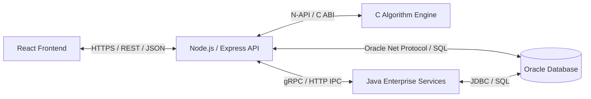

# Technology Stack & System Capabilities

## Table of Contents
- [1. Technology Stack Summary](#1-technology-stack-summary)
- [2. Detailed Technology Rationale](#2-detailed-technology-rationale)
  - [2.1 Oracle SQL (Database Layer) - [Implemented]](#21-oracle-sql-database-layer---implemented)
  - [2.2 Node.js & Express.js (API & Orchestration Layer) - [Planned]](#22-nodejs--expressjs-api--orchestration-layer---planned)
  - [2.3 React.js (Frontend User Interface) - [Planned]](#23-reactjs-frontend-user-interface---planned)
  - [2.4 Java (Object-Oriented Enterprise Services) - [Planned]](#24-java-object-oriented-enterprise-services---planned)
  - [2.5 C (Data Structures & Algorithm Engine) - [Planned]](#25-c-data-structures--algorithm-engine---planned)
  - [2.6 Docker (Containerization & Deployment) - [Planned]](#26-docker-containerization--deployment---planned)
  - [2.7 GitHub (Version Control & Collaboration) - [Active]](#27-github-version-control--collaboration---active)
  - [2.8 Antigravity (AI-Assisted Engineering) - [Active]](#28-antigravity-ai-assisted-engineering---active)
- [3. Inter-Tier Communication Protocols](#3-inter-tier-communication-protocols)
- [4. Environment & Development Tooling Requirements](#4-environment--development-tooling-requirements)

---

## 1. Technology Stack Summary

| Technology | Layer / Domain | Role in Architecture | Implementation Status |
| :--- | :--- | :--- | :--- |
| **Oracle SQL / PL/SQL** | Persistence & Auditing | Relational storage, referential integrity, stored procedures, audit triggers | **Implemented** |
| **Node.js & Express.js** | Application & API Gateway | Stateless REST API, authentication middleware, DB connection pooling | **Planned** |
| **React.js** | Presentation | Single-page administrative dashboard and passenger reservation portal | **Planned** |
| **Java (JDK 17+)** | Enterprise Services | OOP domain services, booking state machines, concurrency control | **Planned** |
| **ANSI C (C99/C11)** | Computation Engine | Graph algorithms, runway queues, gate optimization routines | **Planned** |
| **Docker** | Infrastructure | Containerized execution of API, services, web client, and database | **Planned** |
| **GitHub** | DevOps & Versioning | Git repository hosting, branch management, issue tracking, CI workflows | **Active** |
| **Antigravity** | Development Platform | AI-assisted agentic engineering, architectural validation, documentation | **Active** |

---

## 2. Detailed Technology Rationale

### 2.1 Oracle SQL (Database Layer) - [Implemented]
- **Role**: Serves as the immutable transactional foundation for all airport records.
- **Why Chosen**: Commercial aviation demands strict ACID compliance, robust referential integrity, and sophisticated trigger execution. Oracle Database provides enterprise-grade data security, high-throughput indexing, and PL/SQL procedural extensions.
- **Key Responsibilities**:
  - Enforces relational constraints across 16 tables.
  - Automatically cascades deletes to prevent orphan records.
  - Executes PL/SQL triggers (`DELAYEDFLIGHTS`, `UPDATEDSalary`, `TICKET_PRICE_HISTORY`) to provide immediate audit logging.
  - Runs stored procedures (`DFWECONOMYPASSENGERS`, `FLIGHTSBYSTATUS`) for cursor-based reporting.

### 2.2 Node.js & Express.js (API & Orchestration Layer) - [Planned]
- **Role**: Serves as the central API gateway and integration hub.
- **Why Chosen**: Node's non-blocking, event-driven I/O model is ideally suited for handling concurrent HTTP requests from frontends and edge clients while coordinating database queries.
- **Key Responsibilities**:
  - Exposes RESTful endpoints for flights, manifests, ticketing, and employees.
  - Manages connection pools to Oracle Database via the `oracledb` library.
  - Handles token-based authentication (JWT) and role-based access control.
  - Orchestrates communication between native C modules and Java services.

### 2.3 React.js (Frontend User Interface) - [Planned]
- **Role**: Provides the interactive user experience for airport personnel and passengers.
- **Why Chosen**: React's component-based architecture and reactive virtual DOM enable dynamic updates to flight radar grids, gate timelines, and seat selection canvases without full page reloads.
- **Key Responsibilities**:
  - Renders the Airport Operations Center (AOC) control dashboard.
  - Renders the passenger flight booking and digital check-in interface.
  - Consumes live WebSocket alerts to reflect delay and gate changes immediately.

### 2.4 Java (Object-Oriented Enterprise Services) - [Planned]
- **Role**: Implements enterprise business logic, concurrency control, and transactional state machines.
- **Why Chosen**: Strong typing, robust concurrency libraries (`java.util.concurrent`), and proven enterprise patterns make Java ideal for complex booking state lifecycles and batch reconciliation.
- **Key Responsibilities**:
  - Manages thread-safe ticket reservation lifecycles.
  - Implements dynamic pricing rule evaluations and cancellation penalty algorithms.
  - Executes scheduled batch reconciliation jobs for staff compensation and airline fees.

### 2.5 C (Data Structures & Algorithm Engine) - [Planned]
- **Role**: High-performance, low-latency algorithmic scheduling engine.
- **Why Chosen**: Combinatorial optimization problems (such as runway queue scheduling and gate-to-flight bipartite matching) require deterministic execution times without garbage collection pauses.
- **Key Responsibilities**:
  - Computes optimal gate allocations using bipartite graph matching and graph coloring algorithms.
  - Manages priority queues (min/max binary heaps) for approach and takeoff flight sequencing.
  - Calculates shortest conveyor paths for automated baggage handling systems.

### 2.6 Docker (Containerization & Deployment) - [Planned]
- **Role**: Packages services into immutable, portable runtime containers.
- **Why Chosen**: Eliminates environment discrepancies between development and production, simplifying the deployment of multi-language microservices (Node.js, C binaries, Java, Oracle XE).
- **Key Responsibilities**:
  - Orchestrates multi-tier components via Docker Compose.
  - Ensures consistent networking and volume persistence for database storage.

### 2.7 GitHub (Version Control & Collaboration) - [Active]
- **Role**: Source control and project collaboration platform.
- **Repository**: [https://github.com/Saravana65/Airport-Management-System](https://github.com/Saravana65/Airport-Management-System)
- **Key Responsibilities**:
  - Maintains version history across all schema revisions and documentation.
  - Governs pull requests, code reviews, and issue tracking.

### 2.8 Antigravity (AI-Assisted Engineering) - [Active]
- **Role**: Advanced agentic coding assistant developed by Google DeepMind.
- **Key Responsibilities**:
  - Accelerates architectural drafting, documentation authoring, and schema verification.
  - Facilitates structured pair-programming and automated code refactoring.

---

## 3. Inter-Tier Communication Protocols

- **Frontend to API**: Asynchronous HTTPS requests exchanging standard JSON payloads, supplemented by WebSockets for event push.
- **Node.js to C Engine**: Direct C-library binding via Node-API (N-API) or standard POSIX subprocess pipes for zero-network computational speed.
- **Node.js to Java Services**: Lightweight internal REST or gRPC binary protocol for enterprise service invocation.
- **Application to Database**: Official `node-oracledb` client communicating via Oracle Net Services (port 1521).

---

## 4. Environment & Development Tooling Requirements

### Current Database Requirements (Active Baseline)
- **RDBMS**: Oracle Database 11g / 12c / 19c / 21c, or Oracle Database XE (Express Edition).
- **SQL Tooling**: Oracle SQL Developer, SQL*Plus, or DBeaver.
- **Memory**: Minimum 2 GB RAM allocated to Oracle XE container/instance.

### Future Development Tooling (For Planned Modules)
- **Node.js**: v18.x LTS or v20.x LTS with npm / pnpm.
- **Java**: OpenJDK 17+ or Eclipse Temurin 17+.
- **C Compiler**: GCC (Linux/MinGW) or Clang supporting C99/C11 standards.
- **Container Engine**: Docker Desktop or Docker Engine v24+.
