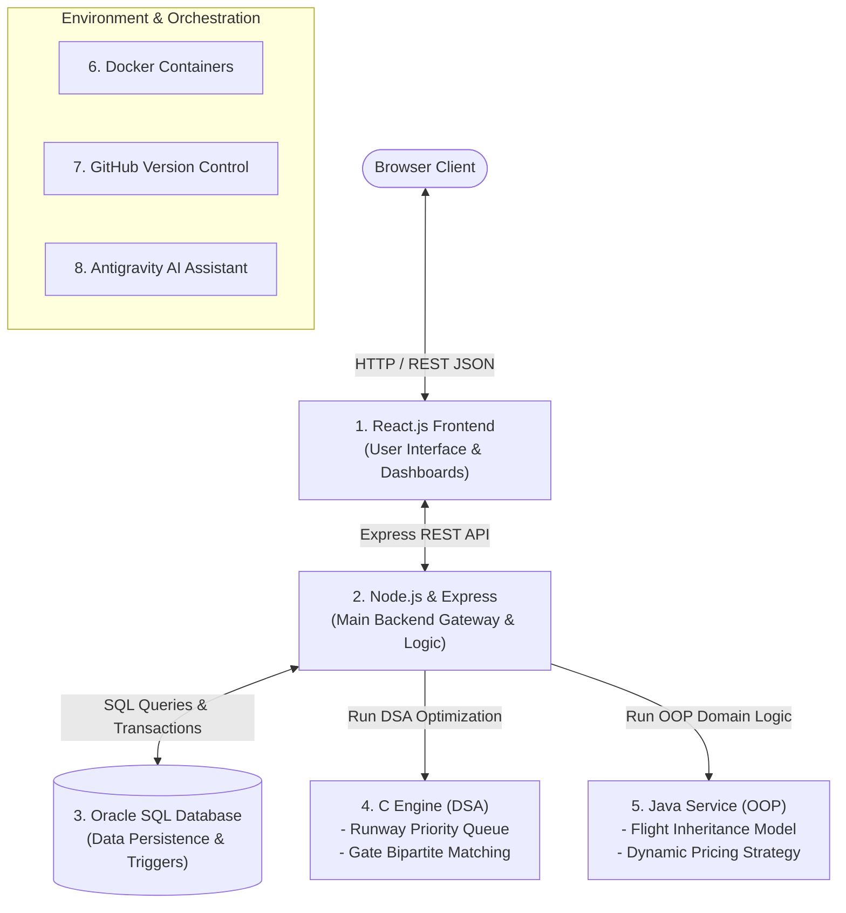

# Technology Usage & System Architecture Plan

> **Target Audience**: BTech Student Viva, Technical Documentation, and Code Implementation  
> **Guiding Principle**: Pragmatic engineering with zero unnecessary bloat. Each technology has a strictly defined, non-overlapping role.

---

## 1. Technological Division of Responsibilities

A common issue in student projects is using multiple languages that duplicate the same work (e.g., writing API routes in both Node.js and Java). In our architecture, **Node.js is the primary application backend**, while **Java and C perform specialized, dedicated tasks** that highlight core computer science concepts.



---

## 2. Detailed Role of Each Technology

### 2.1 Oracle SQL — Persistent Relational Core
- **Role**: The single source of truth for all transactional data.
- **Why It Matters for Viva**: Demonstrates Relational Database Management System (RDBMS) mastery, normalization (1NF, 2NF, 3NF), declarative referential integrity (`ON DELETE CASCADE`), database indexes, and PL/SQL programming (triggers and stored procedures).
- **Concrete Responsibilities**:
  - Enforces schema constraints across 16 tables.
  - Executes stored procedures (`DFWECONOMYPASSENGERS`, `FLIGHTSBYSTATUS`) for cursor-based reporting.
  - Executes row-level triggers to audit flight delays and ticket price changes in real time.

---

### 2.2 Node.js & Express.js — Primary Application Backend
- **Role**: The central nervous system of the project.
- **Why It Matters for Viva**: Demonstrates asynchronous I/O, event loops, RESTful API architecture, JWT authentication, and connection pooling.
- **Concrete Responsibilities**:
  - Exposes RESTful endpoints for CRUD operations (`/api/v1/flights`, `/api/v1/bookings`, `/api/v1/checkin`).
  - Manages database connection pool using the official `oracledb` npm package.
  - Implements authentication middleware verifying JSON Web Tokens (JWT) and user roles (`ADMIN`, `AIRLINE_STAFF`, `AIRPORT_STAFF`, `PASSENGER`).
  - Orchestrates calls to the C and Java modules and serves the processed output to the frontend.

---

### 2.3 React.js — Modern Frontend Presentation
- **Role**: Responsive, component-driven user interface.
- **Why It Matters for Viva**: Demonstrates modern frontend architecture: Single Page Applications (SPA), component reusability, state management (hooks like `useState`, `useEffect`), and clean user experience.
- **Concrete Responsibilities**:
  - Renders the 4 user portals: Administrator, Airline Staff, Passenger, and Operations Staff.
  - Visual flight radar and search filters.
  - Interactive 2D seat map selection canvas.
  - Real-time operational alert displays and the Admin Approval Queue.

---

### 2.4 C Language — Data Structures & Algorithms (DSA) Engine
- **Role**: Dedicated high-performance computational engine.
- **Why It Matters for Viva**: Demonstrates foundational Computer Science concepts—memory management, pointers, graph theory, heaps, and asymptotic algorithm complexity ($O(V \cdot E)$, $O(\log n)$).
- **Concrete Responsibilities**:
  1. **Runway Approach Priority Queue (Min/Max Binary Heap)**:
     - Algorithm: Binary Heap implemented in C.
     - Purpose: Dynamically sequences arriving and departing aircraft based on fuel remaining, emergency status, and scheduled slot time.
  2. **Gate Allocation Matching (Bipartite Graph Matching / Greedy Coloring)**:
     - Algorithm: Adjacency matrix and bipartite graph matching.
     - Purpose: Matches flights to terminal gates to ensure zero collision and minimum passenger walking distance.
  3. **Passenger Manifest Sorting (QuickSort / MergeSort)**:
     - Algorithm: Fast recursive sort on large passenger arrays by seat number or boarding priority.
- **How It Connects to Node.js**:
  - Node.js invokes the compiled C binary via standard process execution (`child_process.execFile`) with JSON/CLI input arguments, receiving the computed optimal schedule instantly.

---

### 2.5 Java — Object-Oriented Programming (OOP) Module
- **Role**: Enterprise domain logic engine demonstrating core OOP paradigms.
- **Why It Matters for Viva**: Demonstrates deep understanding of Object-Oriented Design Principles (Encapsulation, Inheritance, Polymorphism, Abstraction) and Design Patterns.
- **Concrete Responsibilities**:
  1. **Flight Class Hierarchy (Inheritance & Polymorphism)**:
     - Abstract base class `Flight` with specialized subclasses:
       - `DomesticFlight`: Standard baggage allowance, no customs processing.
       - `InternationalFlight`: Strict passport validation, customs clearance logic, higher luggage threshold.
       - `CargoFlight`: Weight-based load distribution and hazmat safety checks.
  2. **Strategy Pattern for Dynamic Pricing (Polymorphism & Abstraction)**:
     - `PricingStrategy` interface implemented by:
       - `EarlyBirdPricingStrategy`: 15% discount for reservations $>30$ days prior.
       - `SurgePricingStrategy`: 25% increase when flight capacity $>85\%$.
       - `LastMinutePricingStrategy`: Dynamic pricing based on remaining seat inventory.
  3. **Boarding Pass Generator Service**:
     - Encapsulated service producing structured boarding pass records with calculated boarding groups (Group 1: First Class, Group 2: Business, Group 3: Economy).
- **How It Connects to Node.js**:
  - Node.js invokes the compiled Java `.jar` or runs it as a lightweight micro-service communicating over HTTP/JSON.

---

### 2.6 Docker — Containerization & Environment Consistency
- **Role**: Eliminates the "it works on my machine" problem.
- **Why It Matters for Viva**: Demonstrates DevOps best practices, container isolation, and simplified deployment.
- **Concrete Responsibilities**:
  - `docker-compose.yml` orchestrates three isolated containers:
    1. `frontend`: Node/Nginx container serving the React build.
    2. `backend`: Node.js container with C binaries and Java runtime installed.
    3. `database`: Oracle Database Free / XE container with persistent storage volumes.

---

### 2.7 GitHub & Antigravity
- **GitHub**: Source code version control, feature branches, and academic commit history.
- **Antigravity**: Advanced agentic coding assistant used for architectural brainstorming, documentation generation, and rapid bug troubleshooting.

---

## 3. Proposed Project Folder Structure

To keep the repository clean and modular, we propose the following directory layout:

```
Airport-Management-System/
├── README.md                      # Main project documentation
├── .gitignore                     # Git ignore rules
│
├── docs/                          # Complete technical & viva documentation
│   ├── EXISTING_PROJECT_ANALYSIS.md
│   ├── OUR_DATABASE_DESIGN.md
│   ├── APPLICATION_MODULES.md
│   ├── AUTONOMOUS_DATABASE_PLAN.md
│   ├── TECHNOLOGY_USAGE.md
│   └── DEVELOPMENT_ROADMAP.md
│
├── database/                      # Database scripts and migrations
│   ├── reference/                 # Archived reference SQL (AIRPORT_MANAGEMENT_SYSTEM(FINAL).sql)
│   ├── schema/                    # Our new approved Oracle DDL scripts
│   ├── seeds/                     # Clean seed data (airports, airlines, test flights)
│   └── procedures/                # Stored procedures and autonomous triggers
│
├── backend/                       # Node.js + Express REST API
│   ├── package.json
│   ├── server.js                  # Application entry point
│   ├── src/
│   │   ├── config/                # Oracle DB connection pool & env variables
│   │   ├── controllers/           # Flight, Booking, Check-in, Admin controllers
│   │   ├── middleware/            # JWT auth, role validation, error handling
│   │   ├── routes/                # Express API routes (/api/v1/...)
│   │   └── services/              # Business logic & integration wrappers
│
├── frontend/                      # React.js Single Page Application
│   ├── package.json
│   ├── src/
│   │   ├── components/            # Reusable UI widgets (Navbar, Modal, FlightCard)
│   │   ├── pages/                 # Portal pages (Admin, Airline, Passenger, Ops)
│   │   ├── services/              # Axios API client calls
│   │   └── App.jsx
│
├── c-algorithms/                  # C Data Structures & Algorithms
│   ├── Makefile                   # Build script to compile C binaries
│   ├── runway_queue.c             # Priority Queue (Min-Heap) for aircraft scheduling
│   ├── gate_assignment.c          # Bipartite graph matching for gate allocation
│   └── manifest_sort.c            # QuickSort / MergeSort implementation
│
├── java/                          # Java OOP Domain Modules
│   ├── pom.xml (or build script)
│   └── src/main/java/com/airport/
│       ├── model/                 # Flight, DomesticFlight, InternationalFlight
│       ├── pricing/               # Strategy Pattern pricing classes
│       └── service/               # Boarding pass generator
│
├── autonomous-engine/             # Background Watcher Daemon
│   ├── index.js                   # Periodic invariant poller (health, conflicts)
│   └── rules/                     # Conflict detection logic (gates, bookings)
│
└── docker/                        # Containerization configs
    ├── Dockerfile.backend
    ├── Dockerfile.frontend
    └── docker-compose.yml
```

> [!IMPORTANT]
> **No folders or application code will be generated until you review and approve this design.**
